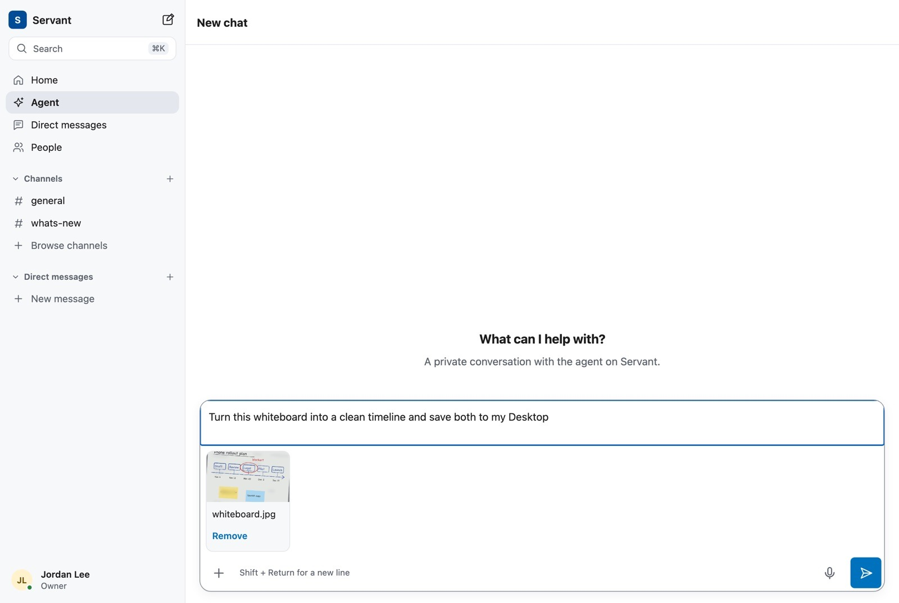
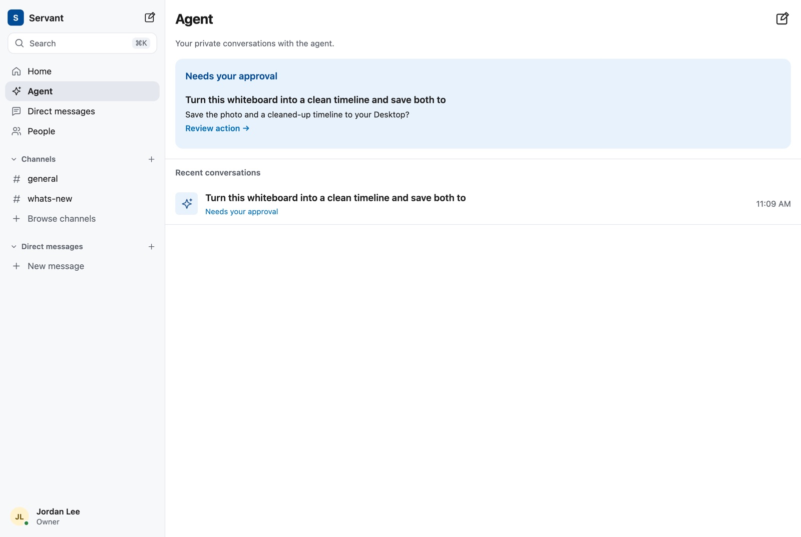
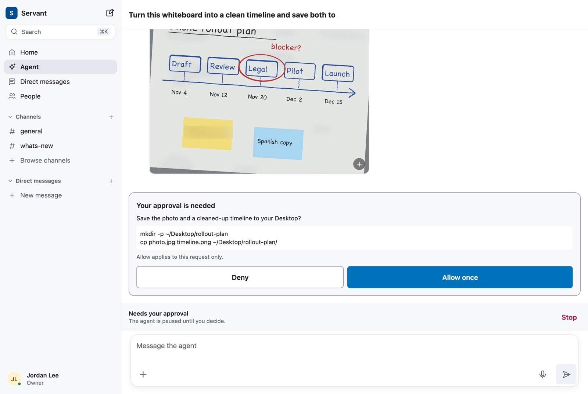
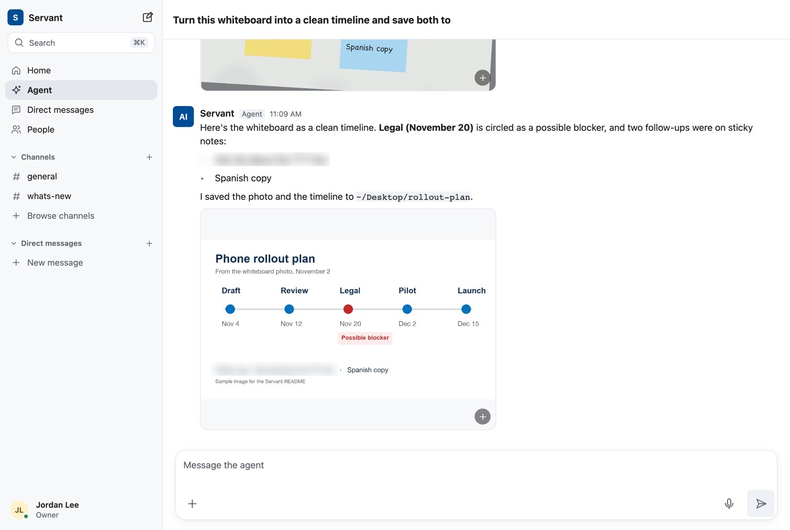

# Servant

Secure messaging for public servants, with an agent you can talk to.

Servant is a phone app plus a small server that runs on your own computer. People you invite can message the agent running on that computer from anywhere, without using a consumer chat service.

Status: private while it gets good. It is meant to be open source (CC0) when it is ready.

## How it works

```
 Phone (Servant app)
   │  pinned app-to-Mac encryption inside HTTPS
   ▼
 Relay (stable address, or legacy cloudflared tunnel)
   │
   ▼
 Server (server/, on the owner's Mac)        invites, device tokens, who can do what
   │  localhost only, server key never leaves the Mac
   ▼
 Agent (Hermes API server)             one conversation history per person
```

- **App** (`app/`): an Expo app for iOS and Android. Testers get it through TestFlight and Firebase App Distribution.
- **Mac app** (`desktop/`): [download Servant for Mac](https://servant-desktop.web.app), then use **You → Link a computer** in phone build 25 or later to scan and approve sign-in. The initial Mac release is an unnotarized preview. See [desktop builds and distribution](desktop/README.md).
- **Server** (`server/`): a Node server with no dependencies. It pairs devices from one-time invites, issues a token for each device, keeps each person's conversations separate, and passes messages to the agent. The agent's API key stays on the Mac.
- **Relay**: the optional [stable relay](docs/relay-transport.md) gives the Mac a fixed address and forwards encrypted traffic over an outbound connection. It needs no gist or GitHub login. Legacy quick tunnels remain supported.

## Reliable agent conversations

**Shame board** (You → Shame board; formerly the token leaderboard): agent tokens used across the server and by person, for today, the last 7 or 30 days, or all time. Each finished agent reply is credited to the person who asked, in their agent chats and in channels (@agent). Servant stores only the counts Hermes reports (input, output, total) in `usage.db`, never prompt text. Each person also shows an estimated dollar cost at list prices ($3 per million tokens in, $15 per million out), not a bill. Everyone on the server can see the shame board. The goal is productivity, meaning pull requests merged per million tokens, not raw token use. Usage before this feature was not recorded.

Agent chats start private, like ChatGPT: only you and the owner (admin) can read a new one. Open **•••** at the top of any chat and turn on **Share with** your server to let everyone read it and give feedback; turn it off to make it private again. Shared chats are read-only to everyone but their author: only the author can send, steer, stop, approve actions, change sharing or delete. Chats that quote a DM or private channel can never be shared. Shared chats appear on the Agent tab under **Shared by others** (**Everyone's conversations** for the owner). The owner can always read every chat.

Private agent requests and incremental replies are journaled on the Mac. The independent worker owns the turn, so locking the phone, leaving a conversation or restarting the API does not cancel it. Reopening the conversation catches up from saved history. Request IDs prevent retries of the same draft from starting duplicate work.

Agent chats, channels, and threads show a working indicator while the agent prepares its reply. The finished text and attachments appear together, instead of word by word. Live status, approvals, and Stop remain available while the agent works.

The repository-owned Hermes bridge adds real **Stop** and owner **Allow once / Deny** controls while preserving image output. Pending requests appear in the Agent tab and their conversation. Approvals are bound to the exact request, apply once, and use Hermes's action-approval mechanism; this is not a blanket approval layer for every possible tool. A worker restart reconnects to an identified upstream run. An ambiguous start is marked interrupted and is never automatically submitted again. See [agent turns](docs/agent-turns.md) and [supported Hermes versions](docs/supported-hermes-versions.md).

Agent replies render headings, lists, bold text, quotations and code. Native notifications show who sent the message and what they said (channels, DMs and agent chats); You → Notifications → Show sender and message turns that off. See docs/notifications.md for what Apple and Google can see.

### Working with the agent: images and approvals

Send the agent a photo, it asks before it touches your Mac, and its reply comes back with an image.

| 1. Send a photo with a request | 2. The Agent tab shows what needs you |
| --- | --- |
|  |  |
| **3. Allow once or Deny** | **4. The reply, with an image** |
|  |  |

The card shows the exact command before anything runs. **Allow once** covers that one request; the next action asks again. Only the owner sees approvals.

These are the Servant web build (`3c56025`) at 1280 by 860 against a throwaway local server, with made-up people and sample images. The agent is a scripted stand-in that speaks the Hermes bridge protocol, so the screens are real but the agent's reply is staged.

## Last seen and read receipts

Members and direct messages show **Online** while a person is using the app, then their last seen time. Each device has its own presence session; a lost connection expires after about a minute.

Your messages show **Sent** until another member views them, then **Read** with reader details available in message actions. Receipts work in channels, direct messages, and threads, and persist across reconnects and server restarts. Only messages visible in the active app are marked read; background updates and off-screen messages do not create receipts. Agent messages do not have read receipts. Older app builds continue to clear unread counts without creating receipts.

## Attachments

In channels, direct messages, and threads, use **Photos & videos** or **Files** to attach up to four files. Videos can be up to 25 MB each, other files up to 5 MB each, and a message up to 30 MB total. Preview or remove selections before sending; a caption is optional. Images appear inline and video cards open a full-screen player. Other files download on web or open the share sheet on mobile. Failed sends retain the draft.

Attachments are stored with messages in the server database and require the same access as their conversation. Deleting a message removes its attachments. Private agent chats accept photos and videos, including messages without a caption. Channel mentions include recent image context. Tap an attachment to open the full-screen gallery and browse the conversation's images, videos, and files, including thread attachments. Video playback stops when leaving the item, closing the gallery, or backgrounding the app.

Agent images and videos delivered as inline data URLs are saved for later viewing. The current Hermes API accepts image inputs but cannot inspect video inputs; videos remain in the conversation and Hermes receives an explicit attachment notice instead. Its current media resolver also only converts image paths to inline data. Older history entries that contain only a local `MEDIA:` path cannot be recovered through its history API; the server does not fetch arbitrary paths or external media URLs.

The attachment picker and sharing modules require a new native app build for existing installations.

## Roles

- **Owner**: the person whose computer runs the agent. Full agent.
- **Member**: anyone the owner invites. The checked-in member bridge allows text and inline-image reasoning, with an empty host-tool allowlist, no local context files and no persistent memory. The server refuses an unverified member upstream. See the [reproducible member policy](docs/member-security.md), including its intentionally restricted capabilities.

Each person can sign in on multiple devices without an account-wide device cap.
QR linking and existing-user invites add separate credentials to the same account;
signing out or revoking a device leaves the others active.

The owner can preview the sending-device category beside messages: Mobile,
Computer, or Browser. The server records the authenticated session's category at
send time and excludes it from member responses. Older messages with no known
source stay unlabeled. This does not give the owner access to anyone else's
private conversations.

## Security notes

- Every request to the server needs a device token. Invites are single-use and expire.
- The agent API listens on localhost only. Only the server can reach it.
- The owner can revoke any device right away.
- Crash diagnostics are sent to Google Firebase Crashlytics in native builds. Message encryption does not cover crash telemetry or the model provider. The [external-service inventory](docs/ato-data-flows.md) records those boundaries for security review.
- Federal use needs an agency security review (ATO) before any real taxpayer data goes through Servant. Until then, use it only for non-sensitive work.

## Layout

For shared UI tokens, components, and navigation patterns, see the
[design system](docs/design-system.md).

For staged API releases, traffic switching, durable workers, and rollback,
see [Deployment](docs/deployment.md). To run the server on a Linux host (cloud
VM or data center) with systemd, see [Linux](docs/linux.md).

```
server/    Node server (no npm dependencies)
deploy/    Mac installer (deploy/mac) and Linux installer and systemd units
relay/     optional Cloudflare Worker relay (development tests use Miniflare)
config/    reproducible restricted member profile and policy
app/    Expo mobile app
docs/   design notes and captures
```

## License

CC0 1.0 Universal. See LICENSE.

## Encryption through the tunnel

The app encrypts API requests and responses to a key held by the owner's server, inside HTTPS. Cloudflare relays ciphertext for pairing codes, device tokens, messages, attachments, feedback, and live agent replies. The server and its admin can still read and store content and run the agent. Cloudflare can still see connection metadata, timing, and traffic sizes; discovery, health, and basic server information remain public.

New invites contain the server's public key. Share these invites directly from the admin through a trusted channel. The app pins that key and retains it when the tunnel address changes. It never learns or replaces the key from Cloudflare or the discovery file, and never falls back to plaintext. The server rejects unencrypted `/v1/` requests except public server information.

To roll out this change:

1. Build and distribute a new native app containing `expo-crypto`, and update the server. Older builds cannot use the encrypted API.
2. Existing users open a fresh invite for their **existing user ID**: `node server/server.mjs invite --user <user-id>`. The upgrade screen accepts it and preserves their server-side conversations. A general team invite creates a new account instead. Revoke the old device token after the replacement device is paired.
3. Keep `server/data/transport-key` (or the configured data directory's equivalent) private and backed up. Losing or replacing it requires fresh trusted invites. Do not publish it with the discovery file.

The protocol uses per-request ephemeral P-256 ECDH, HKDF-SHA-256, and separate AES-256-GCM request/response keys. Ordered encrypted response frames include an authenticated end marker; timestamp checks and a durable replay database prevent replayed writes. The protocol has not undergone an independent security audit and does not provide forward secrecy against later compromise of the server's long-term key. It does not encrypt server storage; native push alerts omit message previews. A web build must be served from a trusted origin because its JavaScript can read plaintext. See [the protocol and verification notes](docs/encryption.md).

## When someone leaves the team

The owner removes them from **People**: tap **Remove** next to their name (or touch and hold the row), then confirm. They are signed out of every phone and Mac straight away, disappear from People, search, @mentions and new messages, and can't use an old invite to come back. Their past messages stay, and #general notes that they left. Other people's shared chats, the owner's view of every chat, and the folders they made are untouched. To let them back, send a new invite.

On the Mac: `servant people` lists everyone, and `servant remove-person "Name"` does the same thing (use the id from the list if two people share a name). `servant revoke <deviceId>` still signs out one device without removing the person.

## Screen sharing in calls

In a call, tap **Share screen** (Mac app and the web). Mac asks which screen or window; the first time, allow Servant under System Settings > Privacy & Security > Screen Recording. Everyone in the call sees it large, with people in a small row below; phones can watch but not share. **Stop sharing** (or leaving the call) ends it. One person shares at a time per person, the share never takes a place in the call, and it carries no audio and isn't recorded, so notes come only from what people say. Test it end to end with `npm run prepare:web --prefix desktop && node desktop/screenshare-e2e.mjs`.

