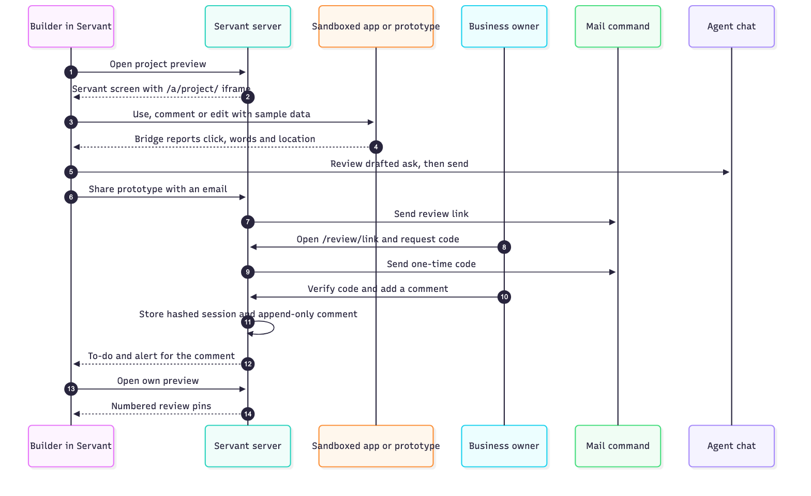

# Architecture diagrams

This folder is the home for Servant's architecture, security, design and technical diagrams. Keep each diagram's Mermaid source (`.mmd`) beside its rendered `.png` and `.svg`, and link those files from other docs instead of copying diagrams inline.

| Area | Location |
| --- | --- |
| System and recent changes | This page |
| Security architecture and review | [security/](security/README.md) |
| New design or technical diagrams | A topic folder under `docs/architecture/` |

These diagrams show Servant as of `origin/main` commit `9233c79`, including the changes merged between November 16, 2026 at 14:00 and November 17, 2026 at 14:00 Eastern time. Each diagram has an editable Mermaid source (`.mmd`) and rendered `.png` and `.svg` files.

For the security-review diagrams and their known gaps, see [security architecture](security/README.md). Where a diagram and a detailed document disagree, the detailed document and the code win.

## 1. Current system


Apps and automation use the encrypted `/v1/` API. Public review and preview pages are separate HTTPS surfaces. The server owns live updates, the durable push queue, agent governance and the data directory. When the network gate is on, the sandboxed agent and Hermes bridge reach the model and approved hosts only through the localhost proxy.

## 2. What changed in the last 24 hours


The main architectural changes are:

- **New review surfaces:** [app preview](../app-preview.md) and [prototype reviews](../prototype-reviews.md).
- **Stronger agent controls:** built-in [entitlements](../entitlements.md), an append-only action log, recorded gate connections and sandbox protection for server files ([agent egress](../agent-egress.md)). The sandbox is the operating system's (`sandbox-exec` on a Mac, a systemd scope on Linux); what it isolates, what it does not, and the test that tries it from the inside are in [What the sandbox isolates](../agent-egress.md#what-the-sandbox-isolates).
- **Alert delivery:** push credentials for more than one app, code-request alerts from the separate push worker, live in-app code prompts and visible unrouted alerts ([notifications](../notifications.md), [code requests](../code-requests.md)).
- **Smaller product surface:** meetings, guest meetings, Loops, Agent feed, Surveys and unused WebRTC/call code were removed. Voice memo recordings remain.

### What this diagram is, and where each item is implemented

This diagram is a summary of what changed in the repository during that window. It was drawn from the commits; it is not a screen in the app and it is not produced from a runtime log, so it can't drift from what an agent did: it never claimed to record that. What an agent did is recorded by the server itself, in two places that are written as part of allowing or refusing the action:

- the **agent action log** (`actions` in `entitlements.db`): one line per checked tool call, written before the call is answered; a call that can't be recorded is refused (`agentUse` in `server/server.mjs`, [entitlements.md](../entitlements.md#built-in-entitlements)). Updates and deletes are refused by the database.
- the **gate's record** (`attempts` and `reached` in the gate's database): every host an agent's command asked for, allowed or refused ([agent-egress.md](../agent-egress.md)).

Each box in the diagram, with the code that implements it and the tests that exercise it:

| Item | Code | Tests | Guide |
| --- | --- | --- | --- |
| App preview | `server/app-preview.mjs`, `app/src/app/app-preview.tsx` | `server/app-preview.test.mjs`, `scripts/app-preview-e2e.mjs` | [app-preview.md](../app-preview.md) |
| Prototype reviews | `server/prototype-reviews.mjs`, `server/prototype-review-page.mjs` | `server/prototype-reviews.test.mjs`, `server/prototype-reviews-http.test.mjs`, `scripts/prototype-review-e2e.mjs` | [prototype-reviews.md](../prototype-reviews.md) |
| Built-in entitlements (allow once, allow always, decline) | `server/entitlements.mjs`, `agentUse` in `server/server.mjs` | `server/entitlements.test.mjs`, `scripts/entitlements-e2e.mjs`, `scripts/test-agent-capabilities.py` | [entitlements.md](../entitlements.md) |
| Append-only agent action log and recorded gate connections | `logAction` in `server/entitlements.mjs`; `attempts` and `reached` in `server/egress.mjs` | `server/entitlements.test.mjs` ("the agent action log keeps every line"), `server/egress.test.mjs` | [entitlements.md](../entitlements.md), [agent-egress.md](../agent-egress.md) |
| Sandbox closes server keys and databases to the agent | `scripts/run-agent-sandboxed.sh` | `server/sandbox.test.mjs` | [agent-egress.md](../agent-egress.md#what-the-sandbox-isolates) |
| Multi-app push credentials | `server/push.mjs`, `server/push-transport.mjs` | `server/push.test.mjs`, `server/push-transport.test.mjs` | [notifications.md](../notifications.md) |
| Code requests: push worker and live in-app prompt | `server/code-requests.mjs` | `server/code-requests.test.mjs`, `server/code-requests-http.test.mjs`, `server/code-requests-worker.test.mjs`, `server/code-requests-identity.test.mjs` | [code-requests.md](../code-requests.md) |
| Server listener retries until its port is free | `listenWhenFree` in `server/egress.mjs`, called where the gate starts in `server/server.mjs` | `server/egress.test.mjs` | [agent-egress.md](../agent-egress.md) |
| Unrouted alerts are shown | `app/src/lib/notification-accounts.ts` | `app/src/lib/notification-accounts.test.ts` | [notifications.md](../notifications.md) |
| Voice memos keep transcription, notes and next-step to-dos | `server/recordings.mjs`, `server/transcription.mjs` | `server/recordings.test.mjs` | [features.md](../features.md#notetaker) |
| Meetings, guest meetings, Loops, Agent feed and Surveys removed | routes removed from `server/server.mjs` | `server/features.test.mjs` (asserts the old meetings API answers 404) | |

The chat reliability and layout items are spread across the app's chat screens and their tests in `app/src/lib/`; they are not listed one by one here.

## 3. Agent governance and network gate


File and GitHub actions require the matching built-in entitlement or a manager decision. Allowed and refused decisions are logged. Network traffic is limited to the always list or hosts covered by the person's entitlements; allowed connections are recorded before they are made.

## 4. App preview and prototype review



Preview builds run sandboxed with sample data and report interactions to the surrounding Servant screen. A prototype reviewer confirms an emailed code before commenting; comments go to the prototype's chat for the person who shared it and appear as pins in the builder's preview. A reviewer's words are treated as untrusted when handed to the agent ([prototype-reviews.md](../prototype-reviews.md#when-the-agent-starts-by-itself)).

## 5. Code-request delivery


The code stays in API memory and is never placed in the push queue. A push alert or a live event tells another device to fetch the request. The asking device can claim the answer once.

## Re-render

From the diagram's directory:

```sh
for f in *.mmd; do
  npx -y @mermaid-js/mermaid-cli -i "$f" -o "${f%.mmd}.png" --scale 2 -b white
  npx -y @mermaid-js/mermaid-cli -i "$f" -o "${f%.mmd}.svg" -b white
done
```
