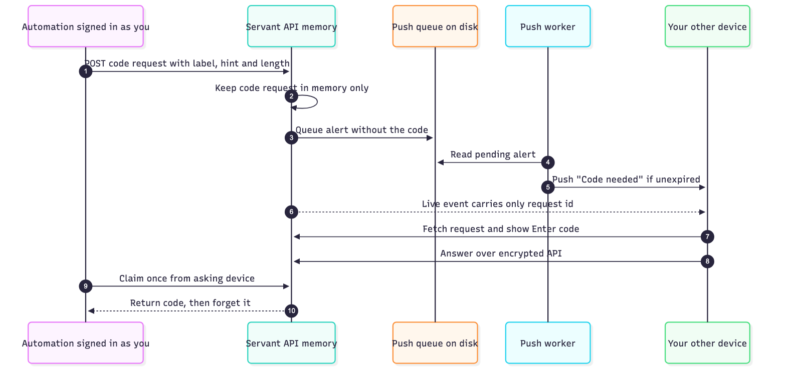

# Architecture diagrams

This folder is the home for Servant's architecture, security, design and technical diagrams. Keep each diagram's Mermaid source (`.mmd`) beside its rendered `.png` and `.svg`, and link those files from other docs instead of copying diagrams inline.

| Area | Location |
| --- | --- |
| System and recent changes | This page |
| Security architecture and review | [security/](security/README.md) |
| New design or technical diagrams | A topic folder under `docs/architecture/` |

These diagrams show Servant as of `origin/main` commit `9233c79`, including the changes merged between November 16, 2026 at 14:00 and November 17, 2026 at 14:00 Eastern time. Each diagram has an editable Mermaid source (`.mmd`) and rendered `.png` and `.svg` files.

For the security-review diagrams and their known gaps, see [security architecture](security/README.md). Where a diagram and a detailed document disagree, the detailed document and the code win.

## 1. Current system


Apps and automation use the encrypted `/v1/` API. Public review and preview pages are separate HTTPS surfaces. The server owns live updates, the durable push queue, agent governance and the data directory. When the network gate is on, the sandboxed agent and Hermes bridge reach the model and approved hosts only through the localhost proxy.

### Trust boundaries

Each boundary in the diagram, the control that enforces it, and what it denies. "Test" is a request that has no right to cross, sent on purpose, and shown to be refused. `server/trust-boundaries.test.mjs` crosses each boundary over the real API in one place; the other tests go into more detail.

| Boundary | Control | What it denies | Test |
| --- | --- | --- | --- |
| Network (tunnel or relay) to the API | App-to-server encryption pinned to the server's key; device token inside the ciphertext ([encryption](../encryption.md)) | Plaintext `/v1/` requests (426); requests with no token or an unknown one (401); modified, replayed, expired or wrong-server requests; a relay choosing the route or headers | `trust-boundaries.test.mjs` "network to API"; `secure-transport.test.mjs`; `relay.test.mjs` |
| Supervisor to the outside | Binds loopback only; refuses to start on any other address (`server/supervisor.mjs`) | Direct connections from other machines; forwarding to local admin routes | `deployment.test.mjs` "proxy cannot forward local admin routes" |
| One person to another person's content | Membership and authorship checks on every route (`server/server.mjs`, `server/messaging.mjs`) | Reading, writing, deleting or listing a private agent chat or a conversation the person isn't in (404, so its existence isn't confirmed either) | `trust-boundaries.test.mjs` "person to person"; `server.test.mjs` "people can't see chats the author made private", "direct conversations swipe…"; `media-integration.test.mjs` (unauthorized viewers) |
| One person's agent session to another's | A Hermes session and session key per chat (`servant_<user>_<chat>`); each turn carries a signed gate token for that person and chat | One person's turn running in another's session or being judged as someone else | `trust-boundaries.test.mjs` "person to agent session"; `server.test.mjs` "each agent chat is its own session" |
| Member to owner | Role checks on owner routes | Devices, replacing the team's invite link (anyone may share it), the agent action log, making entitlements, changing someone's tier or manager (403) | `trust-boundaries.test.mjs` "member to owner"; `entitlements-http.test.mjs` |
| Agent to the network | The gate on localhost plus the OS sandbox ([agent egress](../agent-egress.md)), entitlements per person ([entitlements](../entitlements.md)) | Hosts the person holds no entitlement for; another person's grants; a forged or altered gate token; private and loopback addresses | `trust-boundaries.test.mjs` "agent to network"; `egress.test.mjs`; `entitlements-http.test.mjs`; `sandbox.test.mjs` |
| Agent to files and GitHub | Built-in entitlements checked by the bridge before each tool call; the sandbox closes the server's keys and databases | A file or GitHub action the person's manager hasn't allowed; tool checks whose turn Servant can't identify (403) | `entitlements-http.test.mjs` "built-in entitlements"; `trust-boundaries.test.mjs`; `sandbox.test.mjs` |
| Agent tier | Tier 0 has no agent; the researcher runs only on its own bridge | A turn from someone with no agent; the full agent standing in for the researcher bridge | `server.test.mjs` "agent tiers", "researcher (tier 4)…"; `member-policy.test.mjs` |
| Public pages (review, prototypes, app preview, inbox) | Each page serves only its own folder or share; reviewer and visitor codes | Files outside the folder, dot files, other projects; inbox visitors becoming members or seeing other visitors | `app-preview.test.mjs`; `server.test.mjs` "prototypes are served by the server itself…"; `prototype-reviews-http.test.mjs`; `secure-inbox-integration.test.mjs` |
| Server to push providers | Allowlisted payload ([notifications](../notifications.md)) | Anything beyond the title, body and opaque routing ids | `push.test.mjs` "transport passes only title, body and opaque routing fields" |

What these boundaries do not cover: with `agentAccess` at its default of `full` and the gate and checks off, the agent boundaries above are not in force (see [security/review-response.md](security/review-response.md)). Commands still run as one user on one computer, so the gate token keeps a command honest about whose it is but is not a wall between people ([agent egress, Limits](../agent-egress.md#limits)).

## 2. What changed in the last 24 hours


The main architectural changes are:

- **New review surfaces:** [app preview](../app-preview.md) and [prototype reviews](../prototype-reviews.md).
- **Stronger agent controls:** built-in [entitlements](../entitlements.md), an append-only action log, recorded gate connections and sandbox protection for server files ([agent egress](../agent-egress.md)). The sandbox is the operating system's (`sandbox-exec` on a Mac, a systemd scope on Linux); what it isolates, what it does not, and the test that tries it from the inside are in [What the sandbox isolates](../agent-egress.md#what-the-sandbox-isolates).
- **Alert delivery:** push credentials for more than one app, code-request alerts from the separate push worker, live in-app code prompts and visible unrouted alerts ([notifications](../notifications.md), [code requests](../code-requests.md)).
- **Smaller product surface:** meetings, guest meetings, Loops, Agent feed, Surveys and unused WebRTC/call code were removed. Voice memo recordings remain.

### Where each change lives

This diagram is a summary of what was merged in that window, not a screen in the app. Each box, the commit that made it, and the code behind it:

| Box | Commit | Code |
| --- | --- | --- |
| App preview | `83c1426` | `server/app-preview.mjs`, `app/src/app/app-preview.tsx`, `app/src/lib/app-preview.ts` |
| Prototype reviews | `40bc8d8`, `fb6286c`, `f3bcd41` | `server/prototype-reviews.mjs`, `server/prototype-review-page.mjs`, `app/src/components/PrototypeReviewSheet.tsx` |
| Built-in entitlements | `62a2abf` | `server/entitlements.mjs`, `agentUse` in `server/server.mjs`, `app/src/app/entitlements.tsx` |
| Append-only agent action log and recorded gate connections | `0337c3f`, `6387981` | `actions` table and `logAction` in `server/entitlements.mjs`; `reached` table in `server/egress.mjs` |
| Sandbox closes server keys and databases | `2eabedd` | `SERVANT_SANDBOX_DENY_PATHS` in `scripts/run-agent-sandboxed.sh` |
| Multi-app push credentials | `adbb4f6` | `server/push.mjs`, `server/push-transport.mjs` |
| Code requests | `9854002`, `21c2d35`, `9233c79` | `server/code-requests.mjs`, `app/src/components/CodeRequestOpener.tsx` |
| Server listener retries | `982a7b5` | `listenWhenFree` in `server/egress.mjs` |
| Unrouted alerts shown | `d948274` | `app/src/lib/notification-accounts.ts` |
| Voice memos | `c9c82a9` | `server/recordings.mjs` |
| Chat reliability and layout | `278abb8`, `acb8711`, `715dbaf`, `6eac462` | `app/src/lib/send-queue.ts`, `server/image-size.mjs`, `app/src/lib/unread-line.ts`, `server/chat-media.mjs` |
| Removed meetings, Loops, Agent feed, Surveys, call leftovers | `c9c82a9`, `b4fad17`, `68df3fb` | (code deleted) |

**What the agent did, as recorded.** The action log and the gate's connection record are the source of truth for what agents did, and they can't fall behind it: each is written *before* the action, and an action that can't be written is refused. A tool call the bridge checks is logged with its verdict, then allowed ("Servant couldn't record this, so it wasn't done" otherwise); a connection the gate lets through is counted, then made ("it could not record this connection, so it was not made" otherwise). SQL triggers refuse changes to and deletion of the log. `server/activity-record.test.mjs` breaks each write on purpose and shows the action is refused and the record still matches. The limits: only tool calls the bridge checks (file and GitHub, with `agentCapabilities` on) and traffic through the gate (with `agentEgress` on and the sandbox wrapper) are recorded. What a command does inside an allowed host, or on files the person was allowed, is not ([agent egress, Limits](../agent-egress.md#limits)). Owners read the log at `GET /v1/entitlements/actions` and in the app under Entitlements.

## 3. Agent governance and network gate


File and GitHub actions require the matching built-in entitlement or a manager decision. Allowed and refused decisions are logged. Network traffic is limited to the always list or hosts covered by the person's entitlements; allowed connections are recorded before they are made.

## 4. App preview and prototype review


Preview builds run sandboxed with sample data and report interactions to the surrounding Servant screen. A prototype reviewer confirms an emailed code before commenting; comments become to-dos and appear as pins in the builder's preview.

## 5. Code-request delivery



The code stays in API memory and is never placed in the push queue. A push alert or a live event tells another device to fetch the request. The asking device can claim the answer once.

## Re-render

From the diagram's directory:

```sh
for f in *.mmd; do
  npx -y @mermaid-js/mermaid-cli -i "$f" -o "${f%.mmd}.png" --scale 2 -b white
  npx -y @mermaid-js/mermaid-cli -i "$f" -o "${f%.mmd}.svg" -b white
done
```
