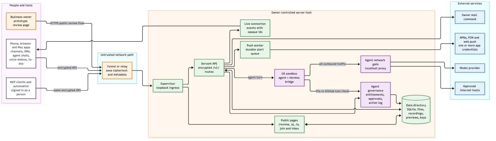
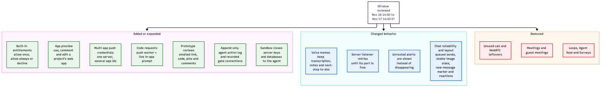
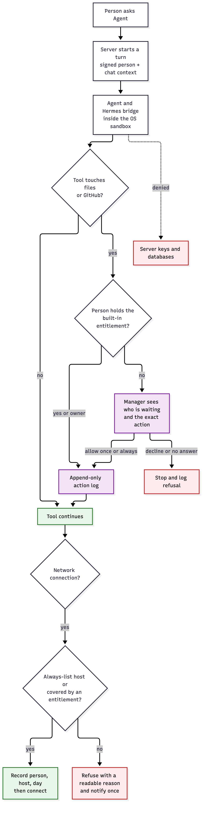

# Architecture diagrams

These diagrams show Servant as of `origin/main` commit `9233c79`, including the changes merged between November 16, 2026 at 14:00 and November 17, 2026 at 14:00 Eastern time. Each diagram has an editable Mermaid source (`.mmd`) and rendered `.png` and `.svg` files.

For the security-review diagrams and their known gaps, see [security-architecture](../security-architecture/README.md). Where a diagram and a detailed document disagree, the detailed document and the code win.

## 1. Current system



Apps and automation use the encrypted `/v1/` API. Public review and preview pages are separate HTTPS surfaces. The server owns live updates, the durable push queue, agent governance and the data directory. When the network gate is on, the sandboxed agent and Hermes bridge reach the model and approved hosts only through the localhost proxy.

## 2. What changed in the last 24 hours



The main architectural changes are:

- **New review surfaces:** [app preview](../app-preview.md) and [prototype reviews](../prototype-reviews.md).
- **Stronger agent controls:** built-in [entitlements](../entitlements.md), an append-only action log, recorded gate connections and sandbox protection for server files ([agent egress](../agent-egress.md)).
- **Alert delivery:** push credentials for more than one app, code-request alerts from the separate push worker, live in-app code prompts and visible unrouted alerts ([notifications](../notifications.md), [code requests](../code-requests.md)).
- **Smaller product surface:** meetings, guest meetings, Loops, Agent feed, Surveys and unused WebRTC/call code were removed. Voice memo recordings remain.

## 3. Agent governance and network gate



File and GitHub actions require the matching built-in entitlement or a manager decision. Allowed and refused decisions are logged. Network traffic is limited to the always list or hosts covered by the person's entitlements; allowed connections are recorded before they are made.

## 4. App preview and prototype review


Preview builds run sandboxed with sample data and report interactions to the surrounding Servant screen. A prototype reviewer confirms an emailed code before commenting; comments become to-dos and appear as pins in the builder's preview.

## 5. Code-request delivery


The code stays in API memory and is never placed in the push queue. A push alert or a live event tells another device to fetch the request. The asking device can claim the answer once.

## Re-render

From this directory:

```sh
for f in *.mmd; do
  npx -y @mermaid-js/mermaid-cli -i "$f" -o "${f%.mmd}.png" --scale 2 -b white
  npx -y @mermaid-js/mermaid-cli -i "$f" -o "${f%.mmd}.svg" -b white
done
```
