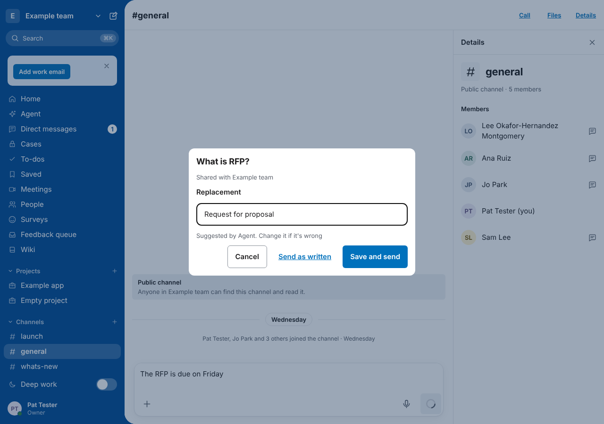
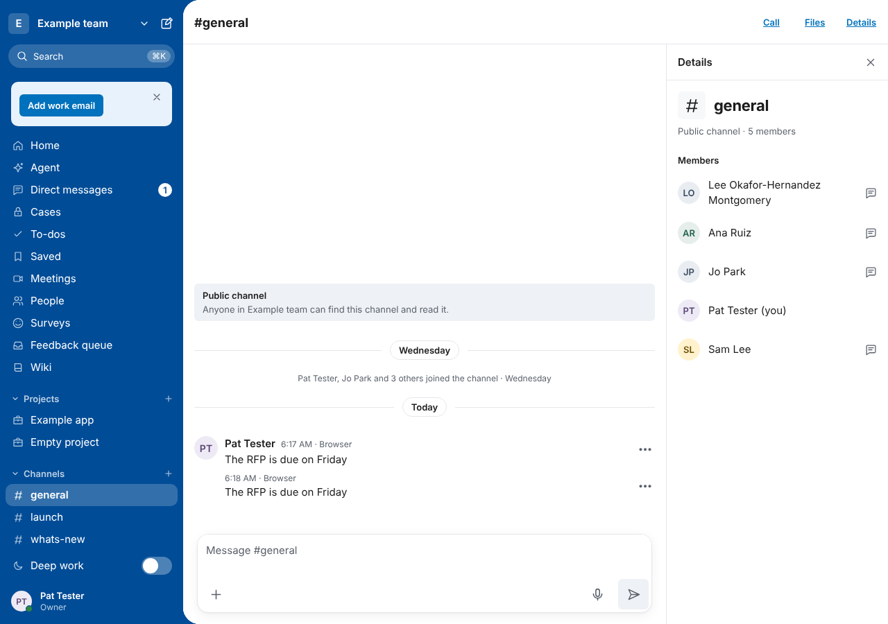
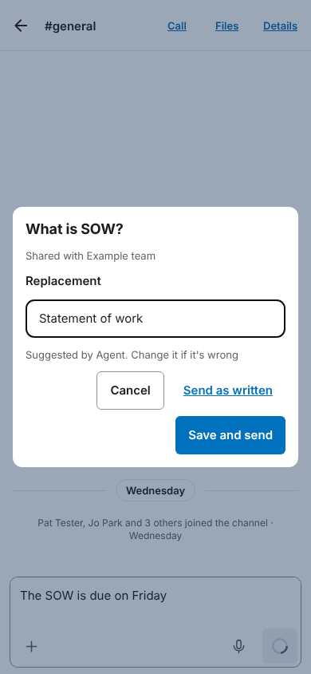
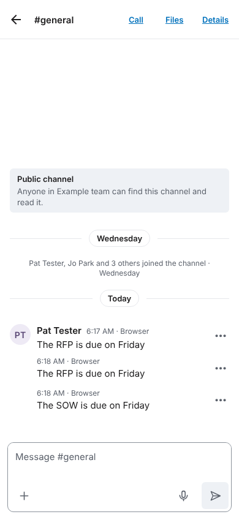
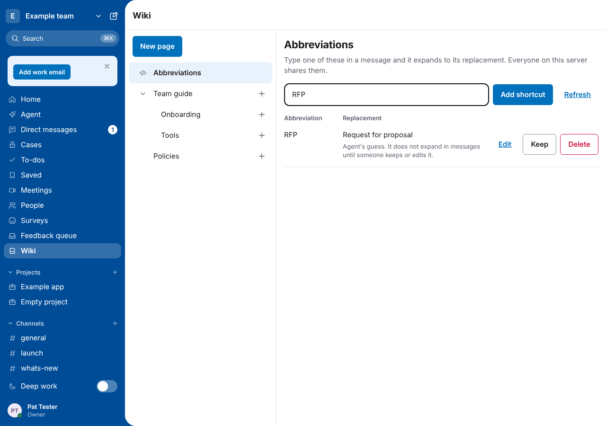
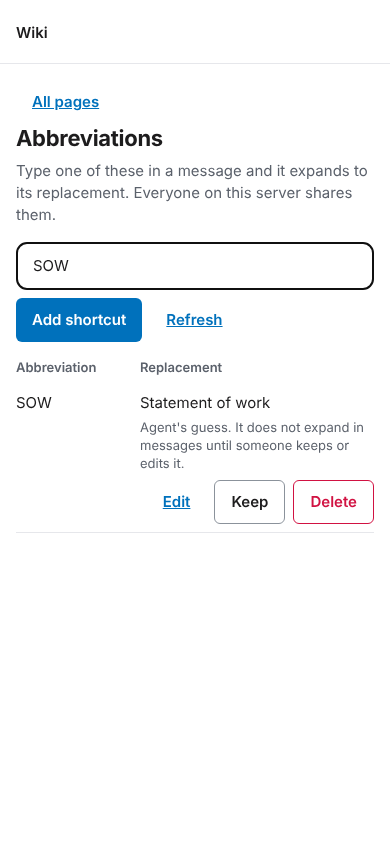
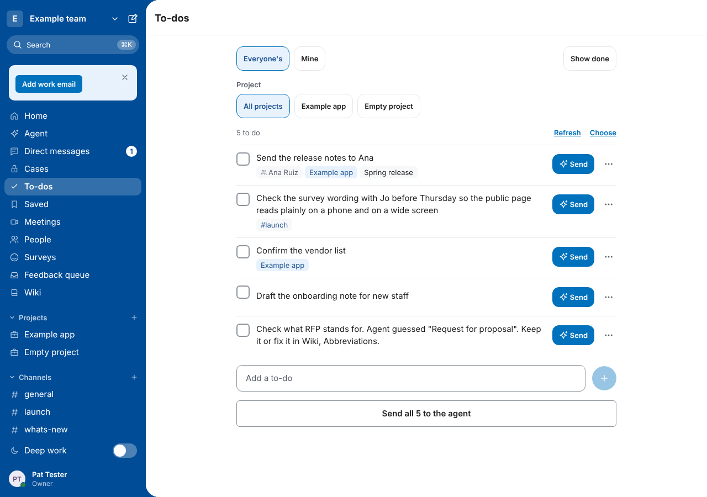
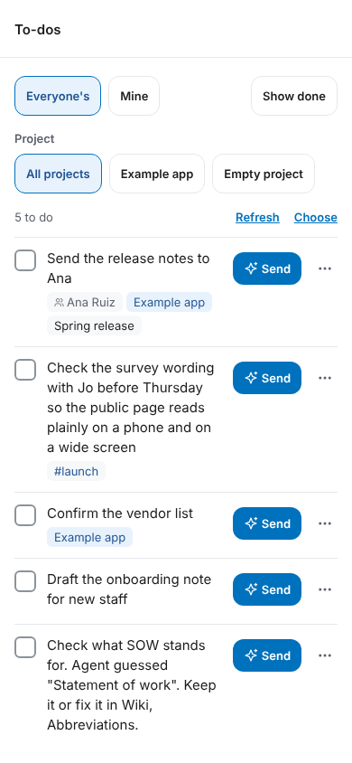
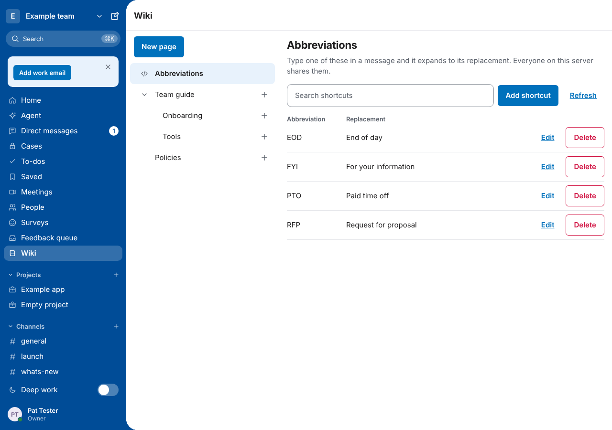

# Abbreviations nobody has defined: before and after

These are actual browser screenshots from running builds. They are not mockups or edited images.

- **Before:** `main` at `0896b83`.
- **After:** the branch at `defb31c`. Full hashes and checksums are in [manifest.json](manifest.json).
- **Desktop:** 1280 × 900. **Phone:** 390 × 844 with touch. Device scale 1, light appearance, English.
- Both sides ran their own server on a copy of the same made-up workspace. The same message was typed in #general on each: "The RFP is due on Friday" on the desktop, "The SOW is due on Friday" on the phone.
- **The agent is a stand-in.** The capture machine has no model, so a small local program answered with fixed text ("Request for proposal", "Statement of work"). The screens, the list and the to-do are the real app and server; the guesses are not a model's.

## Pressing Send

Before, Send stopped at a question and the message stayed in the box. After, the message is in the channel as written and nothing asks.

| Viewport | Before | After |
| --- | --- | --- |
| Desktop |  |  |
| Phone |  |  |

## New: Agent's guess in the list, and the sender's to-do

None of these existed before.

| | Desktop | Phone |
| --- | --- | --- |
| Abbreviations: the guess, marked as one, with Edit, Keep and Delete |  |  |
| To-dos: the sender's to-do to check it |  |  |
| After Keep: an entry like any other. The to-do is done, and typing the abbreviation expands it |  | |
