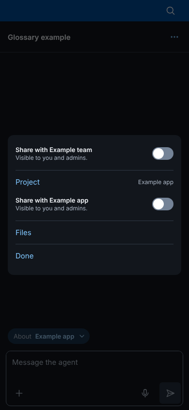
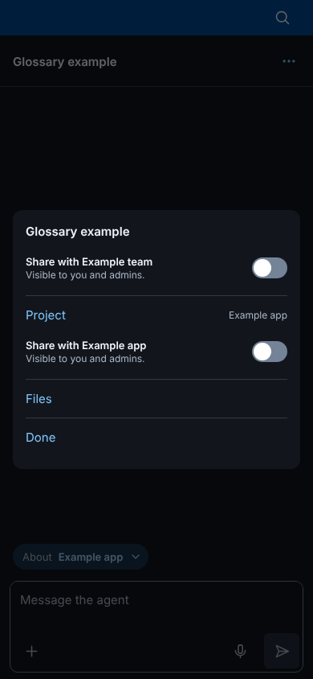
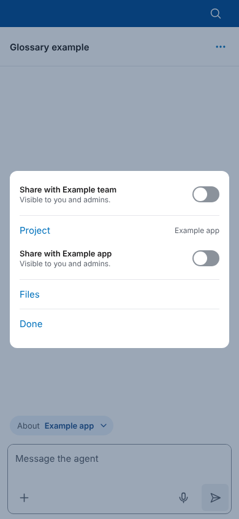
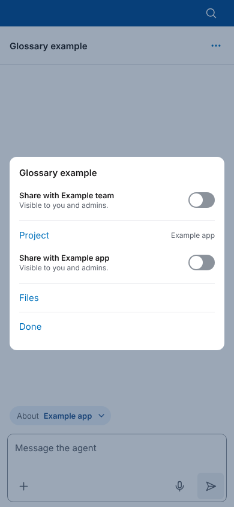
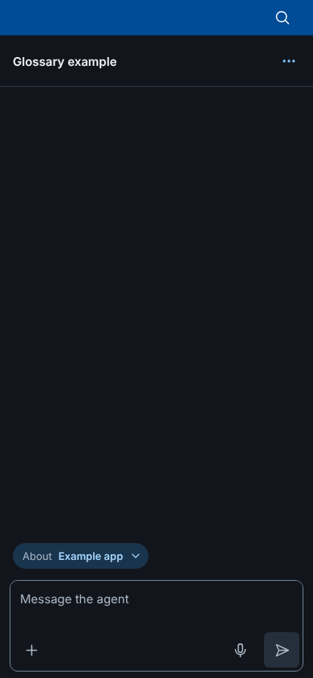
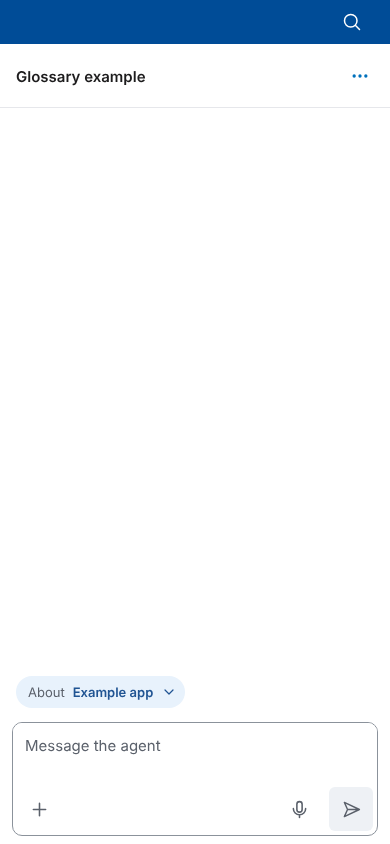

# Agent chat header: before and after

The bug was on an iPhone: a long chat title was drawn under the options button, so "Automatically tackle GitHu…" had three small dots printed over its end. **These captures are not that screen.** There is no iPhone or iOS simulator where they were taken, so the header fix itself is not pictured here and has not been seen on a device. The report's own screenshot is not in this repository because it shows a real person.

What these do show, from running builds in a browser at phone size (390 × 844, touch, device scale 1), is the part of the change a browser has: the whole title is now the first line of the chat's options. They also show the current state of the two other things in the report: there is no Stop button beside the agent's status line and no Abbreviations link above the message box, on either side.

- **Before:** `main` at `88b4108`.
- **After:** the branch at `024ee45`.
- Made-up workspace; the chat is called "Glossary example".

Full hashes and checksums are in [manifest.json](manifest.json).

| Screen | Before | After |
| --- | --- | --- |
| Options, dark |  |  |
| Options, light |  |  |
| The chat, dark |  |  |
| The chat, light |  |  |
