# @agent only, typing on after picking Agent, and a day's cost: before and after

These are actual browser screenshots from running builds. They are not mockups or edited images.

- **Before:** `main` at `ced7f324557540436060e1b7f5dbbbcdcf15c508`.
- **After:** the branch at `1816440`; the full hash is in the manifest.
- **Desktop:** 1280 × 900. **Phone:** 390 × 844 with touch. Device scale 1, light appearance, English.
- Both sides ran their own server on a copy of the same made-up workspace. The model names and prices in the limit sheet are made up for the screenshots.

Commits, routes and checksums are in [manifest.json](manifest.json).

## The agent's name in the suggestions

Before, the row offered `@s`. After, it offers `@agent`, the only name that calls the agent.

| Viewport | Before | After |
| --- | --- | --- |
| Desktop | 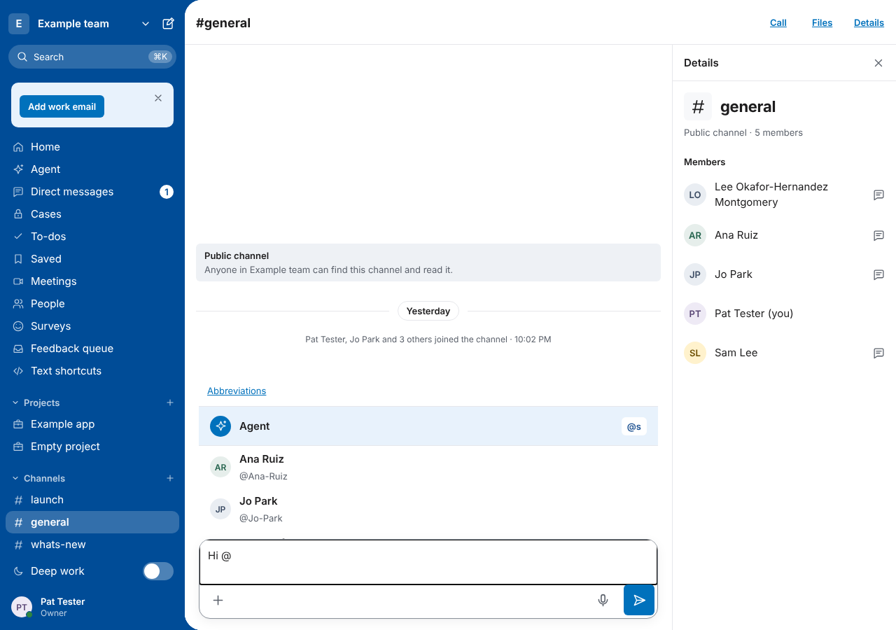 | 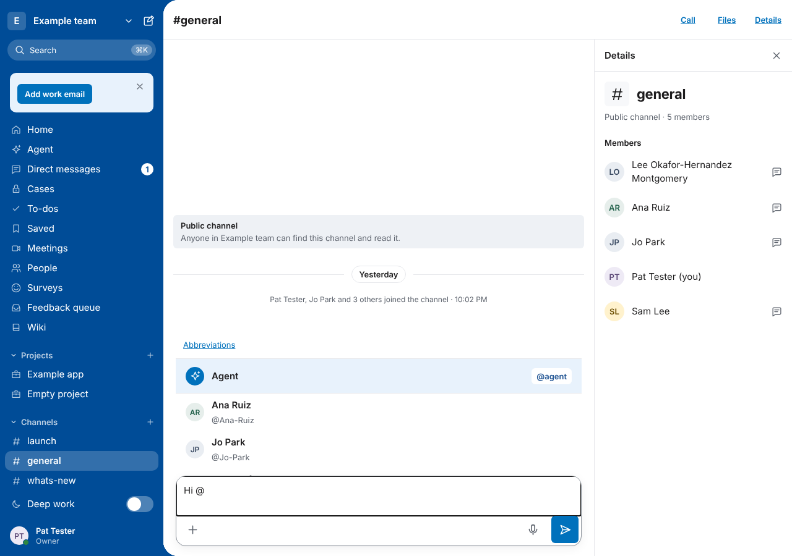 |
| Phone | 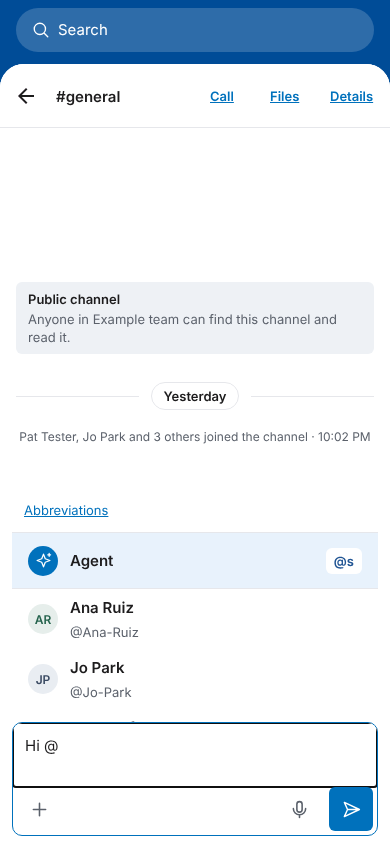 | 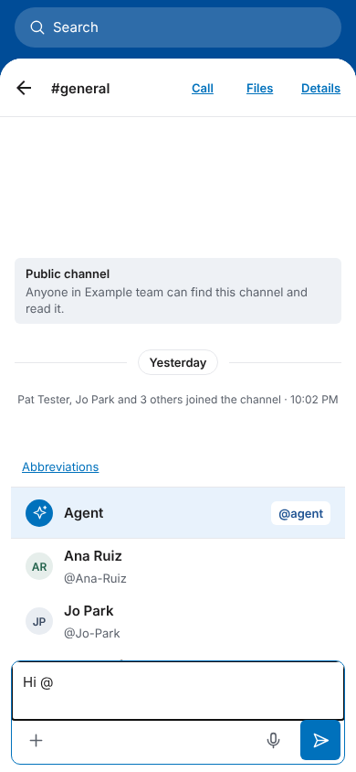 |

## Picking Agent with the mouse held, then typing on

The same script typed `Hi @`, pressed the Agent row for 450 ms, then typed `what is next?`.

Before, on the desktop, the list closed under the mouse: nothing was inserted, the box lost focus and the typing went nowhere, so the box still reads `Hi @`. After, the box reads `Hi @agent what is next?`. A tap on a phone already worked.

| Viewport | Before | After |
| --- | --- | --- |
| Desktop | 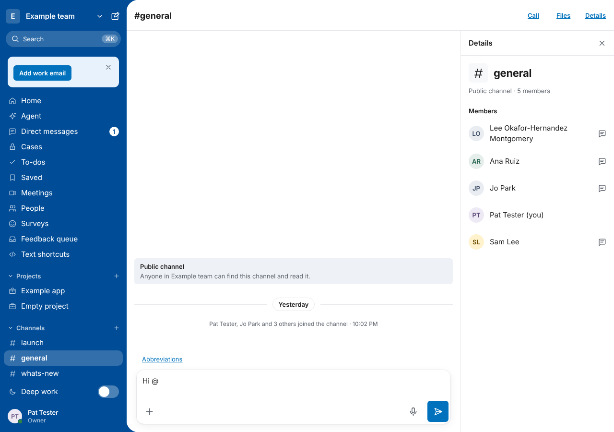 | 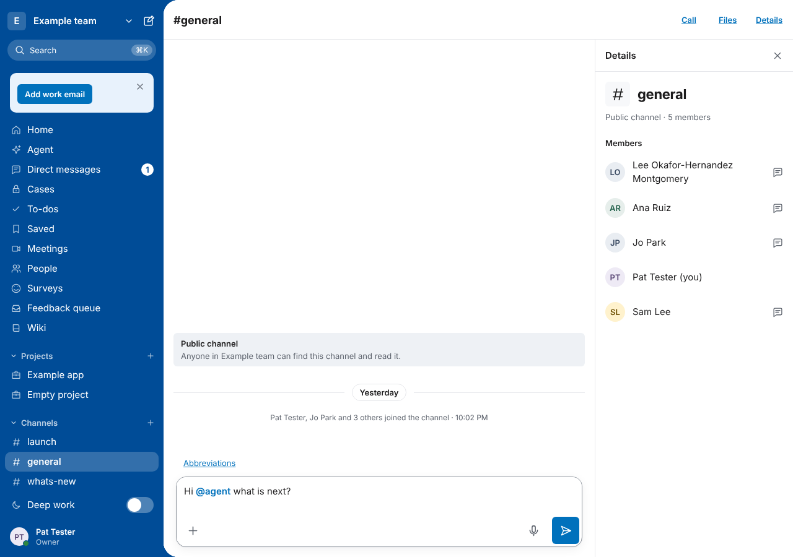 |
| Phone | 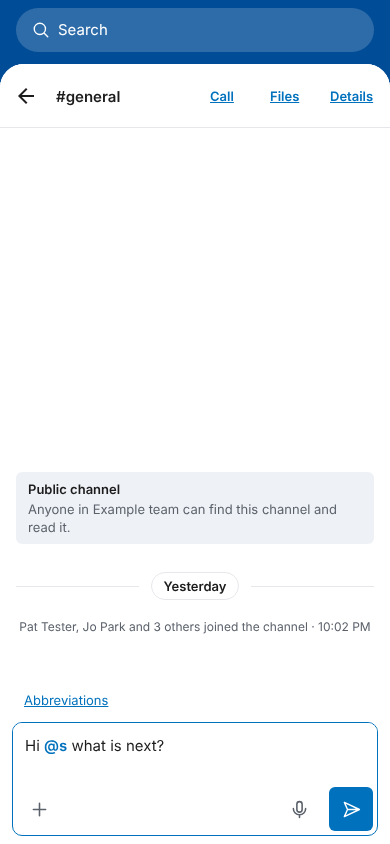 | 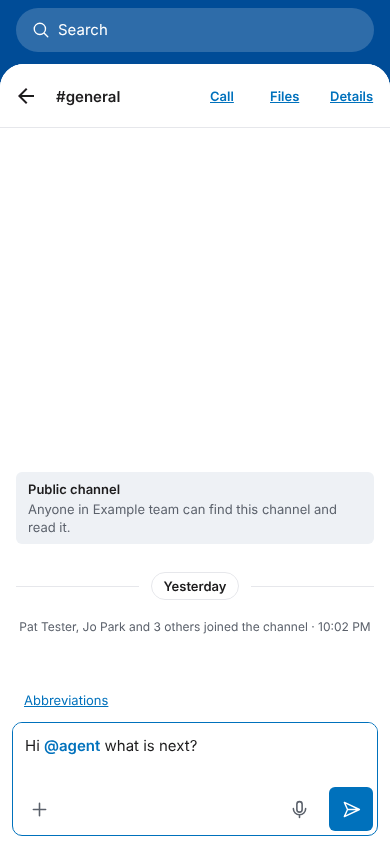 |

## A day's cost, not a month's

| Screen | Before | After |
| --- | --- | --- |
| Roles, phone | 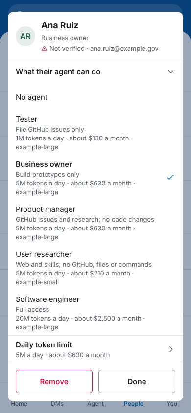 | 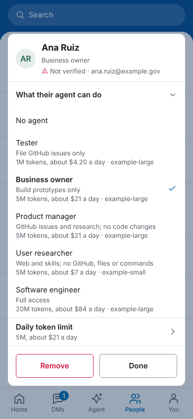 |
| Roles, desktop | 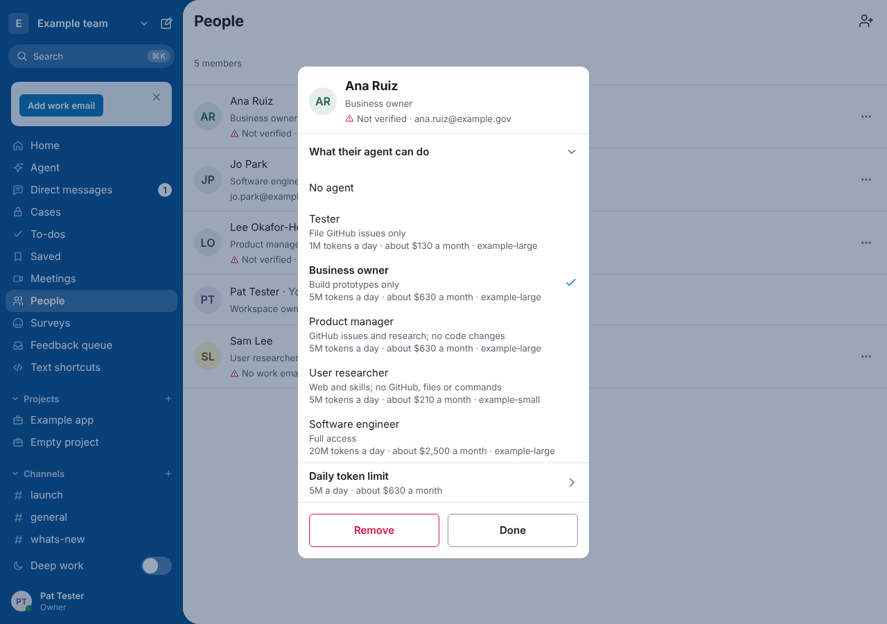 | 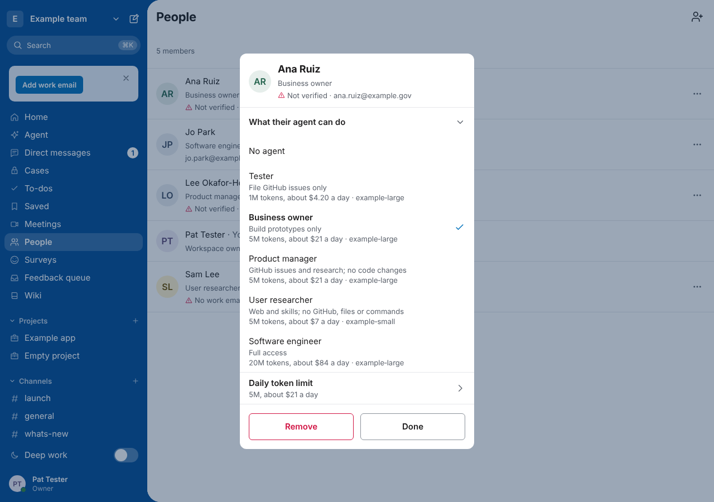 |
| Limits, phone | 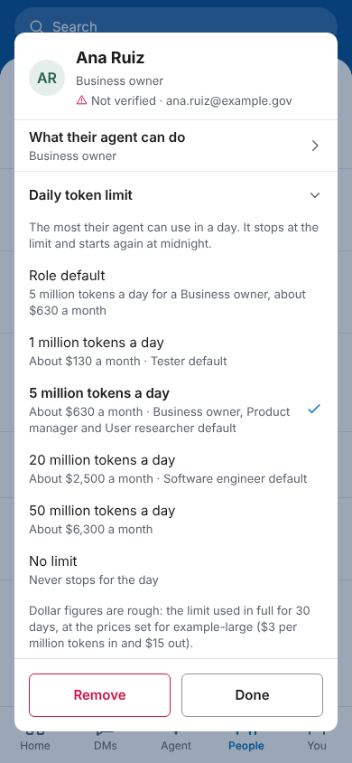 | 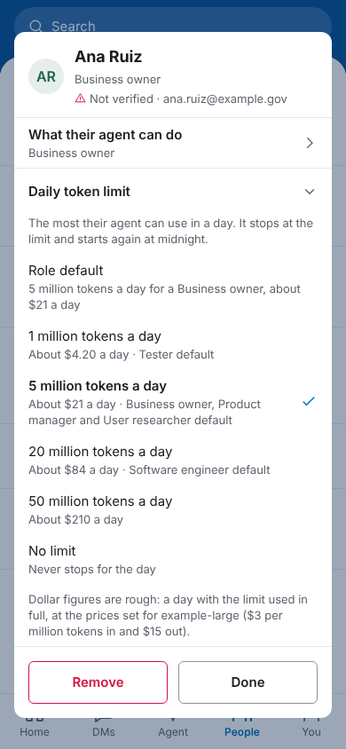 |
| Limits, desktop | 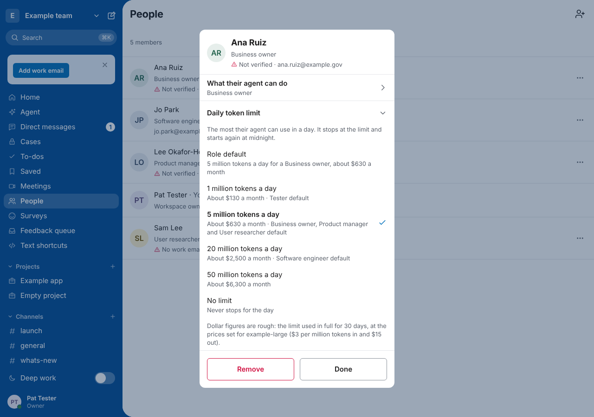 | 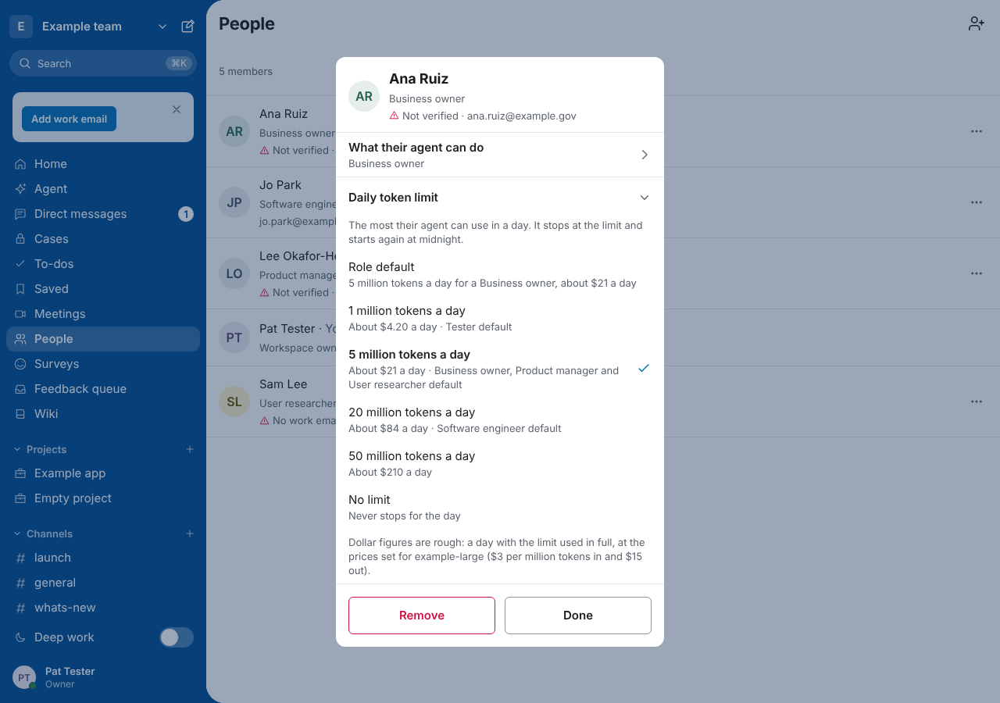 |
