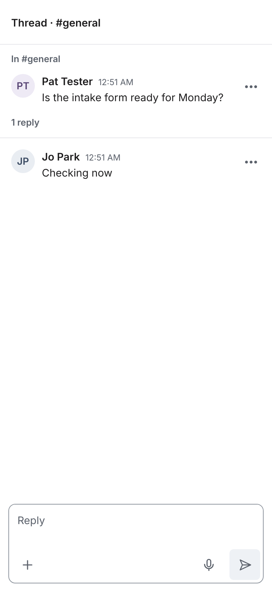
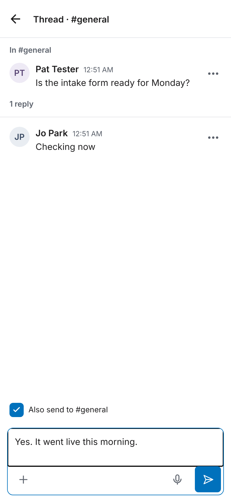
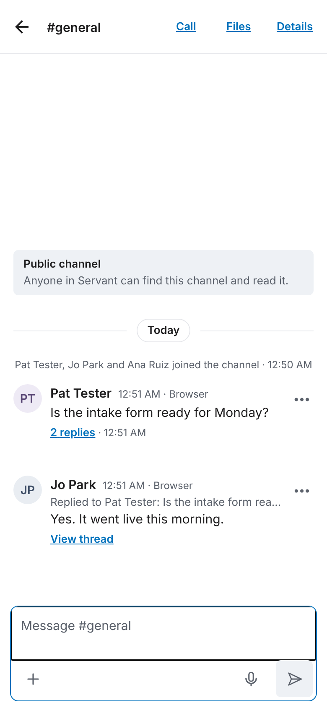
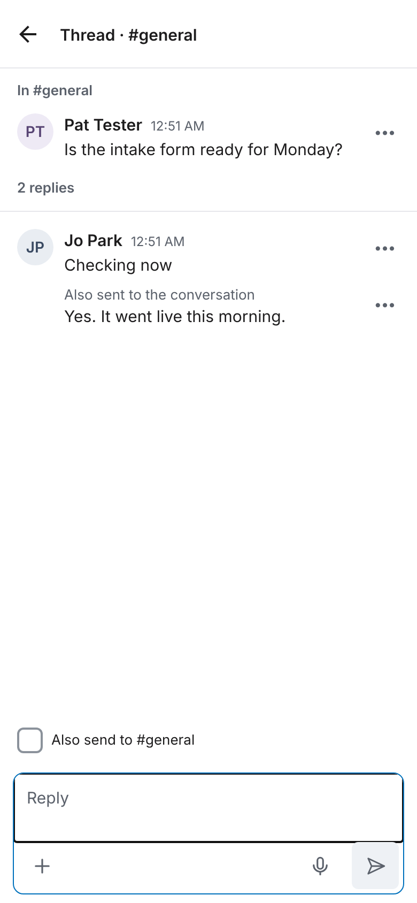
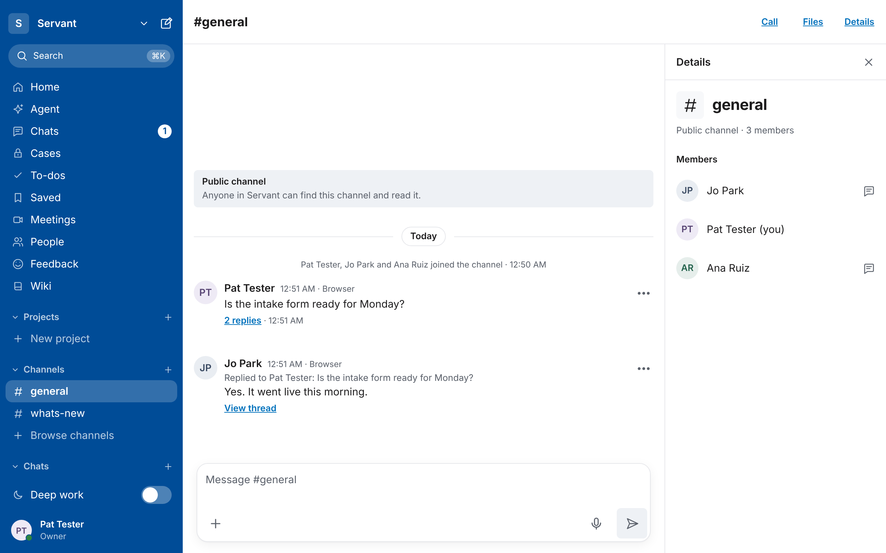
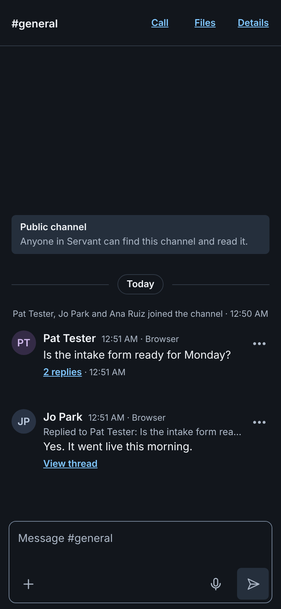

# A thread reply also sent to the channel

Pat Tester asks a question in #general. Jo Park replies in the thread, then ticks **Also send to #general** for the answer.

- **Before:** `main` at `f375f79`: the thread on main, where the reply field has no box. **After:** this branch at `2944492`.
- Phone 390 × 844, light; the channel also at desktop 1280 × 800 and on the phone in dark. Throwaway local server; the people are made up.

| | Before | After |
| --- | --- | --- |
| The thread's reply field |  |  |
| The channel (new) | did not exist: a reply was only in its thread |  |
| The thread after sending (new) | |  |
| The channel, desktop | |  |
| The channel, dark | |  |

Seen during the run, two people signed in:

```
ordinary reply shown in the channel: 0
before: box on main: 0
after: box shown: 1 checked: false
after ticking: true
box cleared after sending: false | thread says also sent: 1
arrived live in the channel: 1 | context: 1 | ordinary reply still absent: true
channel-desktop after a reload: reply 1 context 1
channel-phone-dark after a reload: reply 1 context 1
View thread opens the thread it belongs to: true | replies there: 2
```

("box cleared after sending: false" is the box's checked state: it is unticked again.)
