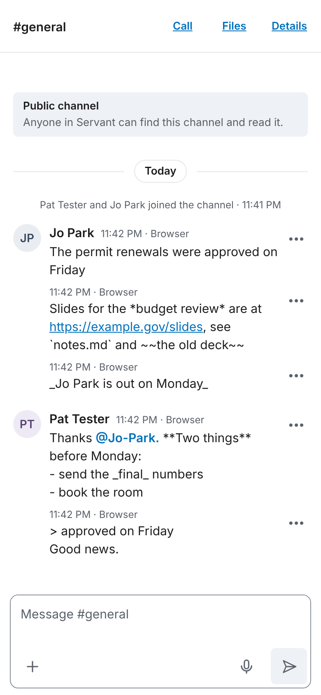
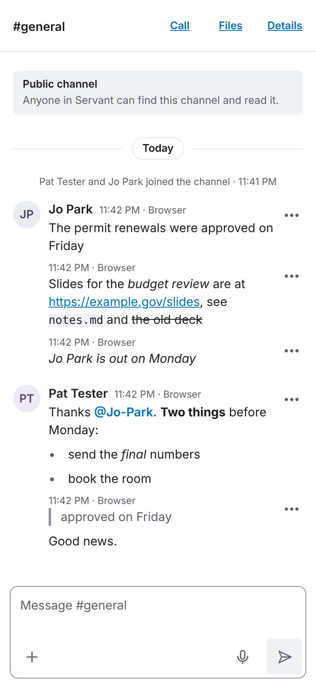
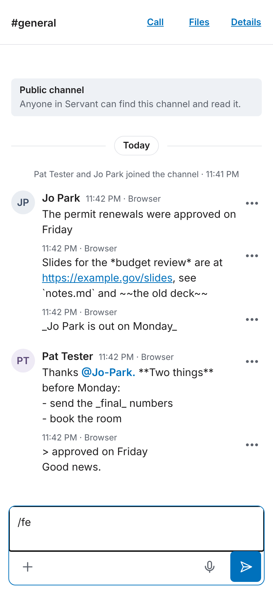
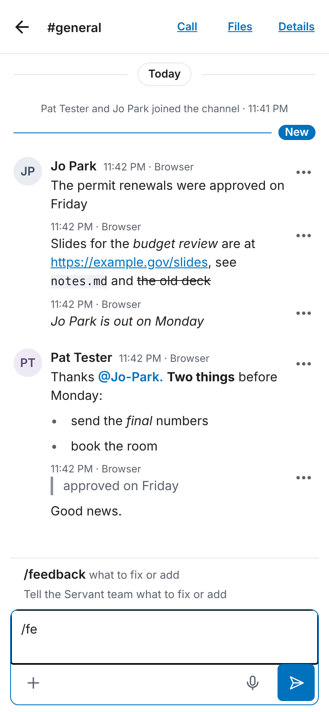
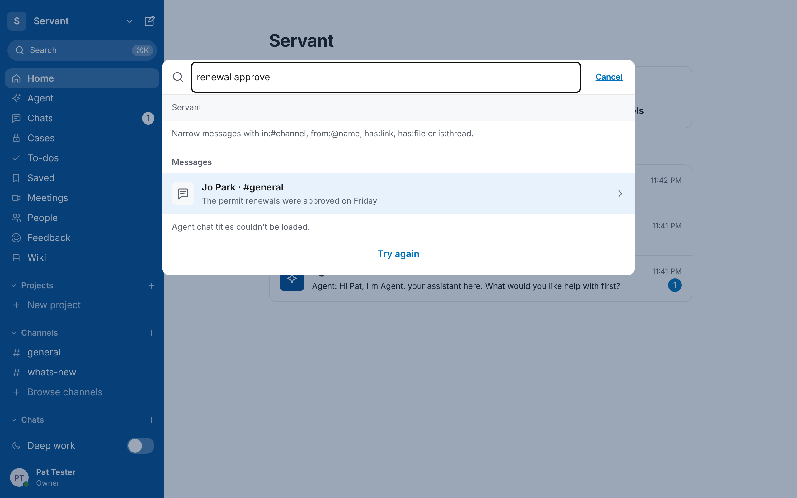
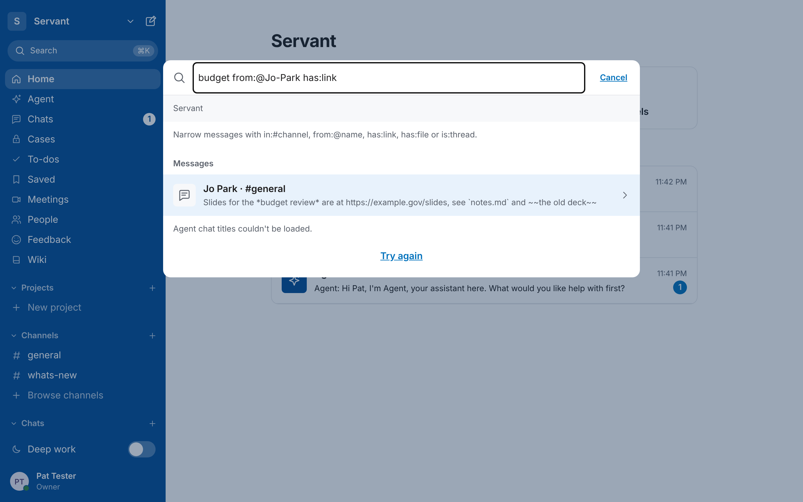

# Formatting, /feedback and search: before and after

Real browser screenshots from the running app against a throwaway local server, phone 390 × 844 and desktop 1280 × 800, device scale 2.

- **Before:** `main` at `f375f79`.
- **After:** the branch at `cdb5e95`.
- Made-up workspace with two placeholder people, Pat Tester and Jo Park, and the same messages on both sides.

| | Before (`f375f79`) | After (`cdb5e95`) |
| --- | --- | --- |
| People's messages |  |  |
| Typing `/fe` |  |  |

After `/feedback The unread dot stays on after I read a channel`: [after/feedback-sent-phone.png](after/feedback-sent-phone.png).

## Search

| Words in any order, by stem | With filters |
| --- | --- |
|  |  |

There is no before picture for search. Search is done by the server, and both sides of these captures ran against the branch's server, so `main`'s app found the same messages. What changed is covered by the server's tests (`server/omnibar-search.test.mjs`): on `main` the typed text had to appear as one string, so `renewal approve` found nothing and a filter was just more text. "Agent chat titles couldn't be loaded" in the pictures is the test machine having no agent running.

## What the run checked

```
before: formatting  asterisks shown: true · underscores shown: true
after:  formatting  bold 700 · italics · /me in italics · strikethrough · code in monospace · no asterisks or underscores shown
typing /fe lists: true                          (before: false)
/feedback with words: says "Feedback sent. Thank you. Find it under You, then Feedback." · box cleared: true · nothing posted to the channel: true
/feedback alone opens the Feedback page: true · the report is listed there: true
after: "renewal approve" finds 1 · "budget from:@Jo-Park has:link" finds 1 · "in:#general from:me" finds 2 · "monday in:no-such" finds 0
```

Not seen on a phone or in the Mac app.
