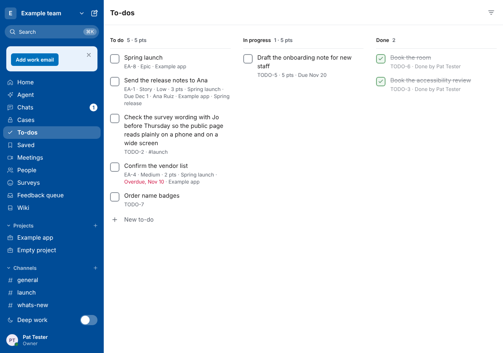
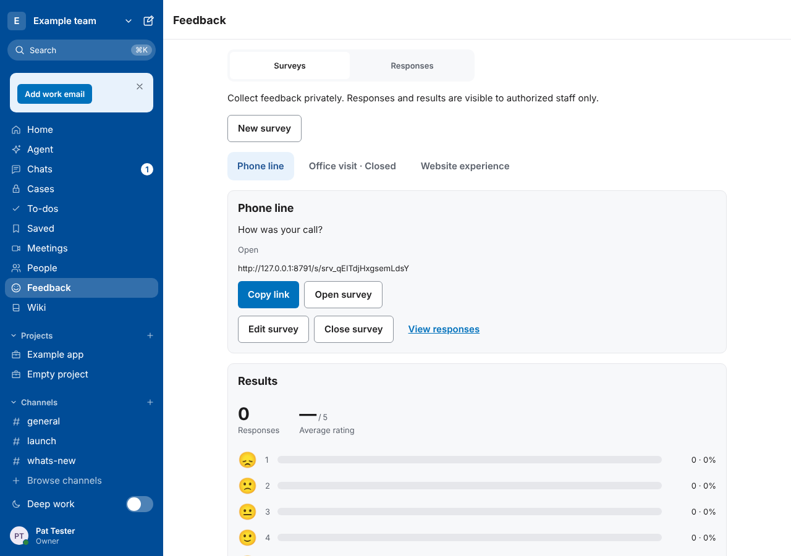
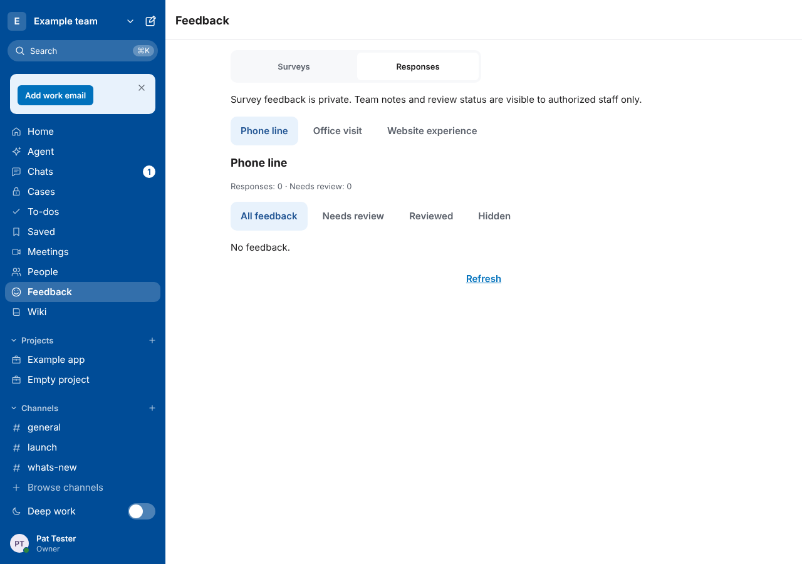
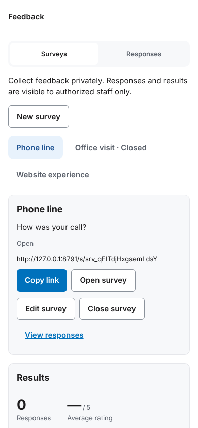
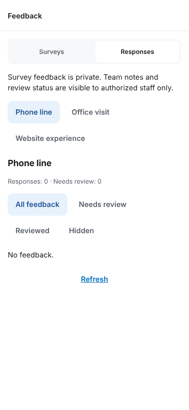

# Surveys and Feedback queue become one place: Feedback

Actual browser screenshots, device scale 1, light appearance, English, a made-up workspace. Desktop 1280 × 900,
phone 390 × 844 with touch.

- **Before:** `c022437`. The sidebar listed **Surveys** and **Feedback queue** as two places. The capture is the
  To-dos screen at that commit, which shows that sidebar; the two screens themselves were not captured before.
- **After:** this change. One place, **Feedback**, with a **Surveys** tab and a **Responses** tab.

| Before: two entries in the sidebar | After: one entry, Surveys tab | After: Responses tab |
| --- | --- | --- |
|  |  |  |

| Phone: Surveys tab | Phone: Responses tab |
| --- | --- |
|  |  |

The script that took the after captures also checked: the sidebar has one **Feedback** entry and no **Surveys** or
**Feedback queue**; the chosen tab says so; switching carries the open survey across and does not add to the
browser's history; no sideways scroll.
