# Opening the app: before and after

Opening Servant showed its wordmark on navy. It now shows the signed-in app's shape, so the app looks like it is already there.

Real browser screenshots from the running app at phone size (390 × 844) and desktop size (1280 × 800), device scale 2.

- **Before:** `main` at `1989903`.
- **After:** the branch at `8db262c`, which has `main` merged in.
- Made-up workspace on a throwaway local server; the only person is Pat Tester. On the before side the launch screen's credit line was pointed at the placeholder name for these captures, so no real name is pictured.

**Not pictured: a phone.** There is no iPhone, simulator or Android device where these were taken, so the native launch screens have not been seen running or built with Xcode or Gradle. What was checked instead is under "The native launch screen" below.

## The launch screen, while the saved account is read

Held open for the capture; normally it shows for a moment. Before, it was the same in light and dark.

| | Before (`1989903`) | After (`8db262c`) |
| --- | --- | --- |
| Phone, light | 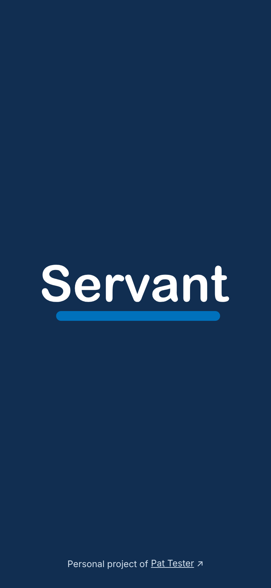 | 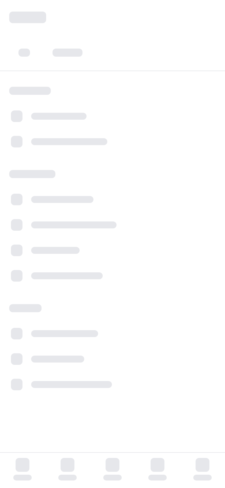 |
| Phone, dark | the same picture | 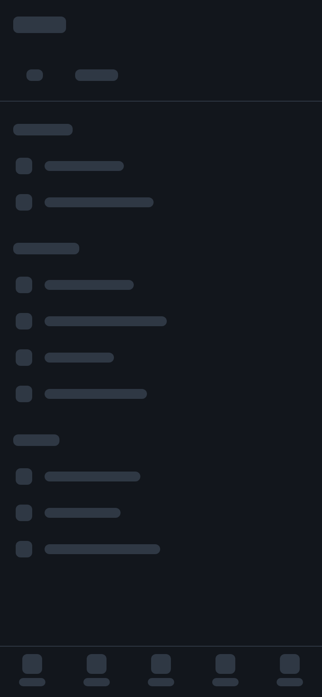 |
| Desktop, light | 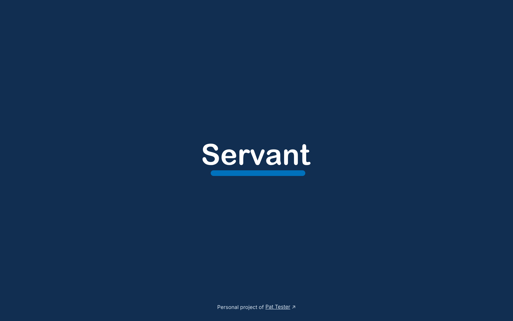 | 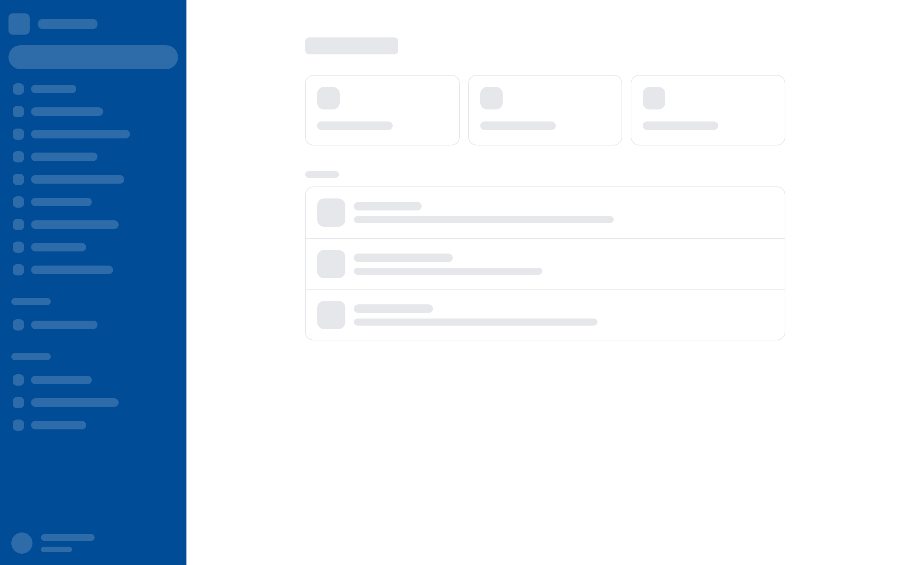 |
| Desktop, dark | the same picture |  |

## The web page before its script loads

What the browser and the Mac app show until the app's script arrives (script requests were held back for the capture).

| | Before (`1989903`) | After (`8db262c`) |
| --- | --- | --- |
| Desktop, dark |  | 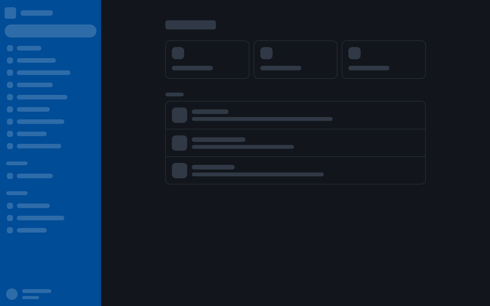 |
| Phone, light | a blank white page |  |

After, this page and the launch screen are the same picture: comparing where shapes are drawn, 0 to 98 pixels differ out of 1.3 million (phone) and 16 to 17 out of 4.1 million (desktop), all at the edges of rounded corners. The Mac app's variant, with room for the window controls, was compared before the pane became square: 45 to 56 pixels out of 3.9 million.

## Home while its list loads

Signed in, with the server's answers held back for the capture.

| | Before (`1989903`) | After (`8db262c`) |
| --- | --- | --- |
| Phone | 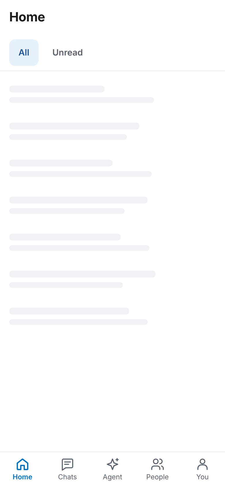 | 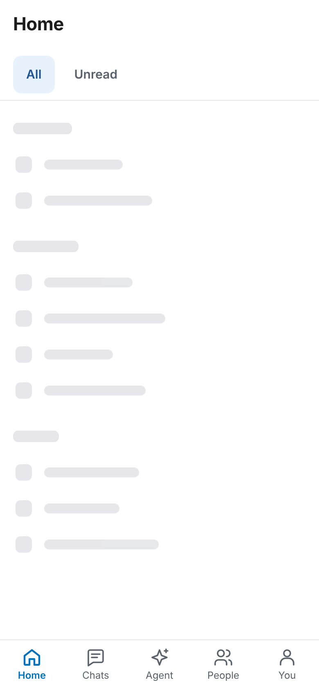 |
| Desktop | 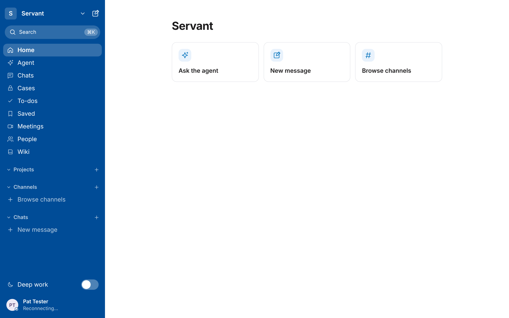 | 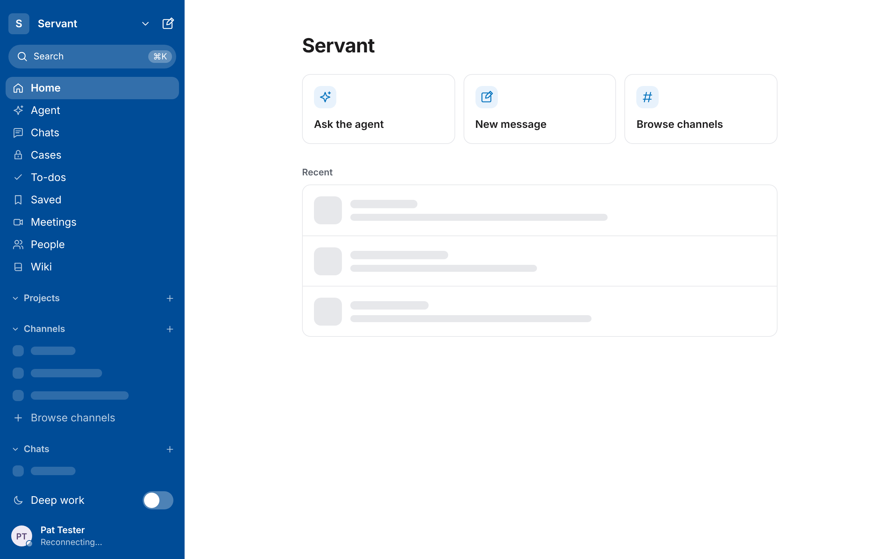 |

## Home once loaded

Unchanged: the before and after files are byte-for-byte the same, so only the after is kept.

| Phone | Desktop |
| --- | --- |
| 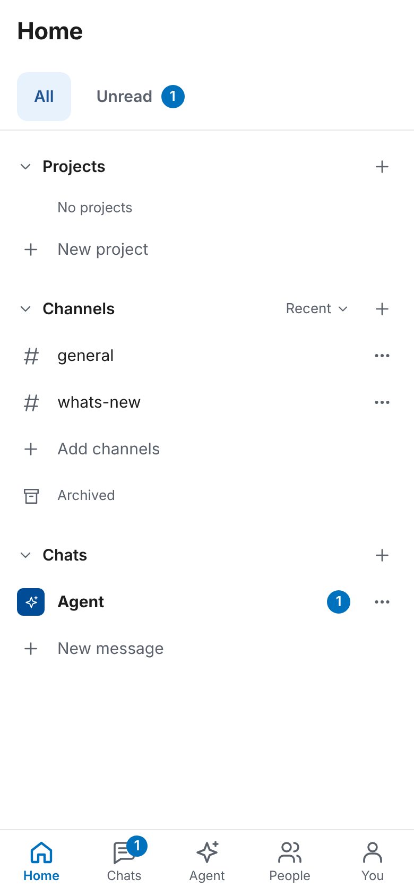 | 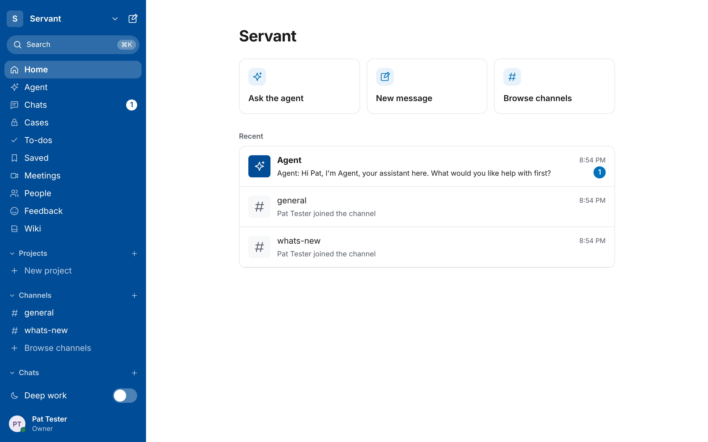 |

## The native launch screen

`npx expo prebuild --no-install --clean` on the branch, then reading what it generated:

- iOS `SplashScreen.storyboard`: well-formed XML, 130 ids all unique, 25 skeleton views (24 bars and the rule), 100 constraints, none pointing at a missing view, no image view and no image resource. The background is the `SplashScreenBackground` color set (`#FFFFFF`, dark `#12161C`) and the bars are the `LaunchSkeleton` color set (`#E6E7EB`, dark `#303945`). `Info.plist` has `UIStatusBarStyleDefault`.
- Android: `splashscreen_background` is `#FFFFFF` in `values/colors.xml` and `#12161C` in `values-night/colors.xml`, and `splashscreen_logo` is a transparent drawable.

On iOS the bars are square-cornered, because a launch screen allows no runtime attributes; the app's are rounded by 6 points.
