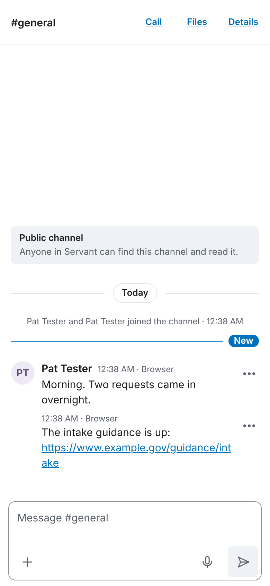
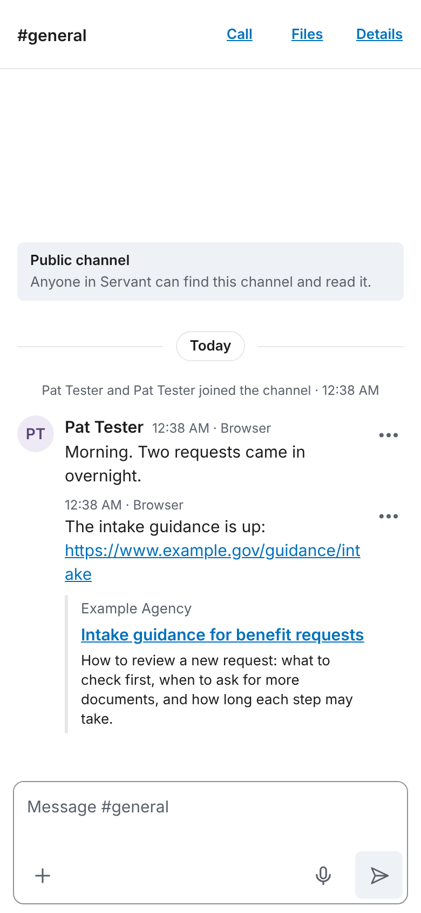
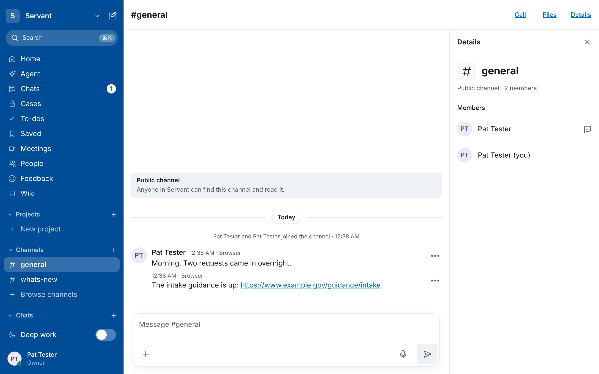
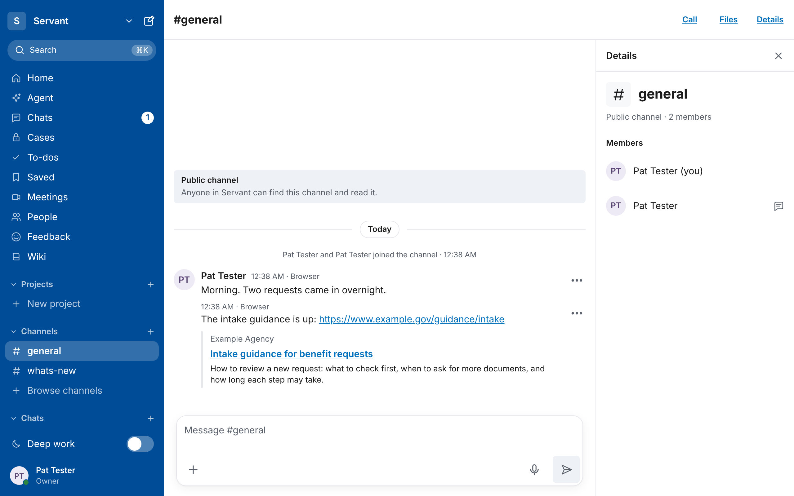
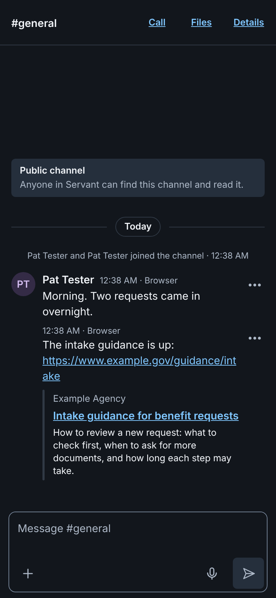

# Link previews

A person posts a link in #general. Before, the message shows the link alone. After, the page's site name, title and description sit under it, as words only.

- **Before:** `main` at `f375f79`. **After:** this branch at `ff06deb`. Both apps talk to the same throwaway server (the branch's), so the same message is on both sides; the "New" line in the before captures is only because that browser had not read the channel yet.
- Viewports: phone 390 × 844 and desktop 1280 × 800, light; the phone in dark as well for the new card.
- People and the page are made up (Pat Tester, `www.example.gov`).

| | Before | After |
| --- | --- | --- |
| Phone |  |  |
| Desktop |  |  |
| Phone, dark | (no card existed) |  |

## What this shows and what it does not

The capture machine has no route to the internet, so the page was answered inside the test server's process: the name was made to resolve to a public address and the request got a fixed page. Everything else ran as shipped: finding the link in the message, the address checks, reading the title and description, saving them, and publishing the message again so the card appeared in the open conversation without a reload.

Seen during the run:

- The card arrived by itself in the open conversation.
- The server asked for the page once, with only these headers: `User-Agent: ServantLinkPreview/1.0`, `Accept: text/html,application/xhtml+xml`, `Accept-Language: en`.
- The browser made no request to the linked site on either side.

Not verified: a read of a real site over the network. The address checks, redirects, size and time limits are covered by `server/link-preview.test.mjs`.
