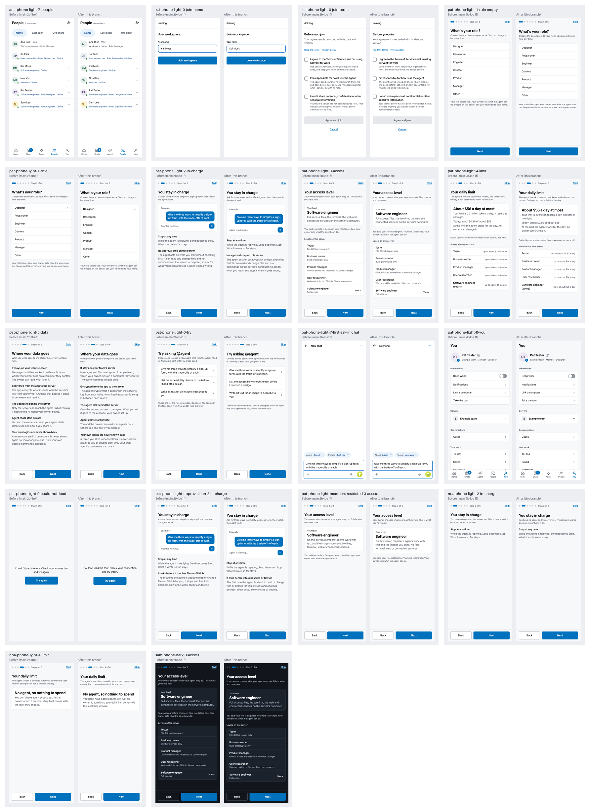

# Onboarding tour spacing captures

Everything stacked on a tour page is 20 pixels from its neighbors (`space.stack`). Same synthetic server and people
as [the tour's own captures](../onboarding-tour/README.md). Phone captures are 390×844, desktop 1280×900.

- `before/`: the app from `main` at `2b4be1f`, with test ids added to `tour.tsx` so the same gaps could be measured
  (no style was touched: the 42 captures that also exist in `../onboarding-tour/after` are identical to them, pixel
  for pixel).
- `after/`: this change.
- `composites/`: each capture, before beside after.
- `contact-sheet.png`: every phone screen once.

Made with `SERVANT_TOUR_E2E_SHOTS=<folder> SERVANT_TOUR_E2E_GAPS=<file> node scripts/onboarding-tour-e2e.mjs`, and
for `before/` also `SERVANT_TOUR_E2E_APP=<the main checkout>/app`. The script measures each gap where the browser
drew it and, for this checkout, fails if one is off.

## Gaps, in CSS pixels

Measured on every page of every walk (four people on a phone, the owner on a wide window, light and dark, 37 pages): 228
gaps after. 183 are 20; the other 45 are the two kept close, at 4 and 8.

| Between | Before | After |
| --- | --- | --- |
| The top bar and the page's title | 16 | 20 |
| The title group and the first card | 16 | 20 |
| The title group and the list of points (Where your data goes; You stay in charge with no agent) | 24 | 20 |
| A card and the note under it (role list, Your level, daily limit, first asks) | 12 | 20 |
| A note and the section under it (Levels on this server, Where each level starts) | 16 | 20 |
| The example card and the points under it | 20 | 20 |
| One point and the next | 16 | 20 |
| Inside the example card: "Example", the message, "Agent is working…" | 12 | 20 |
| The last thing on a page and the end of the page | 24, 36 or 40 | 20 |
| "Couldn't load the tour" and Try again | 16 | 20 |
| A title and its own line of explanation (kept close) | 4 | 4 |
| A section label and the list it names (kept close) | 8 | 8 |

Unchanged, and identical before and after: the join screen (`kai-phone-light-0-*`), You (`pat-phone-light-8-you`),
People (`ana-*-7-people`) and the first ask in a new chat (`pat-phone-light-7-*`). What the tour added to them is a
row inside a list and words on a line that was already there.
