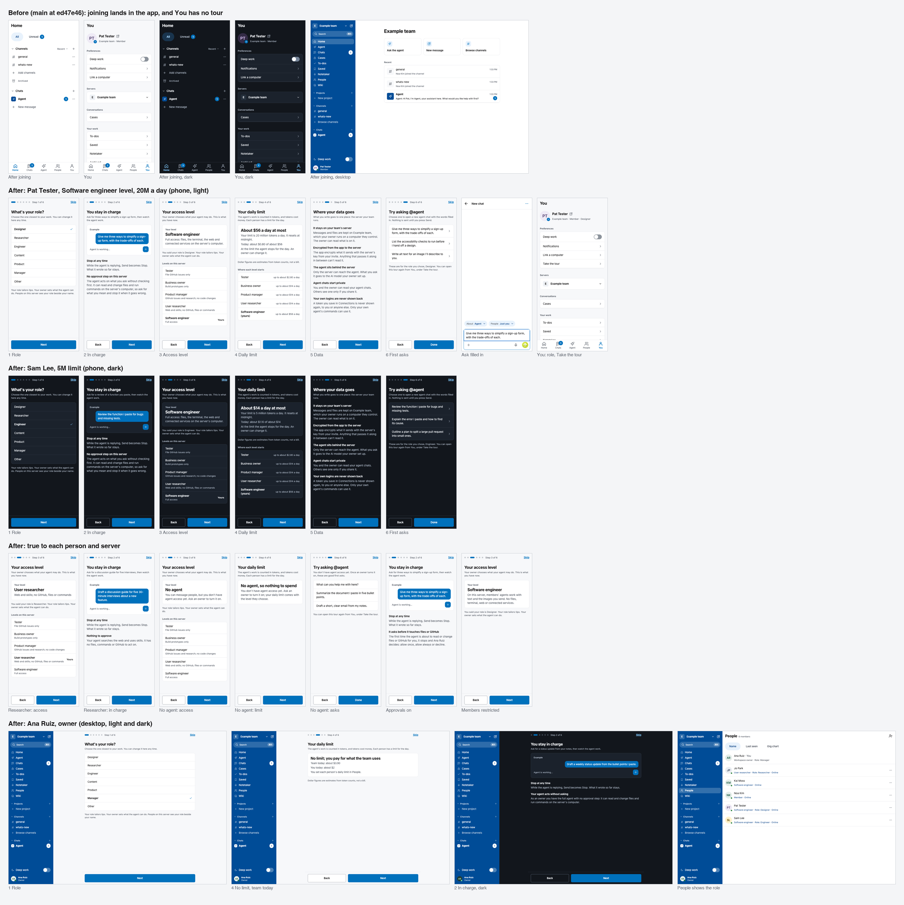

# Onboarding tour captures

Synthetic data on a temporary server called "Example team": Ana Ruiz (owner), Pat Tester (Software engineer level,
20M tokens a day), Sam Lee (the same level with a 5M limit), Jo Park (User researcher), Noa Kim (no agent) and
Kai Moss (joins through the join screen). The agent is priced at $2 in and $10 out per million tokens, and today's
use is seeded as counts. Made with `node scripts/onboarding-tour-e2e.mjs`, which also checks every sentence it
captures. Phone captures are 390×844, desktop 1280×900.

- `before/`: the app from `main` at `ed47e46`, on the same server (`SERVANT_TOUR_E2E_BEFORE=1` with
  `SERVANT_TOUR_E2E_APP` pointing at that checkout). There was no tour: joining lands in the app, and You has no
  way to one.
- `after/`: this change.
  - `pat-phone-light-*`: the whole tour in light, then the first ask filled into a new agent chat, and You with
    the role and **Take the tour**.
  - `sam-phone-dark-*`: the whole tour in dark, with a 5M limit ("About $14 a day at most").
  - `jo-phone-light-*`: a researcher. `noa-phone-light-*`: no agent.
  - `ana-desktop-light-*` and `ana-desktop-dark-*`: the owner in a wide window; `7-people` is People showing the
    roles people chose.
  - `pat-phone-light-approvals-on-2-in-charge.png`: the same page with `"agentCapabilities": { "mode": "ask" }`.
  - `pat-phone-light-members-restricted-3-access.png`: the same page with `"agentAccess": "limited"`.
- `contact-sheet.png`: all of the above on one page.

No iOS simulator capture: no simulator on the capture machine had a build of the app installed, and there was no
tool to tap through joining in one. The tour uses no native code of its own.
