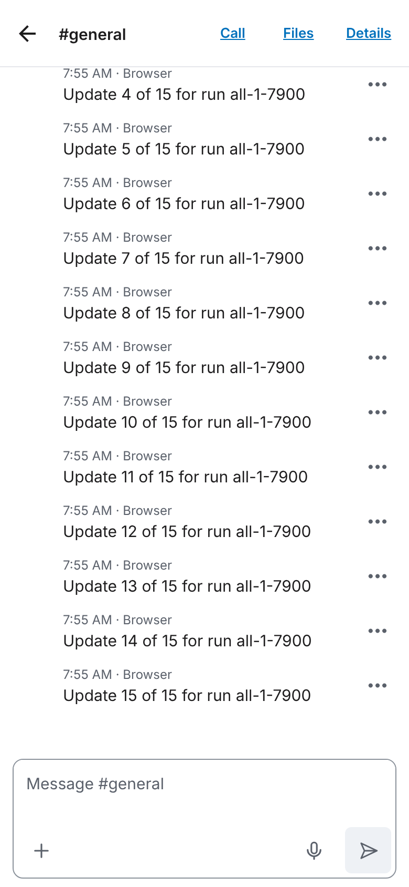
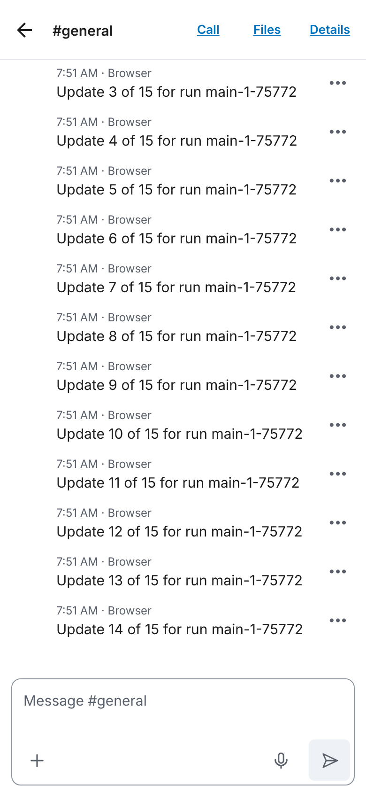
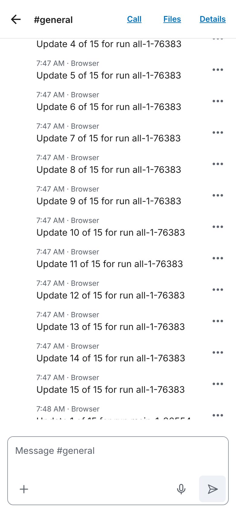
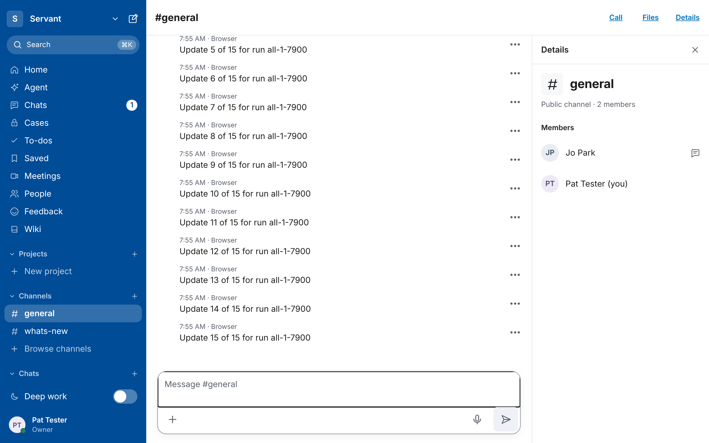
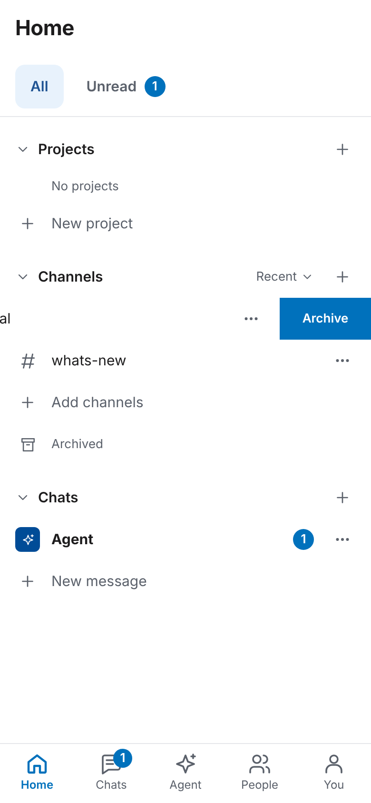

# Performance: React Compiler, a recycling list, and the swipe row

Nothing here is meant to look different. The pictures show the same screens on `main` and on this change; the numbers are in [docs/performance.md](../../performance.md) and [measurements.json](measurements.json).

- **Before:** `main` at `f9d0263`. **After:** this branch. Production web builds, served in turn on the same address against the same throwaway server (2,000 seeded messages in #general, plus the messages the timing runs sent; the people are made up).
- Phone 390 × 844 and desktop 1280 × 800, light, device scale 2.

| | Before | After |
| --- | --- | --- |
| A channel, opened |  |  |
| The same, twelve wheel steps back |  |  |
| Desktop |  |  |
| A conversation's row swiped open (touch) |  |  |

The messages on screen differ between the two sides only because the timing runs kept adding messages to the channel between captures.

## Behaviour checked in the browser

The new list, two people signed in:

```
opens at the newest message: distance from the bottom {"fromBottom":0}
a message arriving while at the bottom is shown: true {"fromBottom":0}
my own message is shown after sending: true {"fromBottom":0}
scrolled back, a new message does not move what is being read: before {"fromBottom":4689} after {"fromBottom":4758} (the new message's own height) | new one on screen: false
older pages load when scrolling up: height 7136 -> 24166
back at the bottom, the newest is shown: true {"fromBottom":0}
desktop opens at the newest: {"fromBottom":0} true
```

The swipe, with touch events, identical on `main` and on this change:

```
at rest                         | row at: 54  | actions opacity: 0
swipe left 150                  | row moved while dragging: -96 | row at: -42 | actions opacity: 1
swipe right 150                 | row moved while dragging: 96  | row at: 54  | actions opacity: 0
swipe left 25 (under a third)   | row at: 54  | actions opacity: 0
drag down 120                   | row moved while dragging: 0   | row at: 54  | actions opacity: 0
```

With a mouse, also identical on both: a 120-point drag moves the row 96 points and does not open the channel; a 20-point drag ends as a press and opens it.
