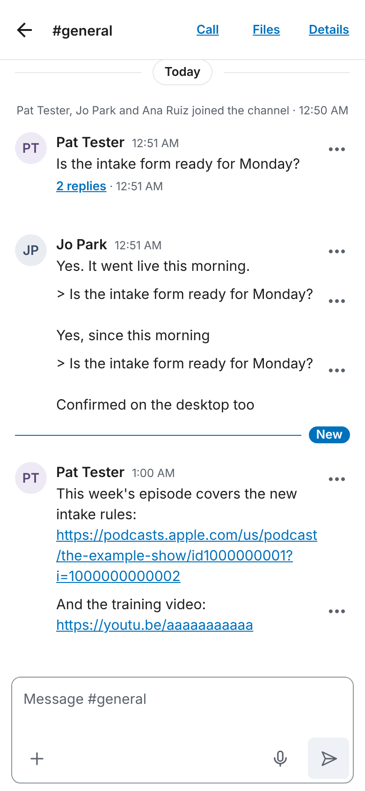
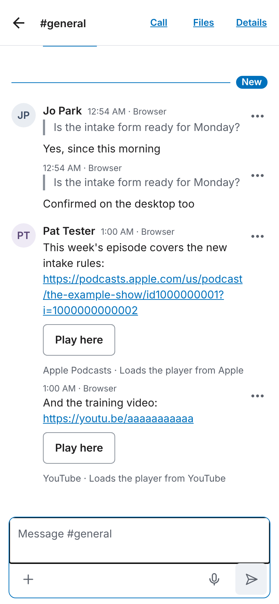
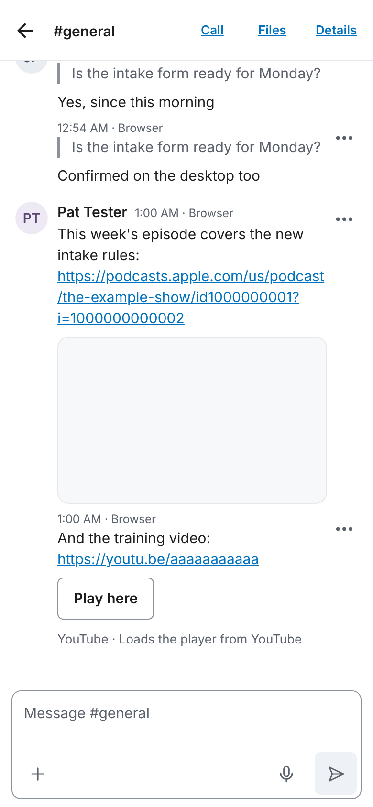
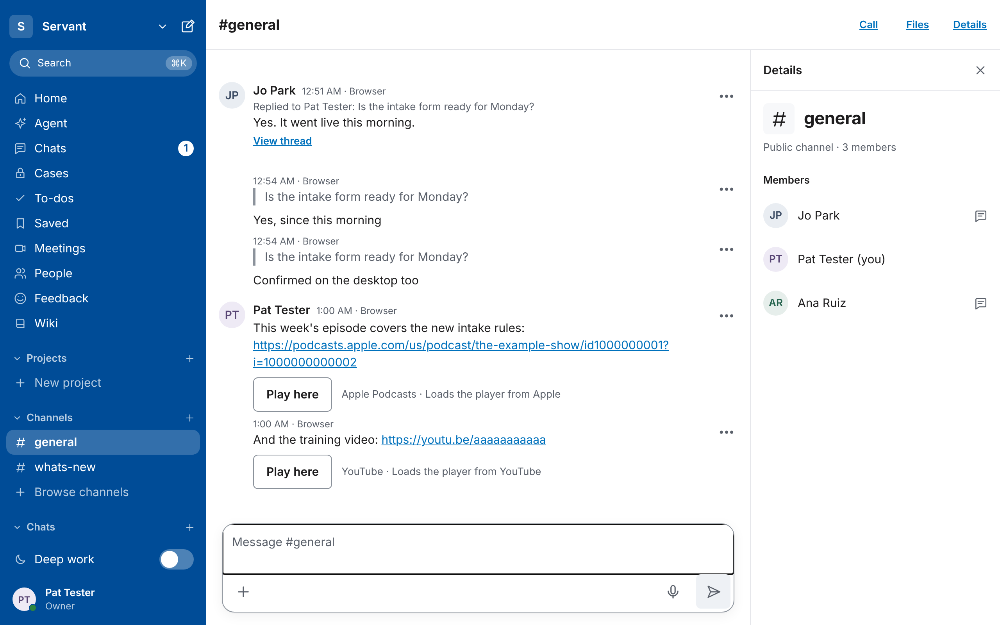
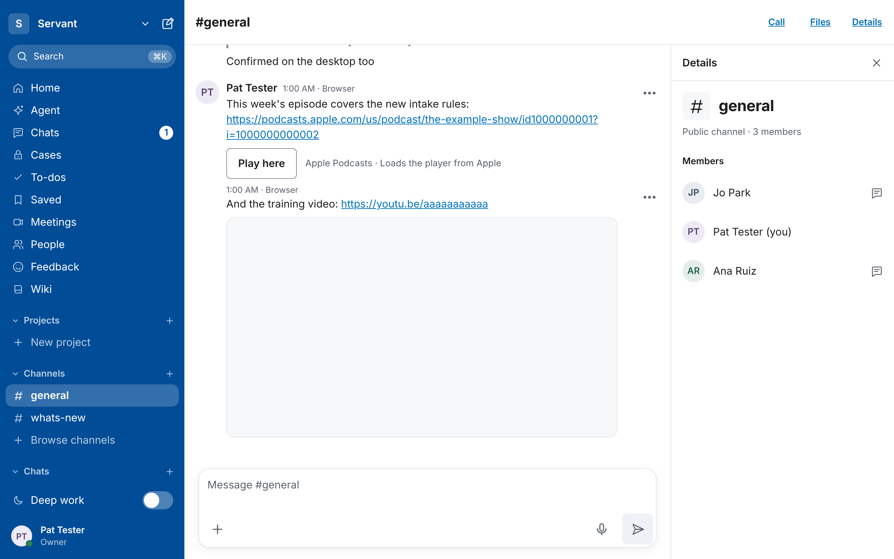
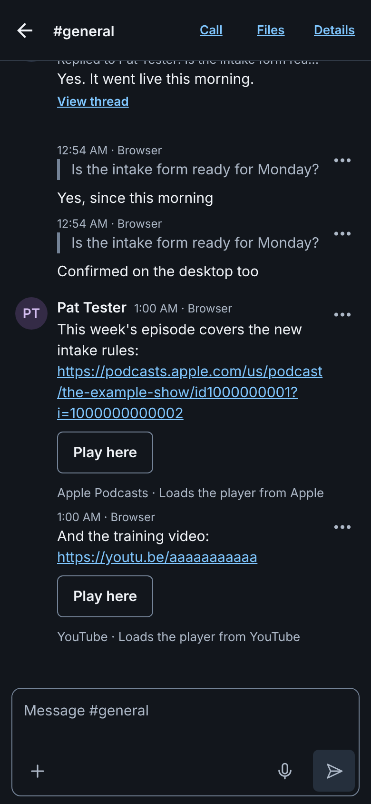

# Playing a link in place

Pat Tester posts a link to an Apple Podcasts episode and one to a YouTube video. Each gets **Play here**; pressing it loads that service's player in place.

- **Before:** `main` at `f375f79`, the same two messages, links only. **After:** this branch.
- Phone 390 × 844 and desktop 1280 × 800, light, and the phone in dark. Throwaway local server; the people, the show and the video are made up, so there is nothing real to play.

| | Before | After |
| --- | --- | --- |
| The messages |  |  |
| After pressing the first (new) | did not exist |  |
| Desktop | |  |
| Desktop, video pressed | |  |
| Dark | |  |

Seen during the run:

```
after: Play buttons: 2 | frames before any press: 0 | hosts contacted before any press: []
before: Play buttons on main: 0
after pressing the first: frames: 1 | src: https://embed.podcasts.apple.com/us/podcast/the-example-show/id1000000001?i=1000000000002 | the other still a button: 1 | hosts contacted: ["embed.podcasts.apple.com"]
desktop: video frame src: https://www.youtube-nocookie.com/embed/aaaaaaaaaaa | size: 560 x 315
```

## What this does not show

The frames are empty. The capture machine's network refuses connections to these services, so no player was ever seen loading or playing, for any of the five services, and the player addresses were written from each service's published embed format rather than checked against a real link. Nothing was run on a phone or in the Mac app.
