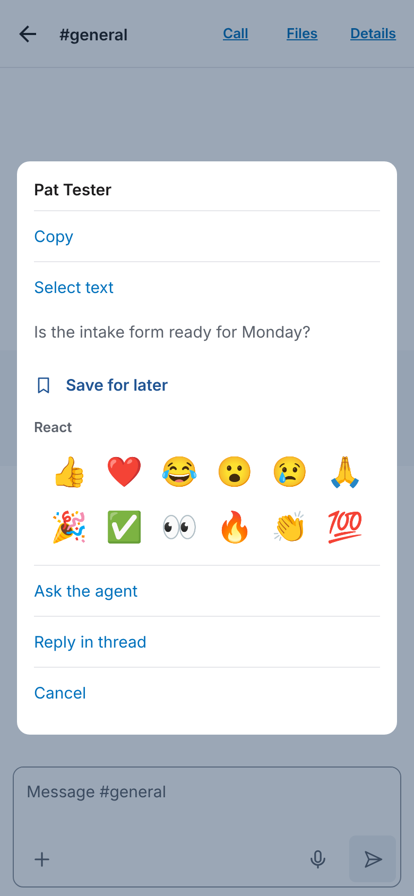
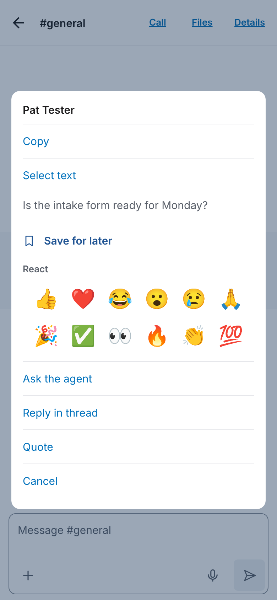
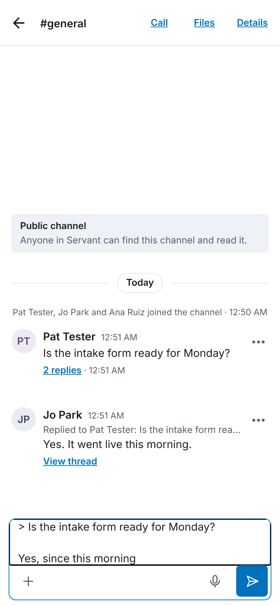
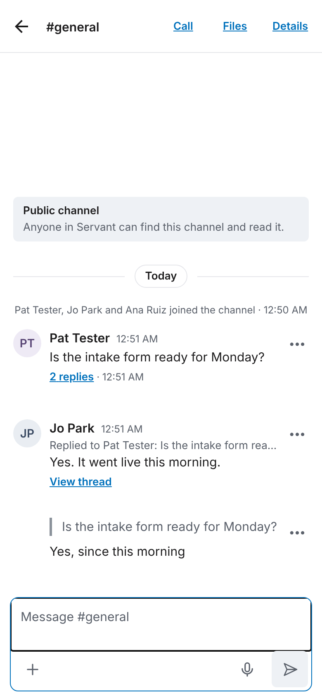
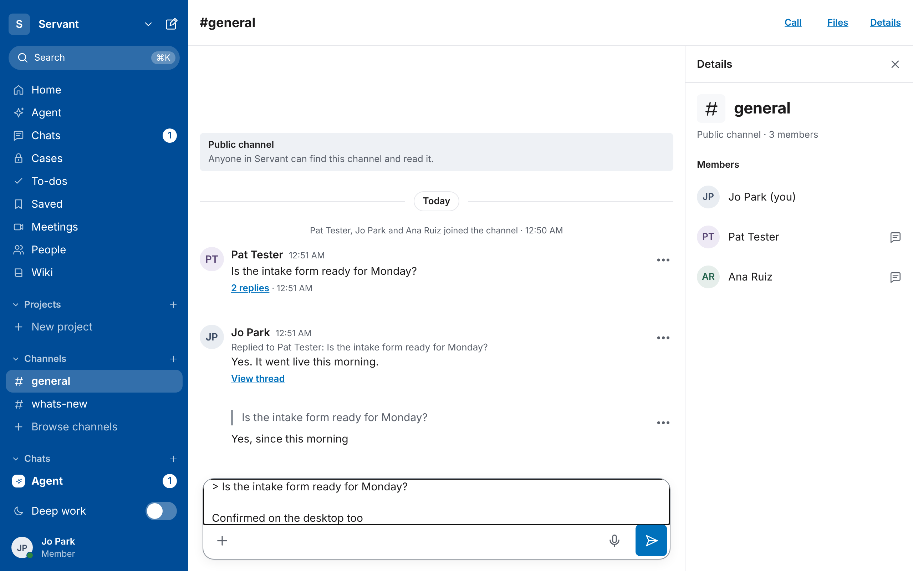
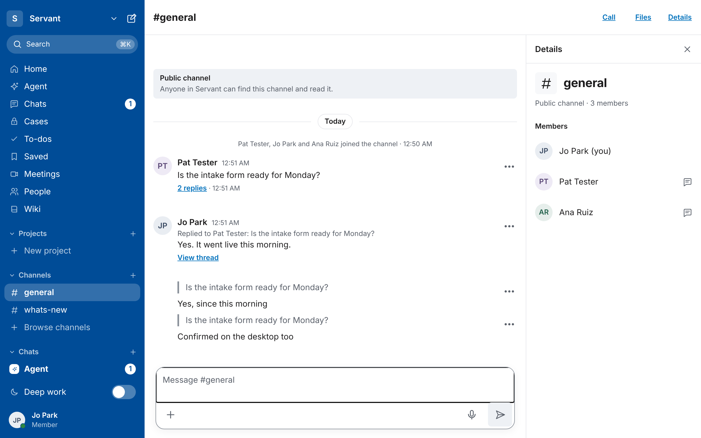

# Quoting a message

Jo Park chooses **Quote** on Pat Tester's question, with an answer already typed, and sends it.

- **Before:** `main` at `f375f79`, the same message's menu, with no Quote. **After:** this branch.
- Phone 390 × 844 and desktop 1280 × 800, light. Throwaway local server; the people are made up.

| | Before | After |
| --- | --- | --- |
| The message's menu |  |  |
| The reply field (new) | did not exist |  |
| Sent (new) | |  |
| Desktop | |  |
| Desktop, sent | |  |

Seen during the run:

```
before: Quote offered on main: 0
phone after: Quote offered: 1
phone reply field: "> Is the intake form ready for Monday?\n\nYes, since this morning" | focused: true
phone sent; field emptied: "" | quote lines shown as typed: 0
after a reload the field is empty: ""
desktop after: Quote offered: 1
desktop reply field: "> Is the intake form ready for Monday?\n\n" | focused: true
desktop sent; field emptied: "" | quote lines shown as typed: 0
```
