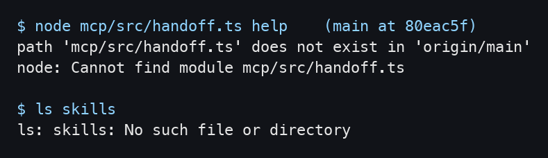
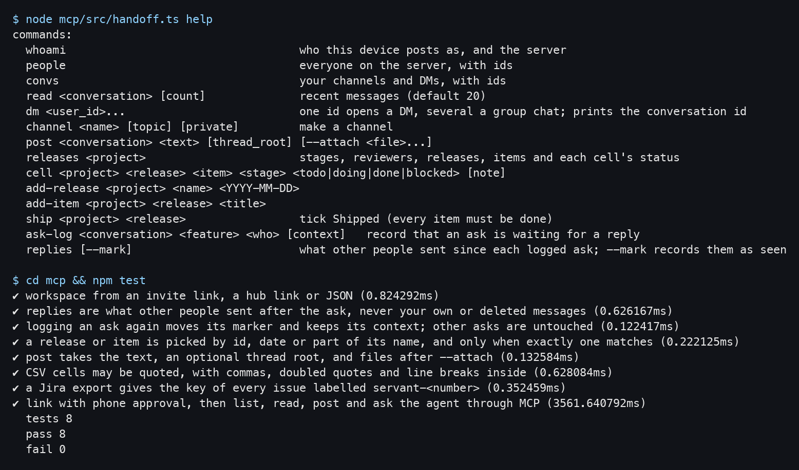

# The review-handoff skill and command: before and after

Terminal output rendered as pictures. There is no screen to capture: this change adds a command and a skill document.

| Before (`main`) | After (this branch) |
| --- | --- |
|  |  |

**Before** shows that `mcp/src/handoff.ts` and `skills/` do not exist on `main`. **After** is the command's own help text and the MCP test run, including the four new tests for picking replies, logging asks, choosing a release or item, and parsing `post` arguments. Neither picture involves a server or any person's data.
