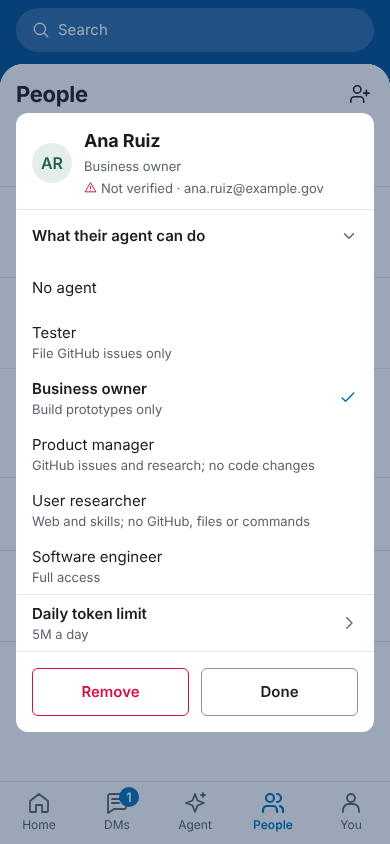
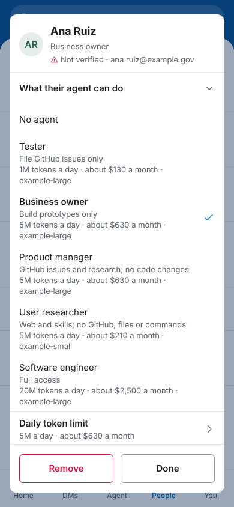
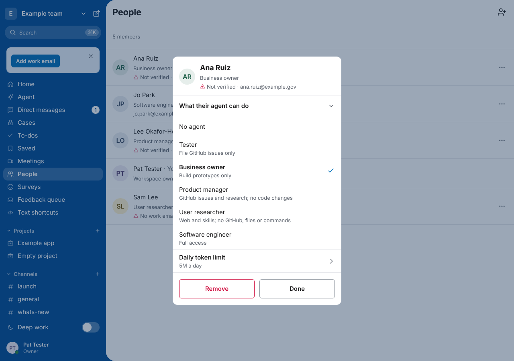
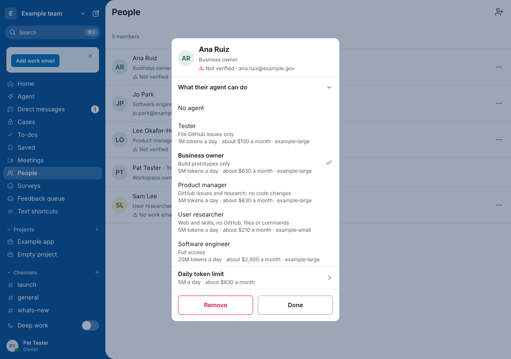
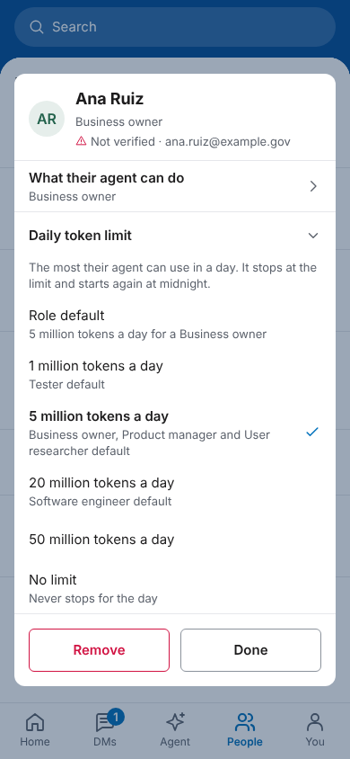
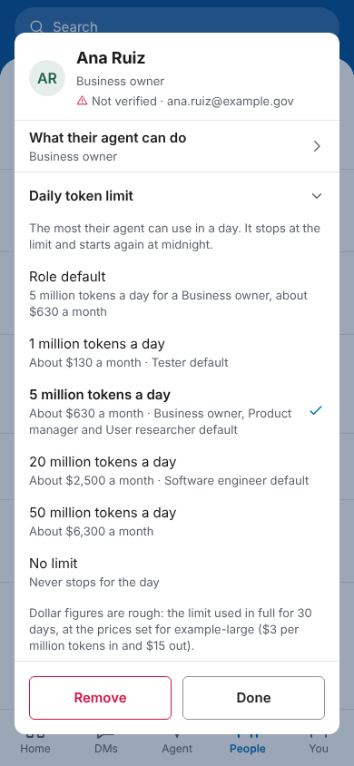
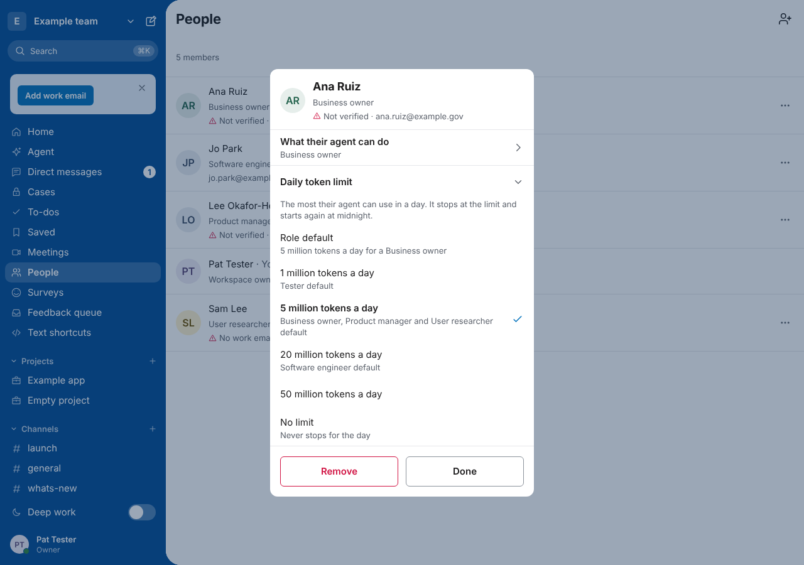
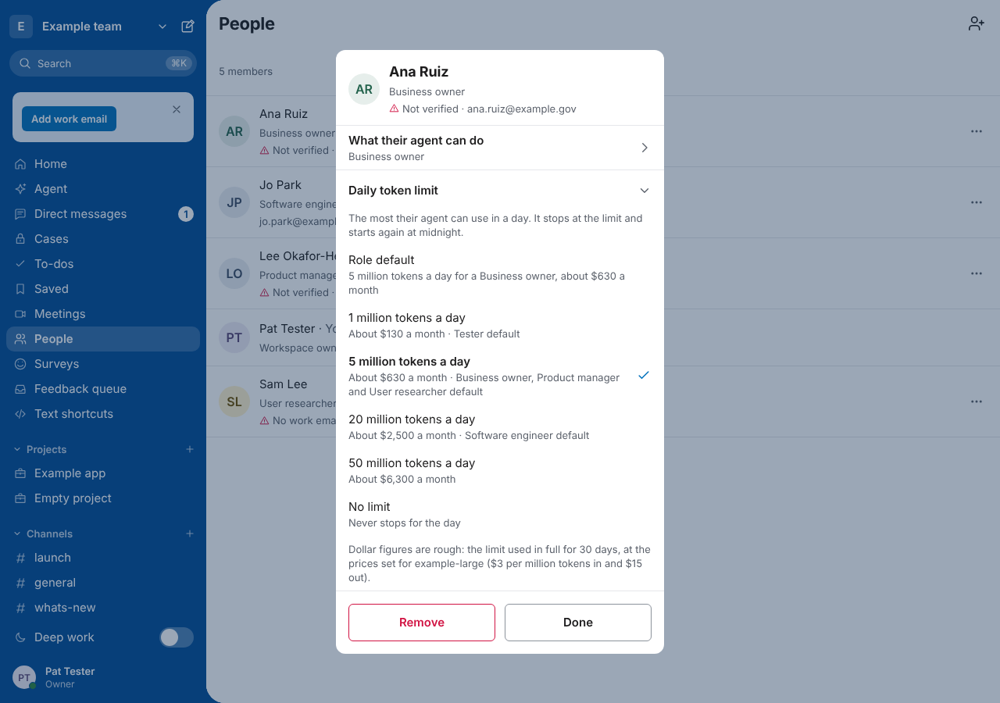
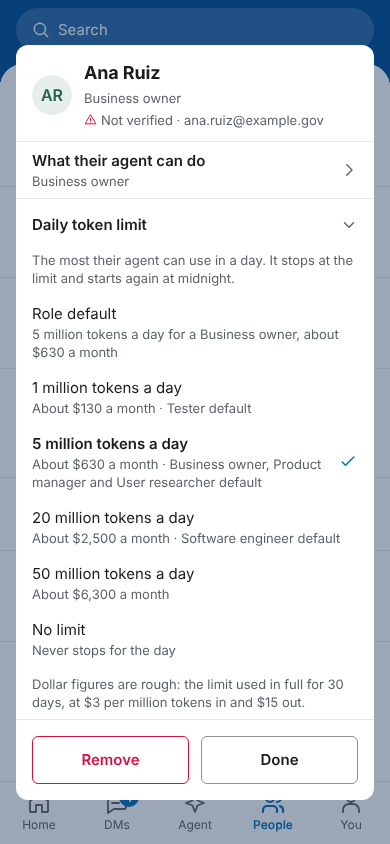

# About what each role costs a month: before and after

These are actual browser screenshots from running builds. They are not mockups or edited images.

- **Before:** `main` at `c64d2ba471476c549d2017731d40a917f6ac97be`, the PR's base.
- **After:** the branch at `171fd3b9b5bd4be8bb0b3ee2523f5cf49b2af2aa`.
- **Desktop:** 1280 × 900. **Phone:** 390 × 844. Device scale 1, light appearance, English.
- Both sides ran their own server on a copy of the same made-up workspace (Pat Tester is the owner; the sheet is Ana Ruiz's). The model names and prices are made up for the screenshots: `example-large` at $3 in and $15 out per million tokens for the full-access and limited agents, `example-small` at $1 and $5 for the User researcher's. `main` ignores those settings.

Commits, routes, times and checksums are in [manifest.json](manifest.json).

## Under each role

Before, a role said only what its agent can do. After, it also says its daily limit, about what that costs a month if used in full, and the model its agent runs.

| Viewport | Before | After |
| --- | --- | --- |
| Phone |  |  |
| Desktop |  |  |

## Beside each limit

Each limit says about what it costs a month for this person's role, and one sentence under the list says what the figures assume. No limit changed.

| Viewport | Before | After |
| --- | --- | --- |
| Phone |  |  |
| Desktop |  |  |

## With no model or price set

A server whose `config.json` names no model or price uses the usage report's estimate ($3 in, $15 out per million tokens) and names no model.

