# PR 75: before and after

These are actual browser screenshots from two clean, isolated source checkouts. They are not mockups, edited images, or screenshots of an intermediate version of the feature.

- **Before:** PR base `1ff5f04f1748eb7e09a51f077b9e6b5ea58ddb85`.
- **After:** implementation commit `6c8d6be3efef46595e488378bc1fba8b62ac0394`, which includes the design pass that brought the Cases screens and the public page onto the app's design system.
- **Desktop:** 1280 × 900. **Phone:** 390 × 844. Device scale: 1.
- Both revisions use the same browser, light theme, English locale, time zone and synthetic team-message fixture. Exact browser version, capture times, routes, HTTP status and image checksums are in [manifest.json](manifest.json).

The PR adds a new feature. Before it, the team had internal **Direct messages**, but no **Cases** workspace or public conversation entry. The workspace comparison therefore shows the existing Direct messages screen before, and the new Cases screen after. The public comparison uses the same `/contact` route: its real HTTP 404 before, and the new entry form after. No nonexistent baseline screen has been fabricated.

## Team workspace

| Viewport | Before: existing Direct messages | After: new Cases workspace |
| --- | --- | --- |
| Desktop | 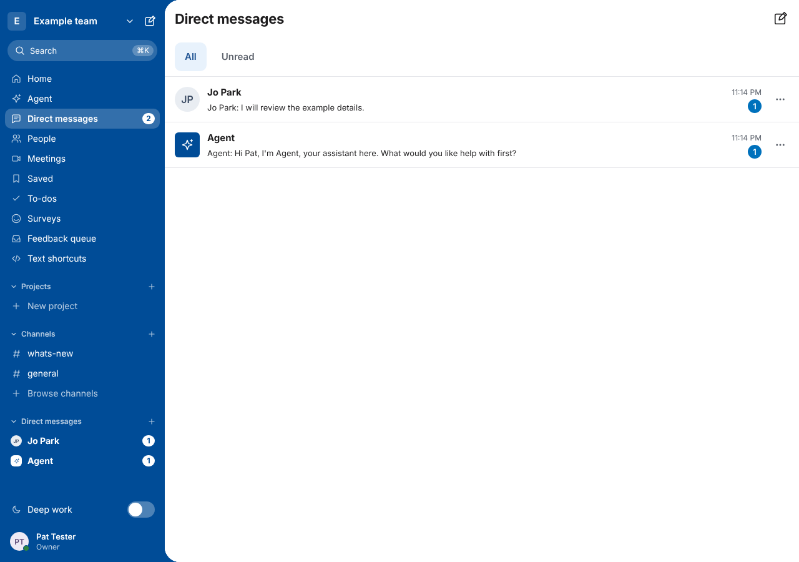 | 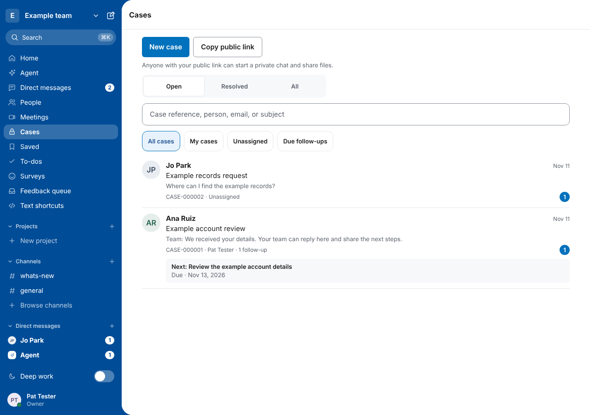 |
| Phone | 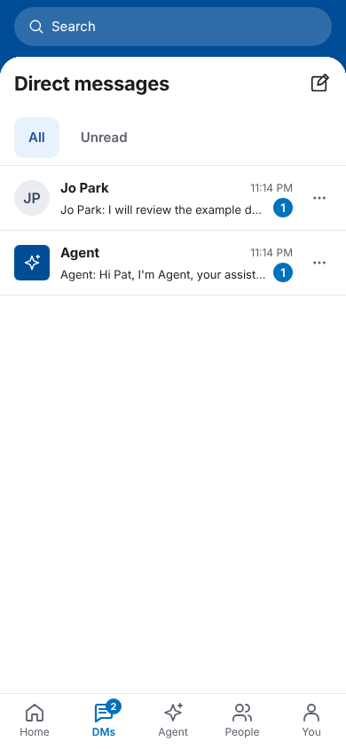 | 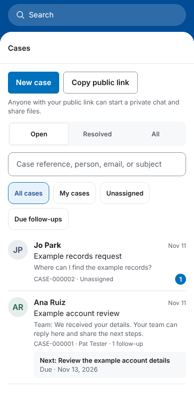 |

## Public entry

| Viewport | Before: `/contact` is unavailable | After: public conversation entry |
| --- | --- | --- |
| Desktop | 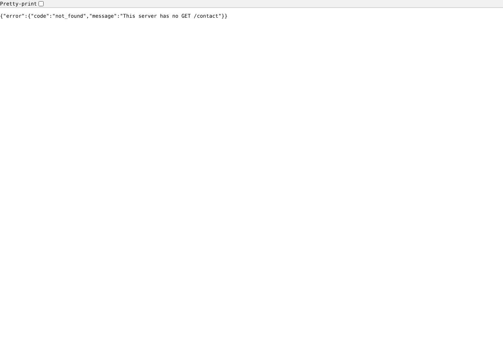 | 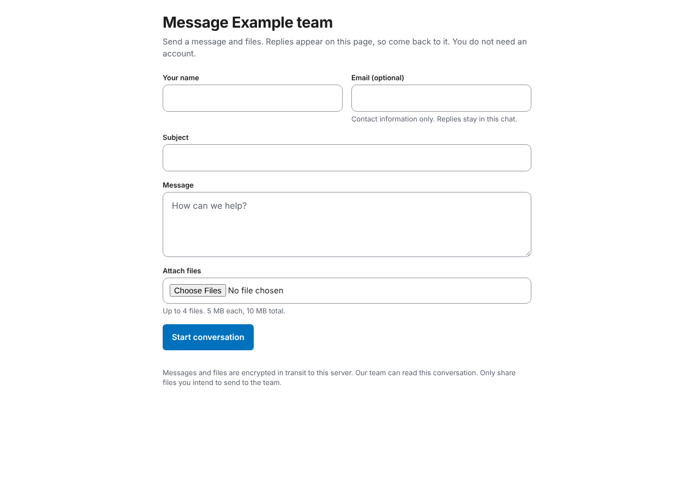 |
| Phone | 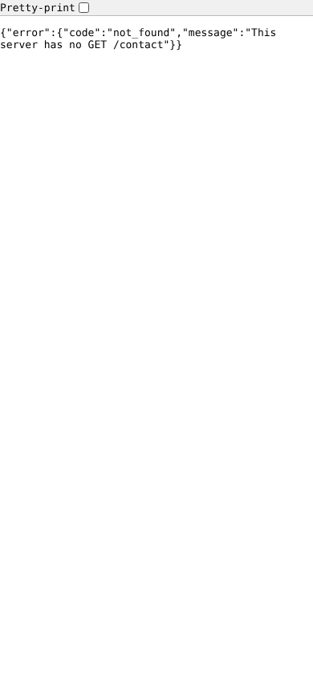 | 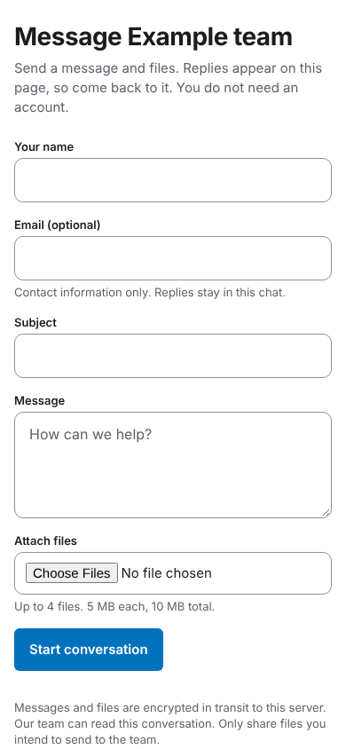 |

## New case workspace details

These views have no counterpart at the PR base. They show the implemented feature with real fixture data saved through the encrypted server API.

| View | Desktop | Phone |
| --- | --- | --- |
| Visitor conversation and files | 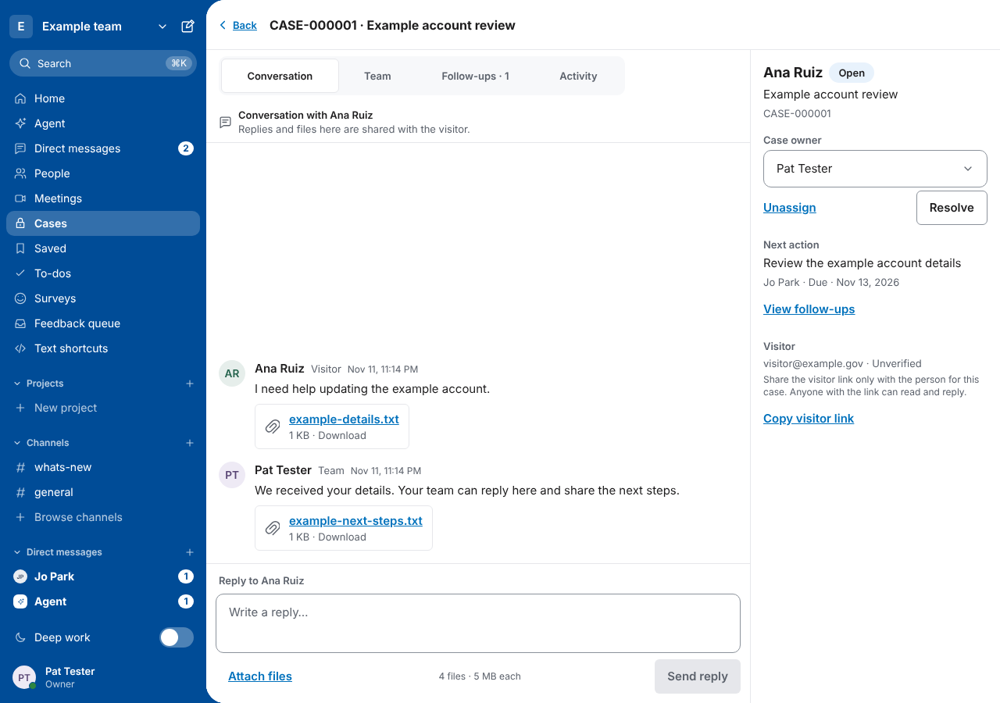 | 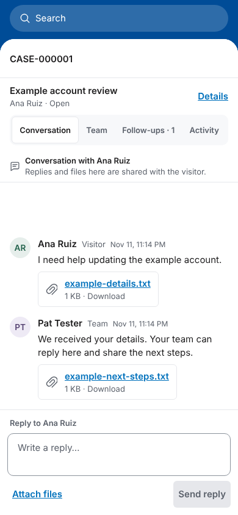 |
| Private team notes and working files | 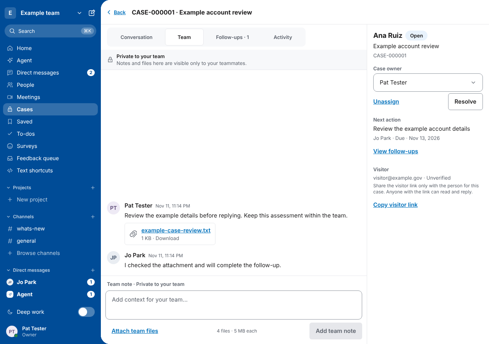 | 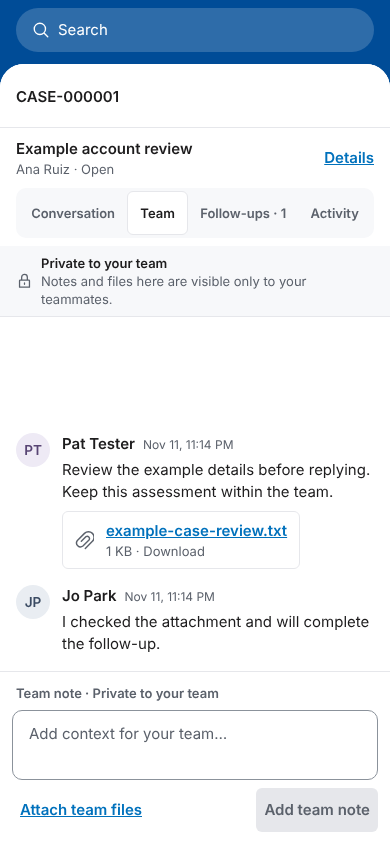 |
| Follow-up owner, due date and controls | 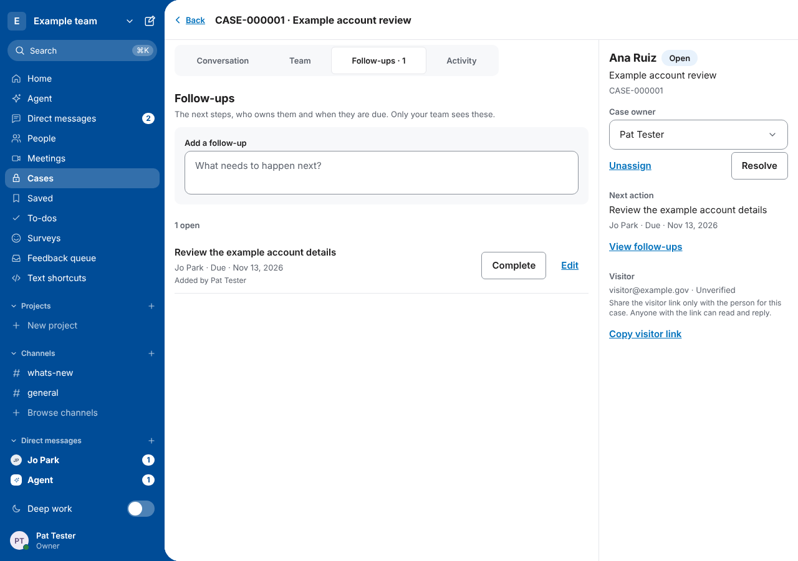 | 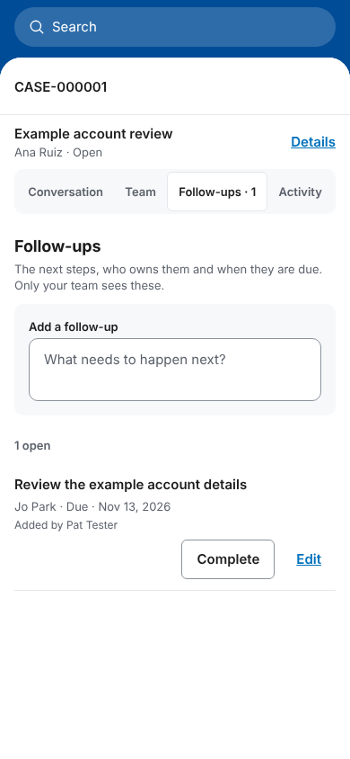 |

## Provenance and reproduction

Each revision ran its own temporary Node server, SQLite data and Expo web build. Pat Tester and Jo Park are synthetic team members; Ana Ruiz is a synthetic visitor. All messages, email addresses and files are examples. The servers used loopback development addresses, disabled push delivery and external agent workers. Browser traffic was restricted to those temporary local servers. No live account, conversation, credential or personal data was used.

The harness reads the actual commit of each checkout and refuses changed app or server source. It verifies that the baseline public route returns HTTP 404, the new route returns HTTP 200, the requested UI content has loaded, and every captured viewport has no horizontal overflow. Screenshots are saved directly by Playwright without image processing. Phone task screenshots scroll to the actual follow-up controls; the selected tab is recorded in the manifest.

To reproduce, prepare clean checkouts for the two commits and install their app dependencies. Each checkout needs a real `app/node_modules` directory: a shared symlink can make Expo Router load routes from the wrong checkout. Install the desktop Playwright dependency in the checkout containing the harness, then run:

```sh
SERVANT_E2E_BROWSER=chrome node scripts/secure-inbox-pr-captures.mjs \
  --before /path/to/base-checkout \
  --after /path/to/head-checkout
```

The default output is this directory. Use `--output /path/to/captures` for another destination. Without `SERVANT_E2E_BROWSER`, Playwright uses its installed bundled Chromium.
