# Reply emails for the secure inbox: before, after, and the visitor's side step by step

These are actual browser screenshots from running builds. They are not mockups or edited images.

- **Before:** `main` at `9ba545c485014debed3ea847508d9e92e62636b3`, the PR's base.
- **After:** the branch at `b3399ebae4b73a2b6cce7b09bbd38c284d0e8ac4`. The step-by-step run is from `7c90537a276d4dd99feaf2aa004f50b81ab1b2f6`; the commits between the two change only the browser check that produces it.
- **Desktop:** 1280 × 900. **Phone:** 390 × 844. Device scale 1, light appearance, English. The public page is captured whole, because what matters on it sits below the first screen; the team's app is captured as its window shows it.
- Each side ran its own server on a throwaway data directory with the same configuration, including a mailer command that writes each email to a file. `main` ignores that setting: it has no reply emails. The capture run on `main` handed 0 emails to the mailer; the run on the branch handed 2.

Commits, routes, times and checksums are in [manifest.json](manifest.json).

## Before and after

### Before the first message

The page now says an address gets an email when the team replies. Before, it said the address was contact information only.

| Viewport | Before | After |
| --- | --- | --- |
| Phone | 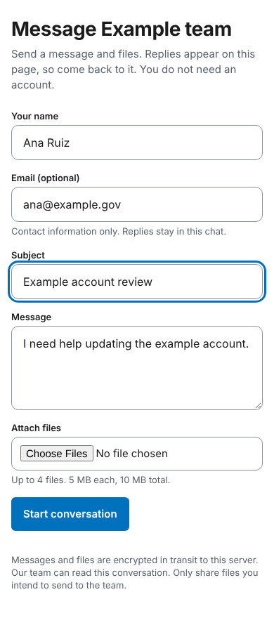 | 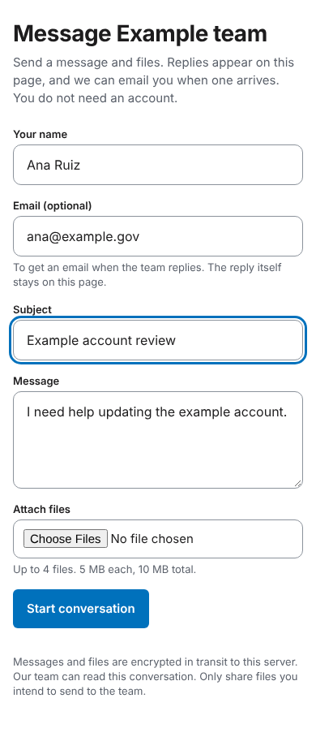 |
| Desktop | 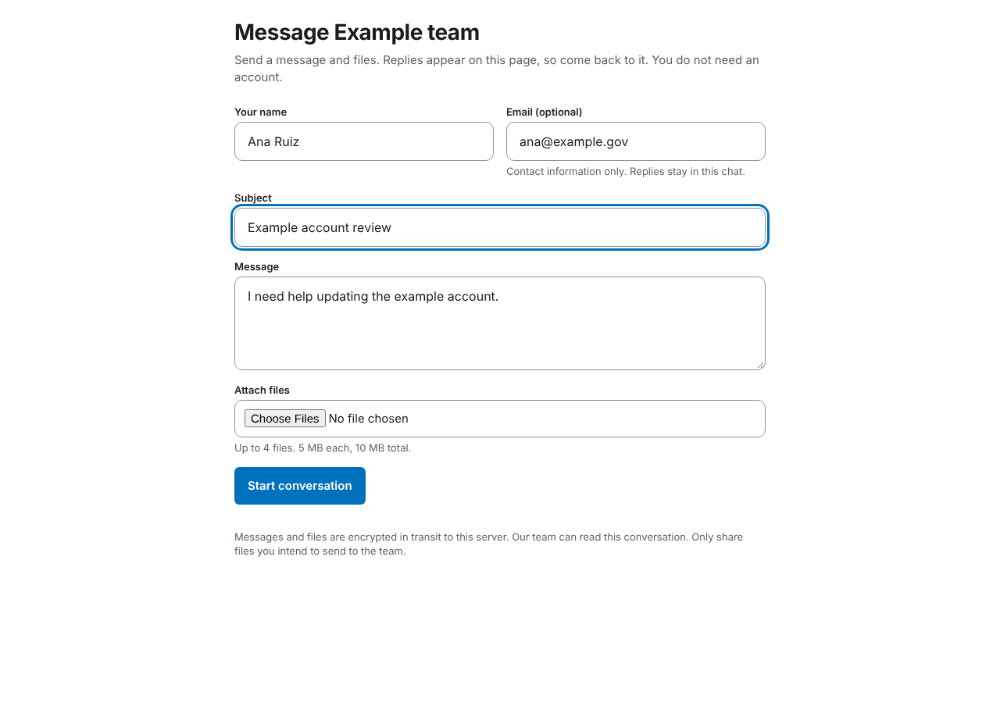 | 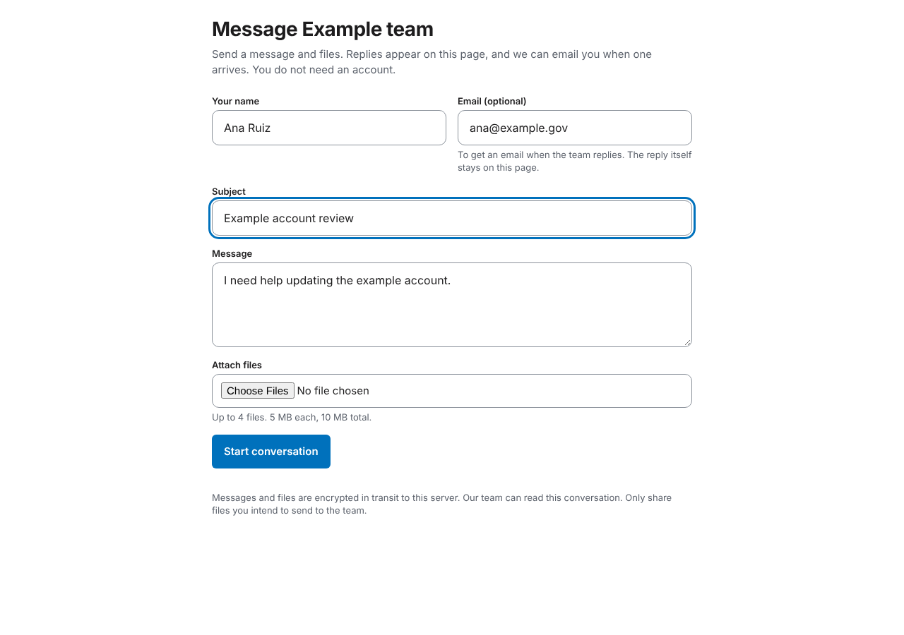 |

### Straight after the first message

Before, nothing would ever tell the visitor a reply had come: the only word on it is "There are no email notifications" at the bottom of the page. After, the page confirms the message was sent and asks for the code it emailed.

| Viewport | Before | After |
| --- | --- | --- |
| Phone | 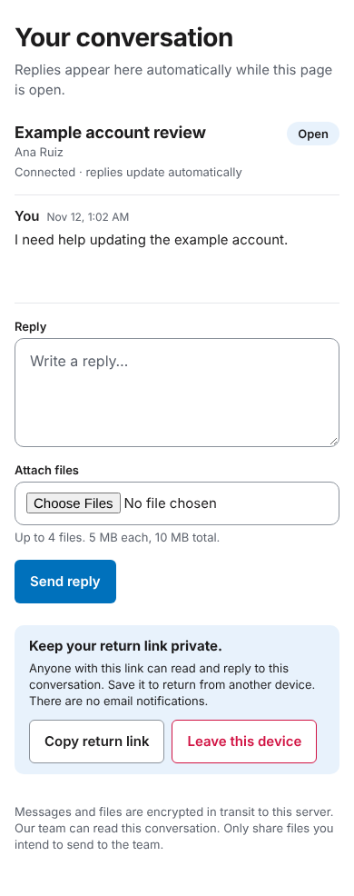 | 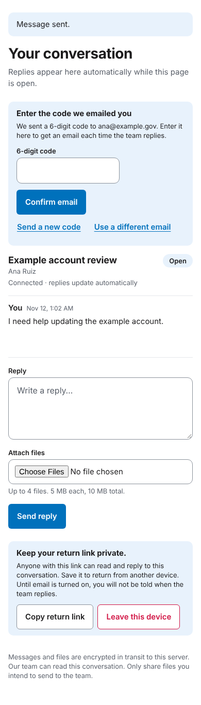 |
| Desktop | 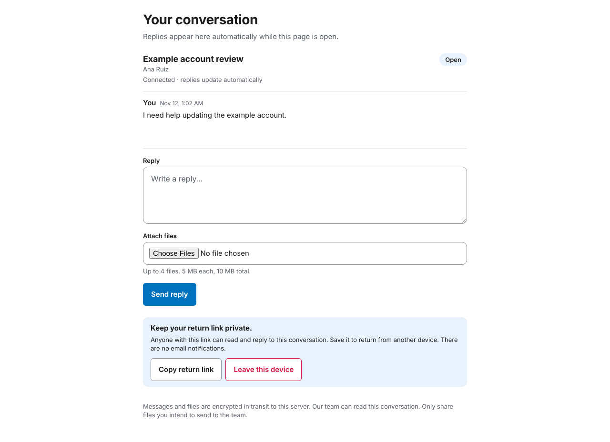 | 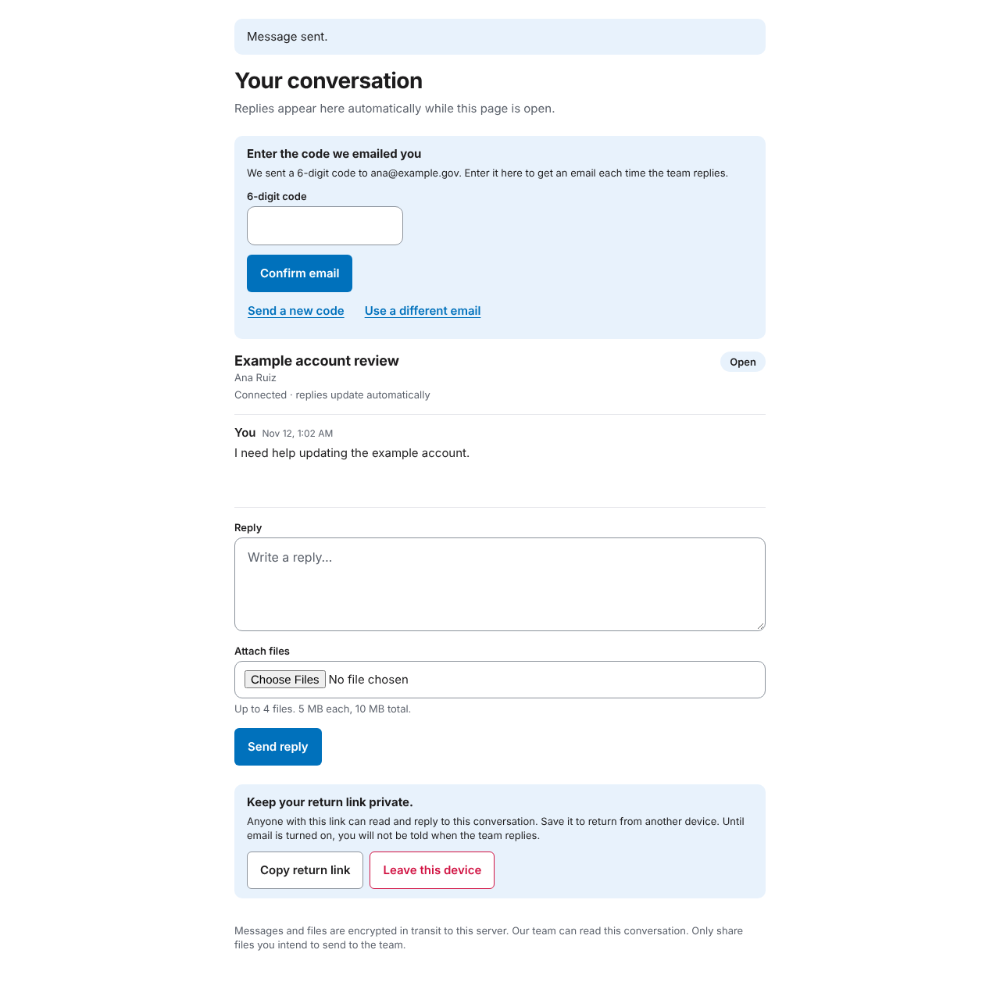 |

### What the team sees

Before, a case said the address was unverified and nothing about whether the visitor would see a reply. After, with the visitor's code entered, it says the address is confirmed and that they are emailed.

| Viewport | Before | After |
| --- | --- | --- |
| Desktop | 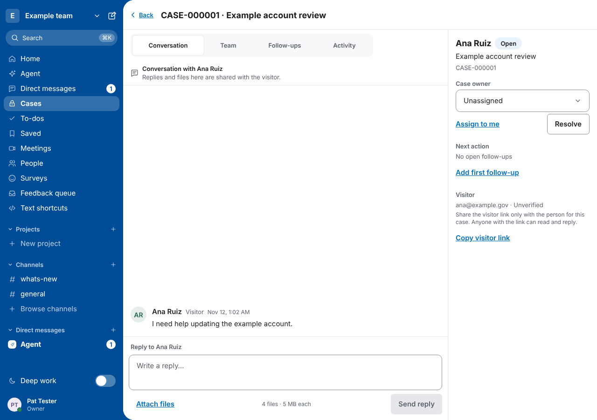 | 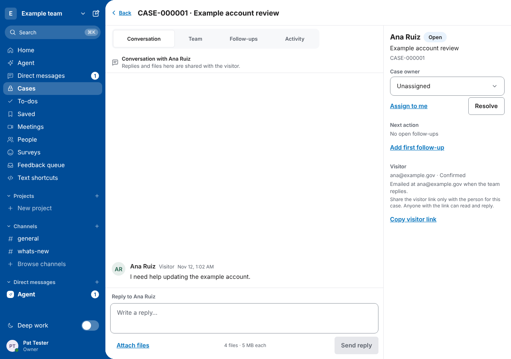 |
| Phone, Details open | 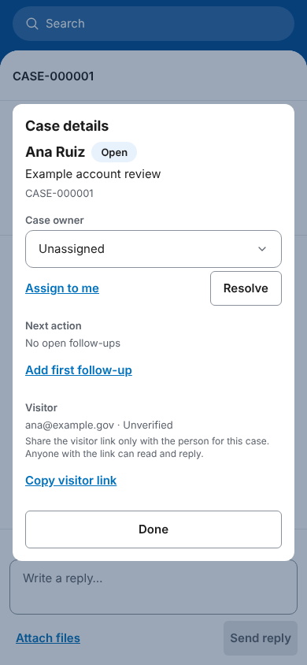 | 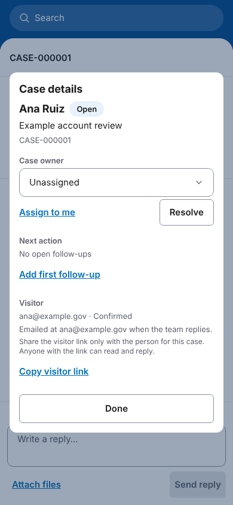 |

## The visitor's side, step by step

One conversation from the first message to **Stop emails**, as `scripts/secure-inbox-reply-email-e2e.mjs` runs it. The visitor is on a phone; the team is in a wide window. None of this exists on `main`, so there is no before.

| | Who | What happens | Screen |
| --- | --- | --- | --- |
| 1 | Visitor | Writes to the team and gives an email address. | 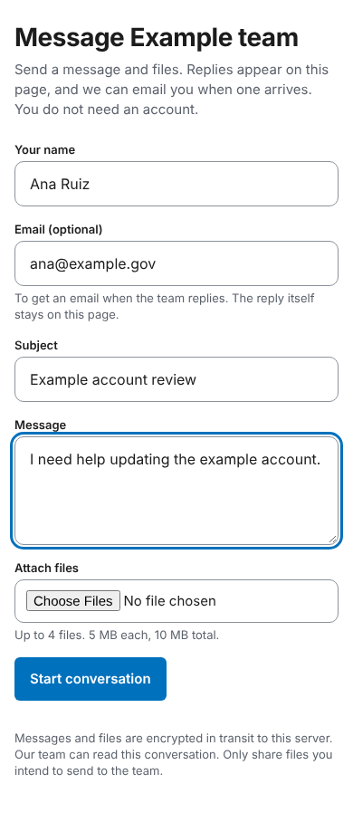 |
| 2 | Visitor | The message is sent. The page asks for the code it just emailed. |  |
| 3 | Email | The first email: a code, to prove the address is theirs. | 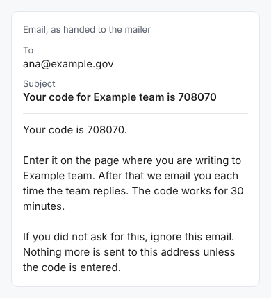 |
| 4 | Visitor | With the code entered, they are emailed each time the team replies. | 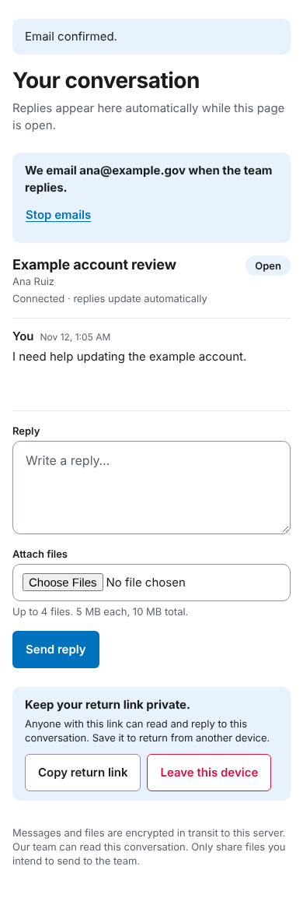 |
| 5 | Team | The visitor has closed the page. The team replies; the case says the visitor is emailed at a confirmed address. | 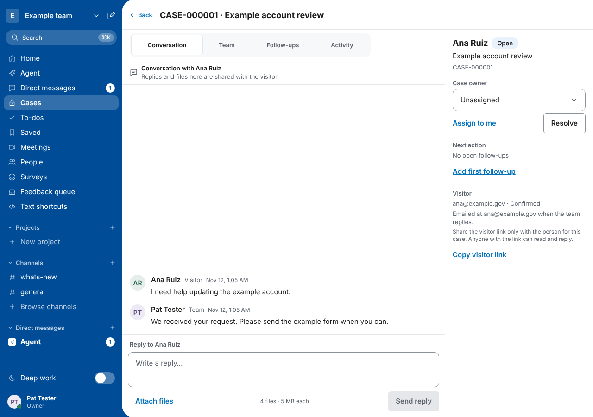 |
| 6 | Email | The reply email: a private link, and nothing from the conversation. | 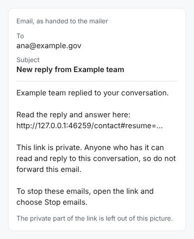 |
| 7 | Visitor | On another device, the link opens the conversation with the reply. | 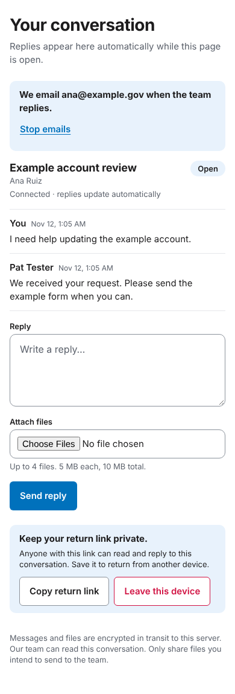 |
| 8 | Visitor | Answers and attaches a file. | 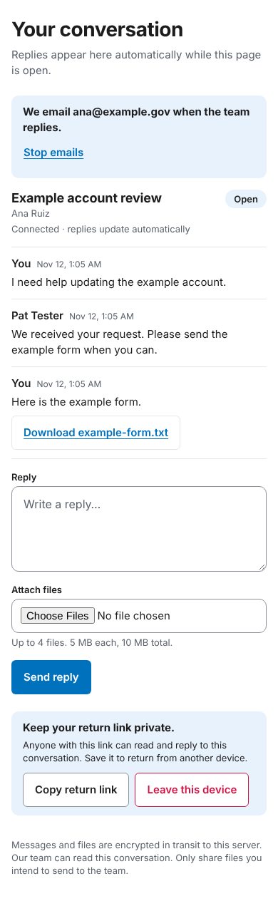 |
| 9 | Visitor | The team's next reply was emailed too. The case is resolved and can still be answered. | 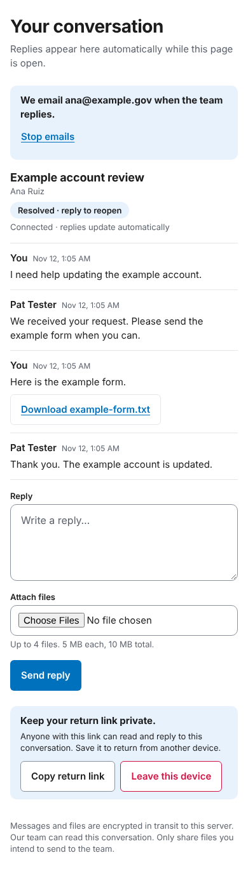 |
| 10 | Visitor | **Stop emails** turns them off. They can be turned on again in the same place. | 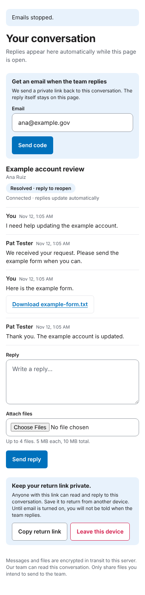 |
| 11 | Visitor | On a server that sends no email, the page says so and offers the return link. | 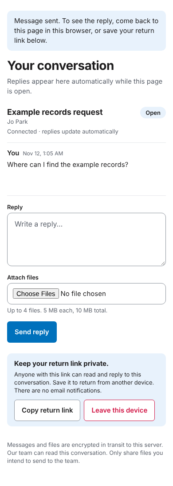 |

The two email pictures are the exact recipient, subject and text the server handed to the mailer command, drawn on a plain page by the check. No mail program or provider is involved. The private part of the link in the reply email is left out of the picture. The code shown belonged to a throwaway server that no longer exists.

## What these do not show

Dark appearance (the check runs in it with `SERVANT_INBOX_CAPTURE_SCHEME=dark`), a wrong or expired code, the limits on codes and emails, and a mailer that fails. The server tests and the browser check cover those.

## How they were made

The before and after pairs came from two clean checkouts, each running `server/server.mjs` on a loopback address and Expo web for that checkout. A made-up visitor, Ana Ruiz at `ana@example.gov`, wrote the same message on both; Pat Tester is the made-up teammate. The capture refused a checkout with changed app or server source and failed on any sideways overflow.

The step-by-step screens are the screenshots the browser check saves as it runs:

```sh
node scripts/secure-inbox-reply-email-e2e.mjs
```

It starts its own server and web build, and fails if any email contains message text, the subject, a file name, a person's name or the case reference. Push delivery and discovery were off, and no request left the machine. Every image was reviewed for readability and private information; none shows a real person, address or credential.
