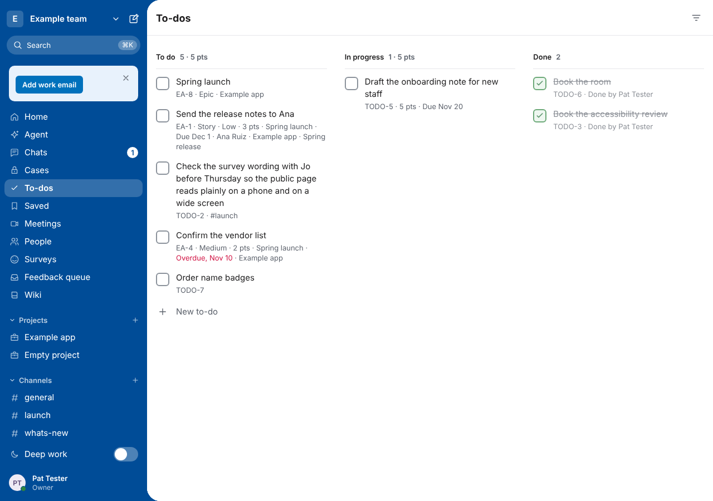
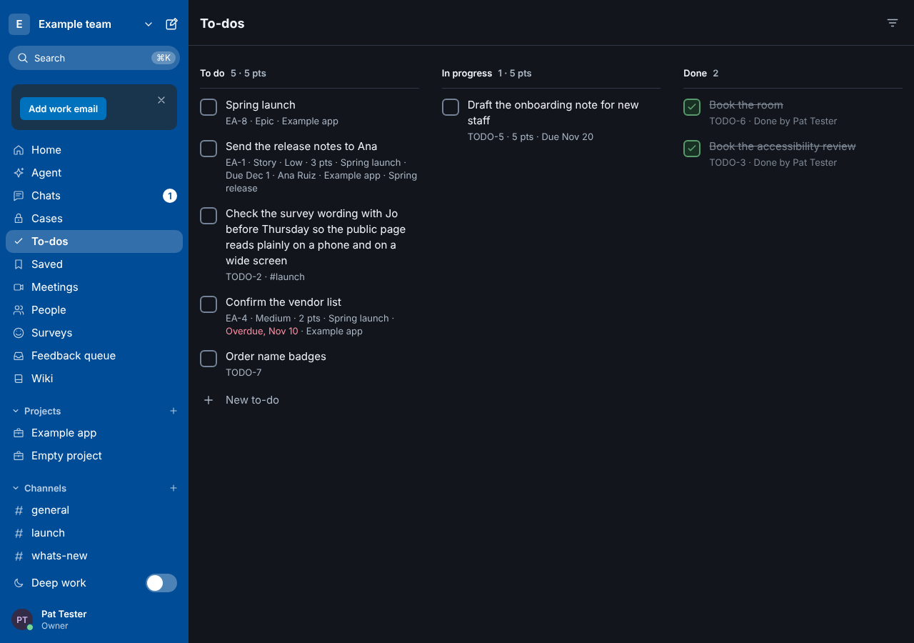

# The main pane beside the sidebar: square corners

Actual browser screenshots, 1280 × 900, device scale 1, English, a made-up workspace.

- **Before:** `a85e220`. The white pane was rounded at its top-left and bottom-left corners, where it meets the sidebar.
- **After:** this change. The pane meets the sidebar in a straight edge.

| Before (light) | After (light) | After (dark) |
| --- | --- | --- |
|  |  |  |

A phone has no sidebar, so nothing changes there. There is no dark "before" capture; the corners were the same in
both appearances.
