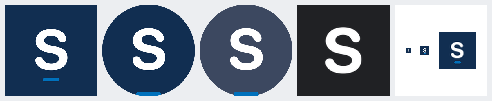
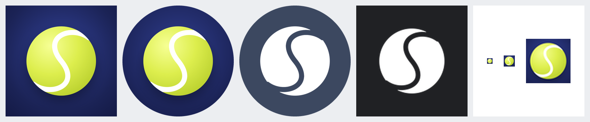
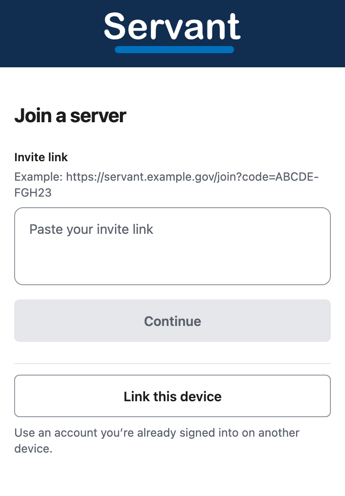
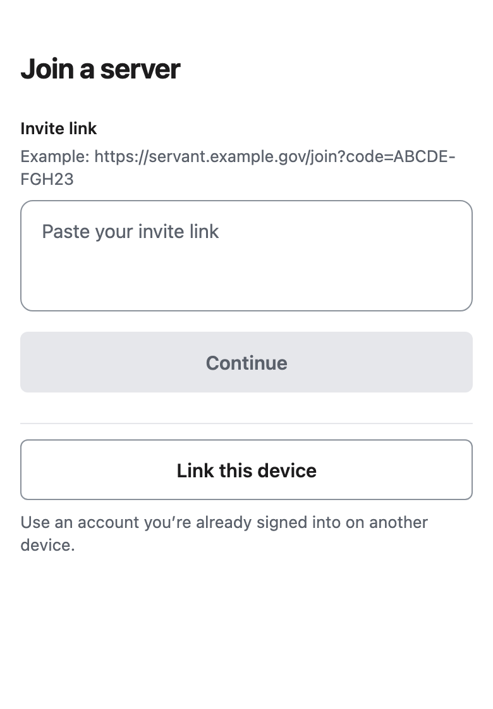
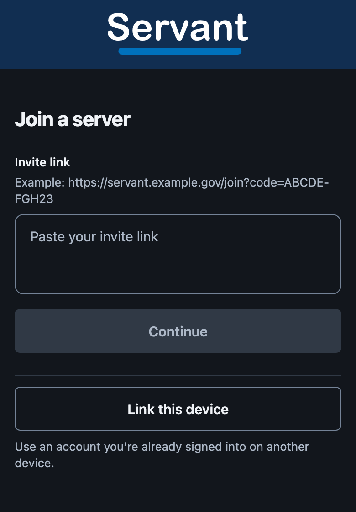
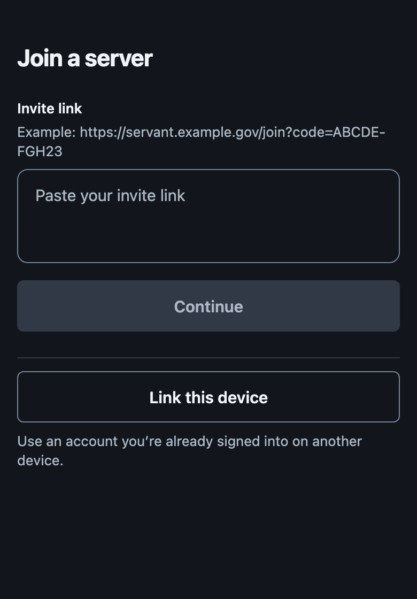
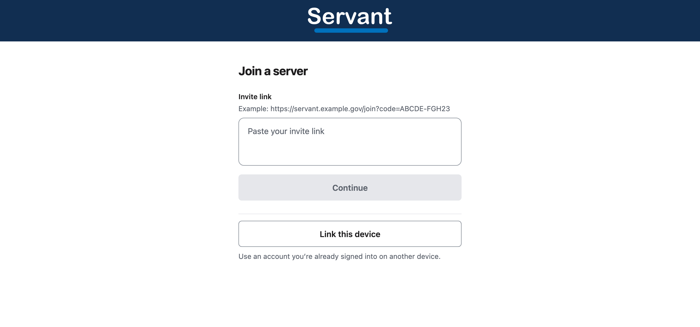
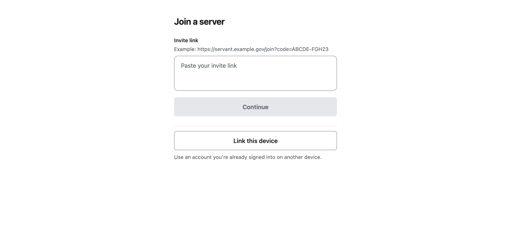
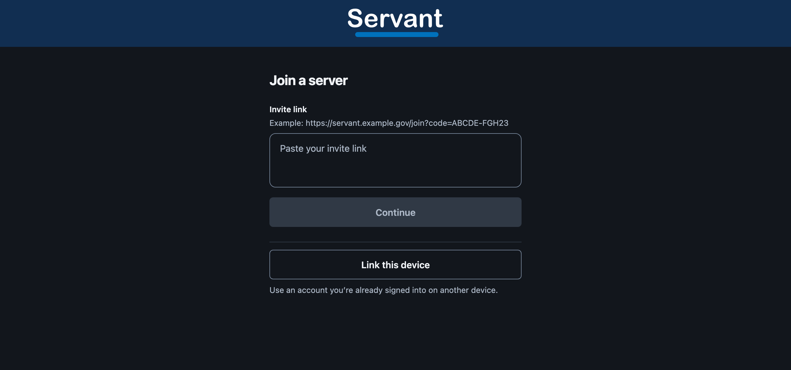
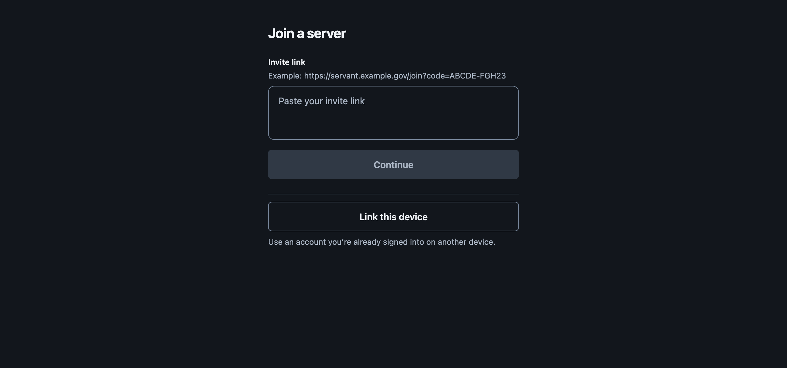

# The tennis ball icon, and no logo on Join a server: before and after

The app icon is now a tennis ball on a navy field whose seam is a white S (Servant helps people serve). The app's colors are unchanged. The Servant wordmark and its navy band are gone from the first screens (Join a server, and sign-in on the Mac and in a browser): they open on the page title.

- **Before:** `main`.
- **After:** this branch.

## The icon files

The icon, the Android adaptive icon in a round launcher mask, the one-color shape for Android themed icons, the status-bar icon, and the favicon at 16, 32 and 128 pixels. These are the files themselves, composed the way a launcher, a themed icon and a status bar use them; they were not photographed on a phone.

| Before | After |
| --- | --- |
|  |  |

## Join a server

Real browser screenshots from the running app at phone size (390 wide) and desktop size (1280 wide), device scale 2, cropped above the footer.

| | Before | After |
| --- | --- | --- |
| Phone, light |  |  |
| Phone, dark |  |  |
| Desktop, light |  |  |
| Desktop, dark |  |  |
