# To-dos as a board: before and after

These are actual browser screenshots from running builds. They are not mockups or edited images.

- **Before:** `main` at `da83711`.
- **After:** the board, built on that commit. Full hashes and checksums are in [manifest.json](manifest.json).
- **Phone:** 390 × 844 with touch. **Desktop:** 1280 × 900. Device scale 1, light appearance, English.
- Both sides ran their own server on a copy of the same made-up workspace with the same six to-dos. The after side
  also holds what only it can: two due dates and one to-do that has been started.

## The screen

Before: one list of open to-dos, with finished ones behind a switch. After: three columns by status, and a line
under the words that says when a to-do is due.

| Viewport | Before | After |
| --- | --- | --- |
| Desktop | 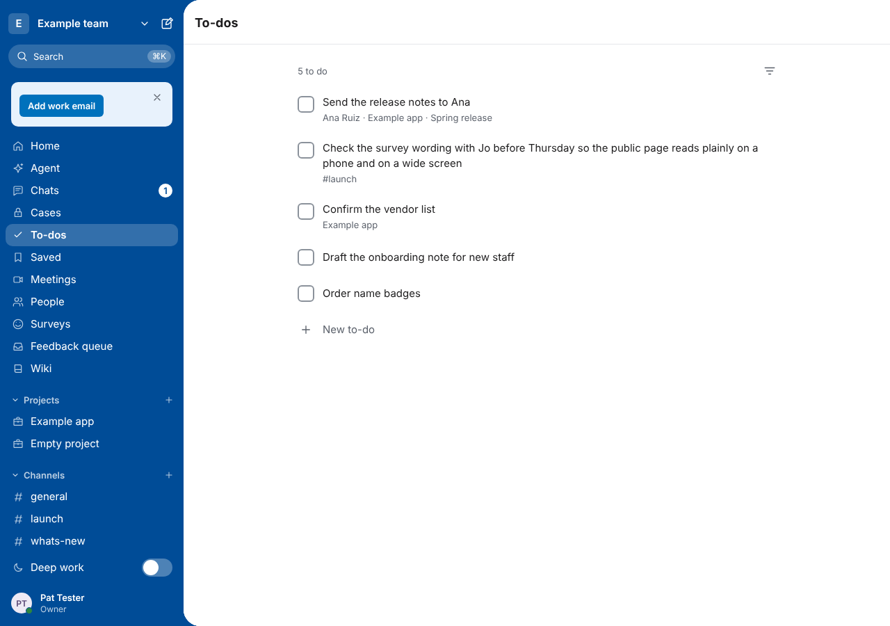 | 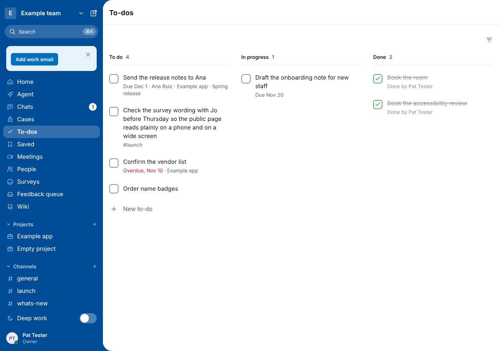 |
| Phone | 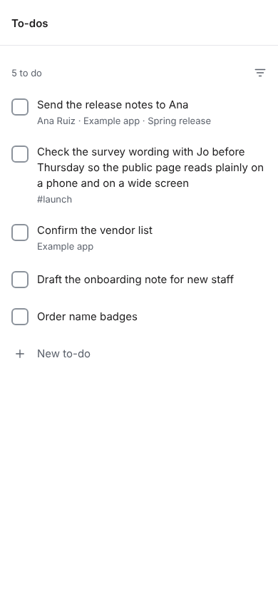 | 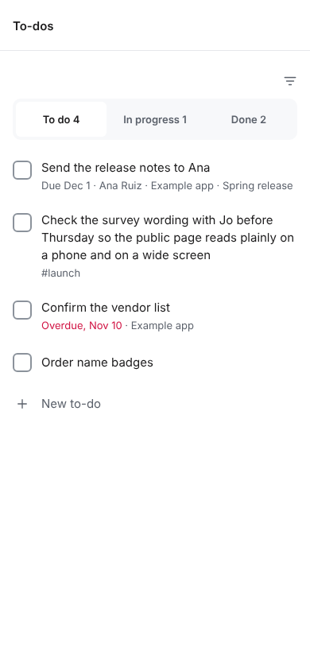 |

"Send the release notes to Ana" has no date of its own, so it is due with its release, Dec 1. "Confirm the vendor
list" was due Nov 10 and the captures were taken on Nov 14, so it is overdue and its day is red.

## New: moving a card

These screens did not exist before. With a mouse, a card is dragged onto another column, which is outlined while the
card is over it. On a phone one column shows at a time and the row being edited offers the move.

| | |
| --- | --- |
| A card held over In progress | 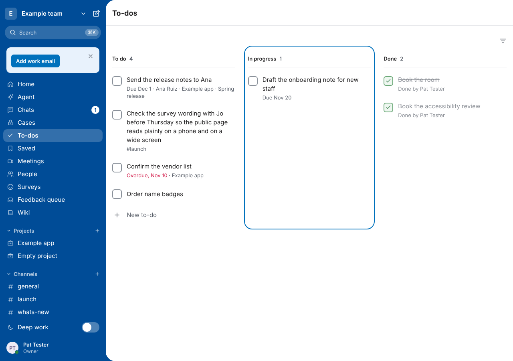 |
| After the drop | 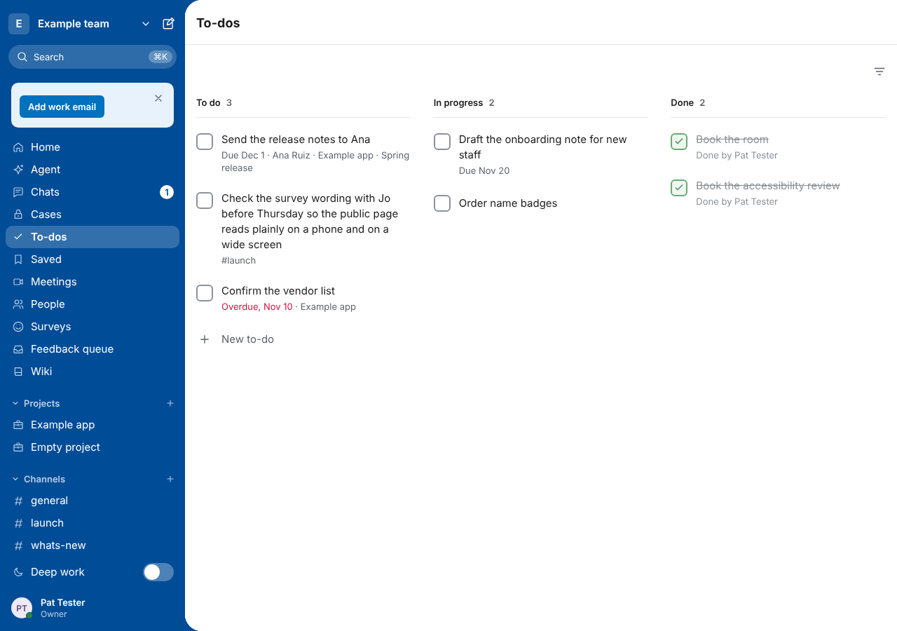 |
| The row being edited, on a phone | 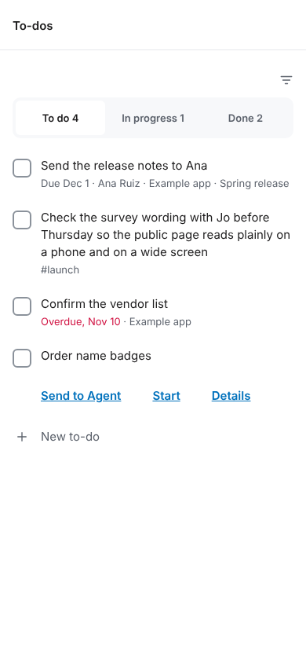 |
| In progress on a phone | 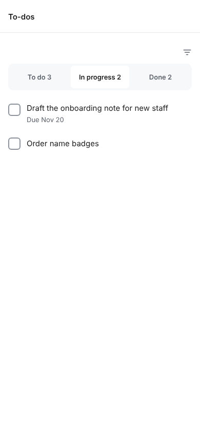 |
| Done on a phone | 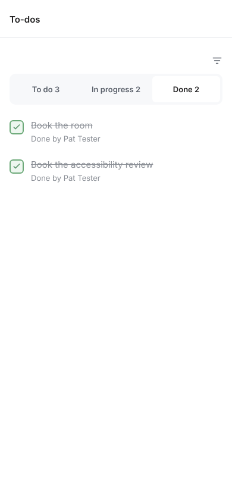 |

## New: a due date, and the board for one project

| | |
| --- | --- |
| Details: a due date, and what happens without one | 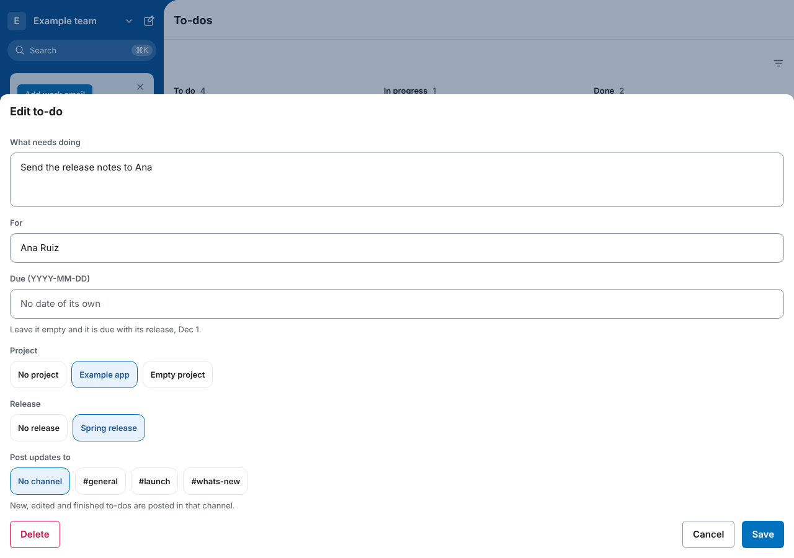 |
| The board filtered to one project | 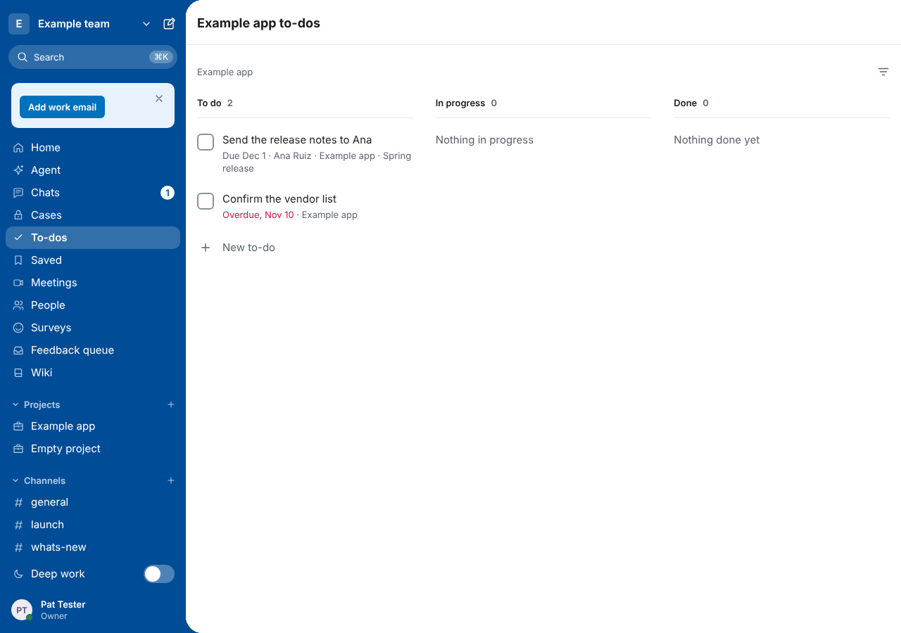 |

## What the run checked

The script that took the after captures also drove the board and failed on any difference: each to-do is in its own
column; the three due lines read "Due Dec 1", "Due Nov 20" and "Overdue, Nov 10" with the overdue one in another
color; a card dragged To do, In progress, Done and back to To do lands in each and is ticked only in Done; ticking and
unticking; Start and Move to To do from the row; a due date of "soon" and of Feb 30 are refused with a message, Nov 25
is saved, and clearing it shows the release's date again; and no screen scrolls sideways.
