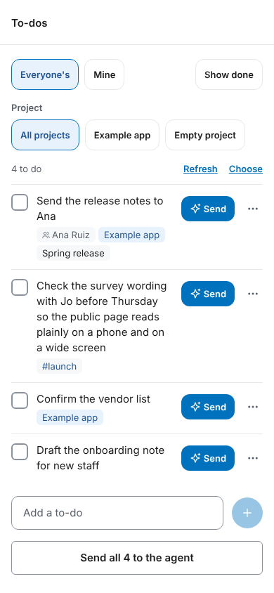
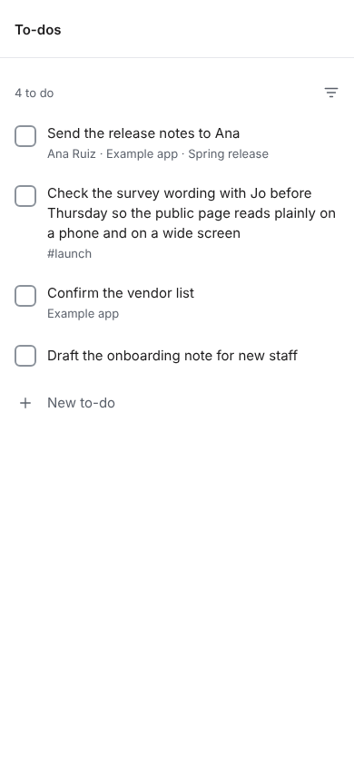
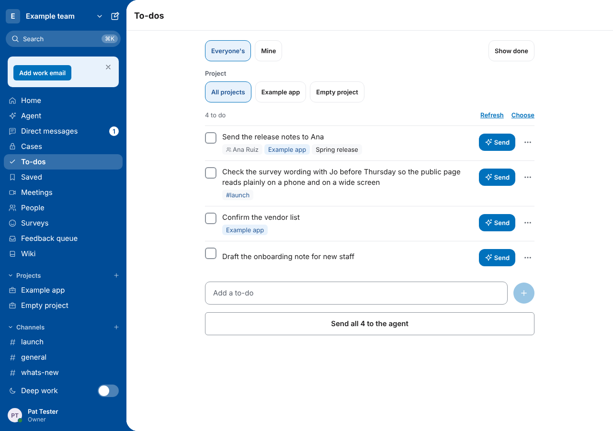
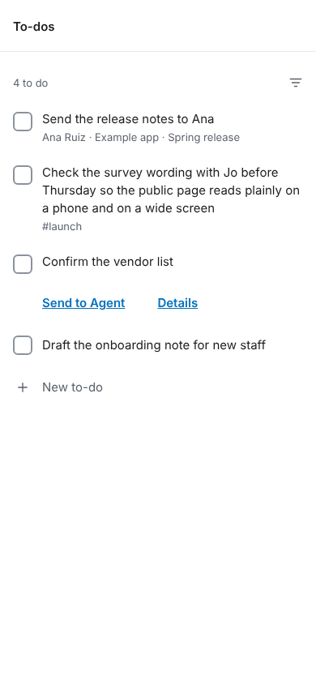
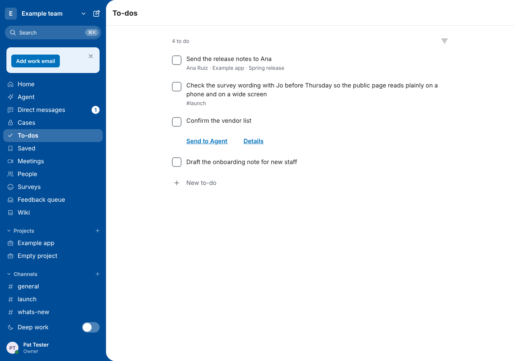
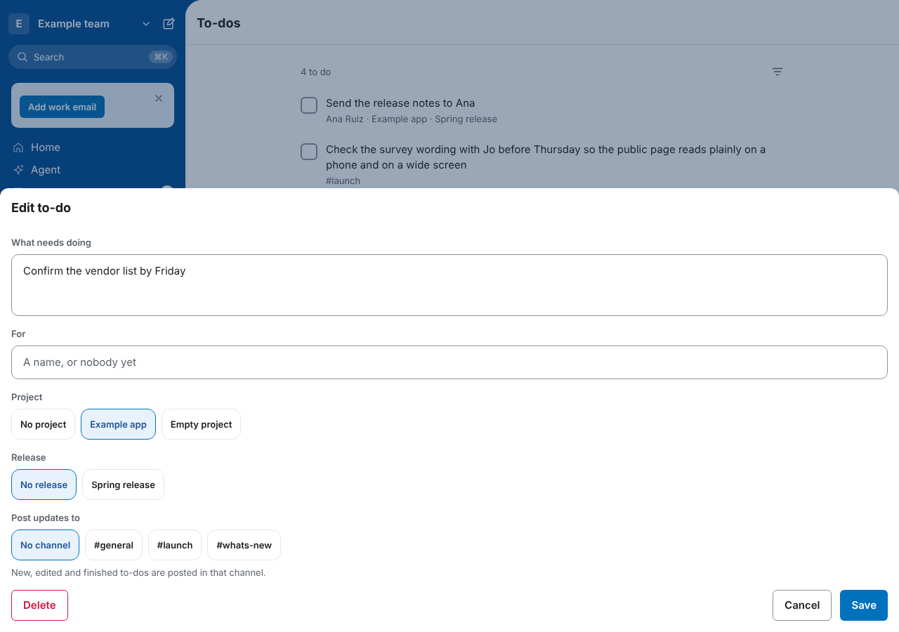
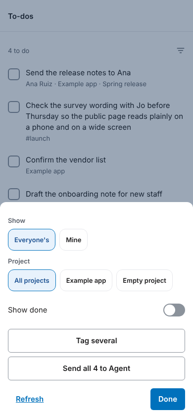
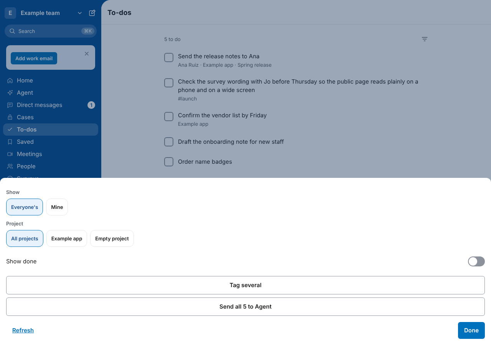
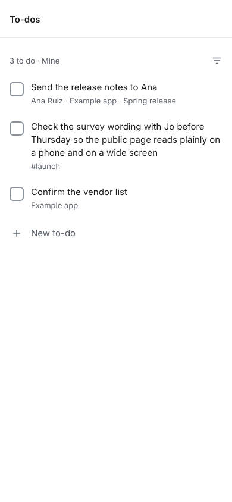
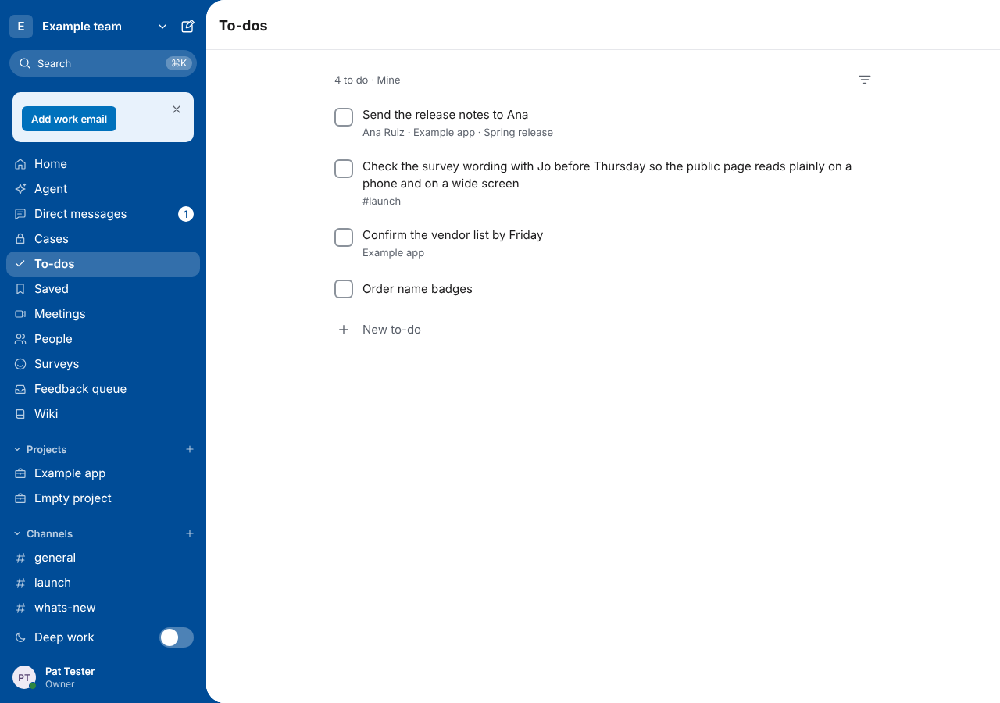

# To-dos as a plain list: before and after

These are actual browser screenshots from running builds. They are not mockups or edited images.

- **Before:** `main` at `0896b83`.
- **After:** the branch at `2157759`. Full hashes and checksums are in [manifest.json](manifest.json).
- **Phone:** 390 × 844 with touch. **Desktop:** 1280 × 900. Device scale 1, light appearance, English.
- Both sides ran their own server on a copy of the same made-up workspace with the same four to-dos.

## The list

Before: two rows of filter chips, Refresh and Choose, and on every row a Send button, a grip and colored tags. After: a box to tick and the words, with one quiet line for who it is for and where it belongs.

| Viewport | Before | After |
| --- | --- | --- |
| Phone |  |  |
| Desktop |  |  |

## New: a row offers its options only while it is being edited

Tapping the words puts the caret in them, in place. Only that row then shows Send to Agent and Details.

| | Phone | Desktop |
| --- | --- | --- |
| Editing a row |  |  |
| Details, from the row being edited | |  |

## New: one icon for the list as a whole

The filters, tagging several and sending all moved behind the icon above the list. With a filter on, the line above the list says so.

| | Phone | Desktop |
| --- | --- | --- |
| Filter and options |  |  |
| A filter is on |  |  |
