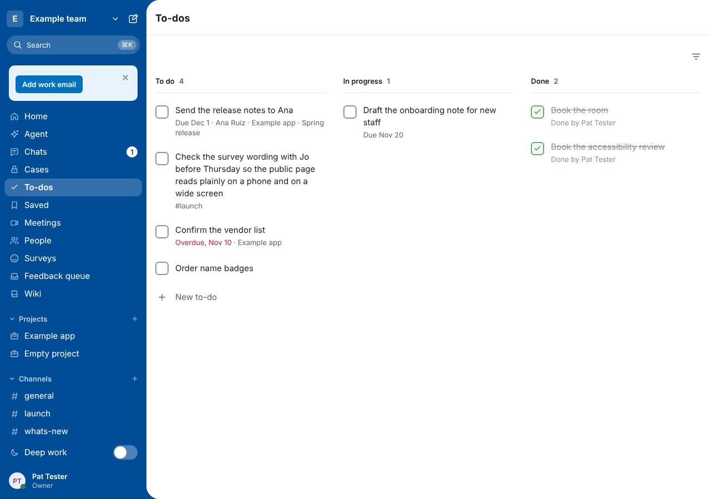
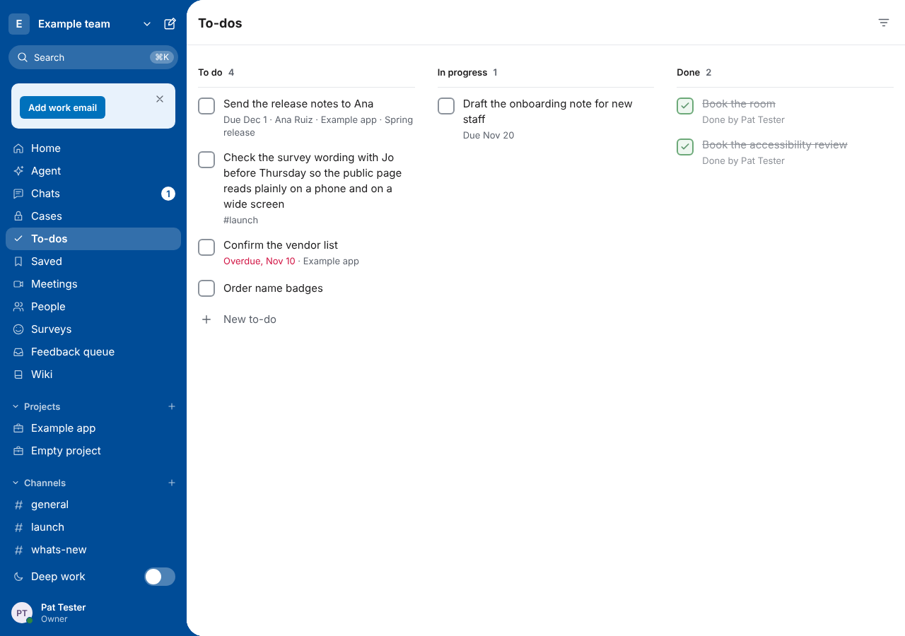
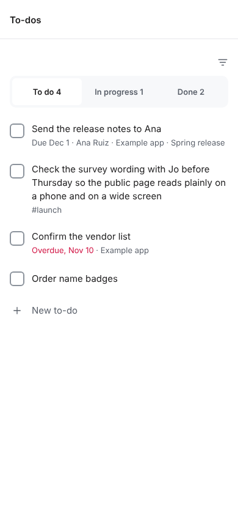
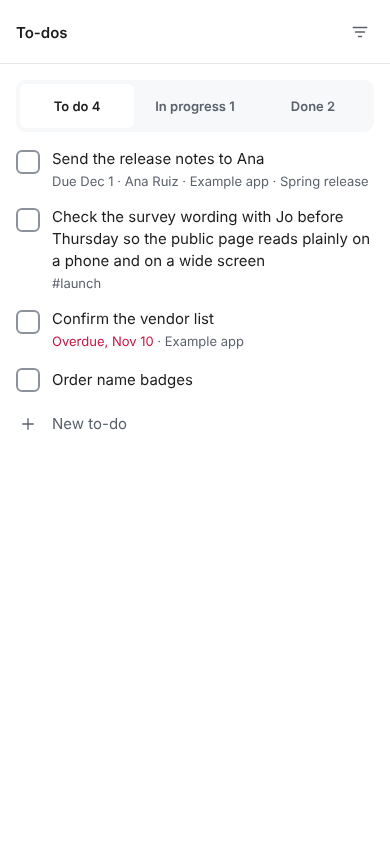
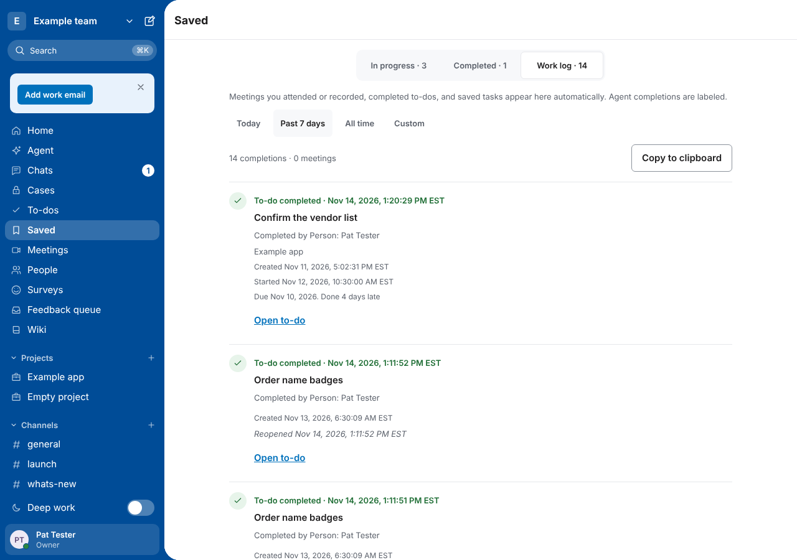
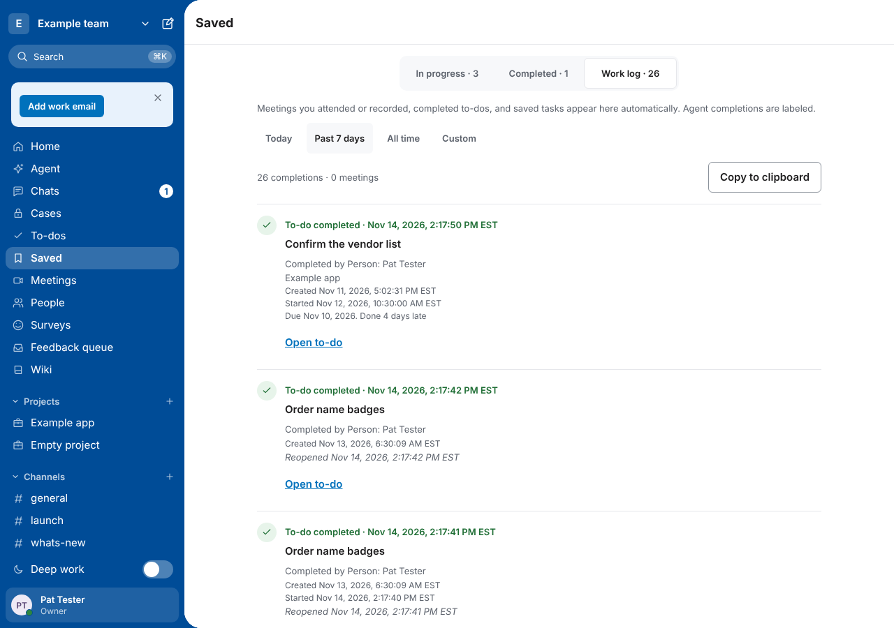
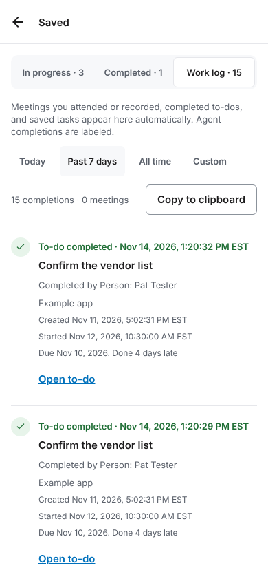
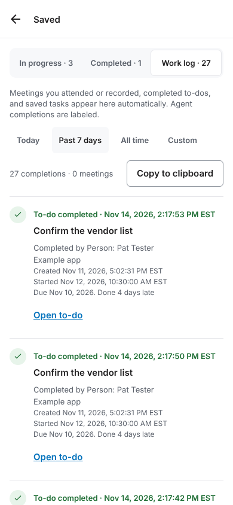

# To-dos and work log: less vertical space

Actual browser screenshots from running builds, not mockups.

- **Before:** `main` at `612bb4c` (the captures in [../todos-board](../todos-board/README.md)).
- **After:** this change, built on that commit.
- **Phone:** 390 × 844 with touch. **Desktop:** 1280 × 900. Device scale 1, light appearance, English. The same made-up workspace on both sides.

What changed: the board's filter and options button is in the screen's header, top right, instead of on an empty
line above the board; the lines of the list are closer together; and the facts under a finished to-do in the work log
read as one block.

| | Before | After |
| --- | --- | --- |
| Board, desktop |  |  |
| Board, phone |  |  |
| Work log, desktop |  |  |
| Work log, phone |  |  |

The scripts that took the after captures also ran the board and the work log end to end (drags, due dates, Start,
the work log entry) and failed on any difference or sideways scroll.
