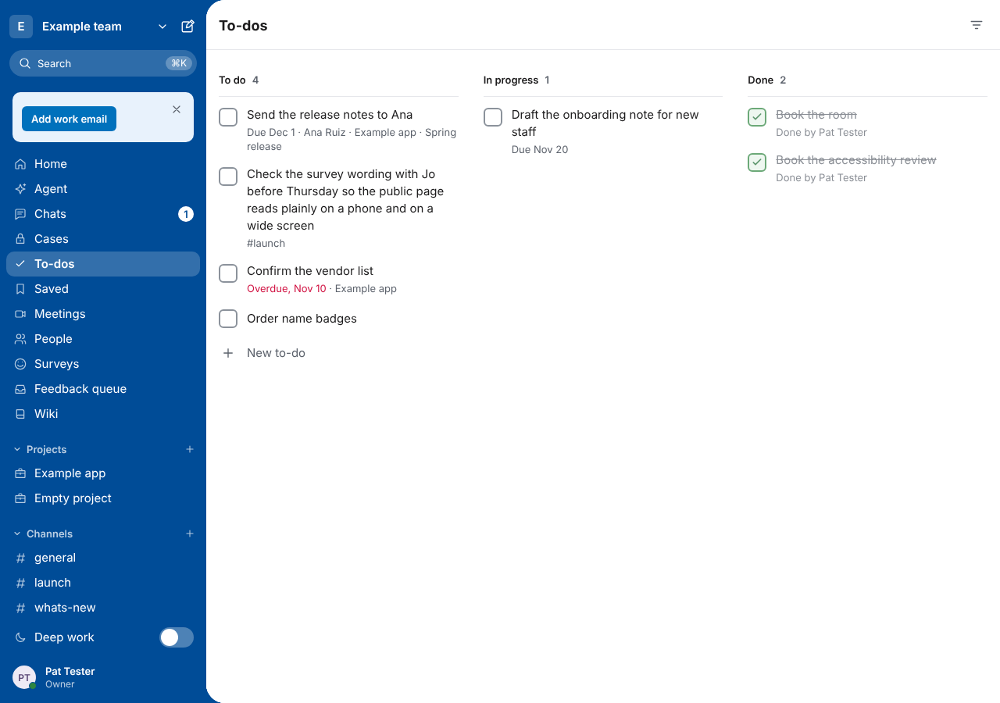
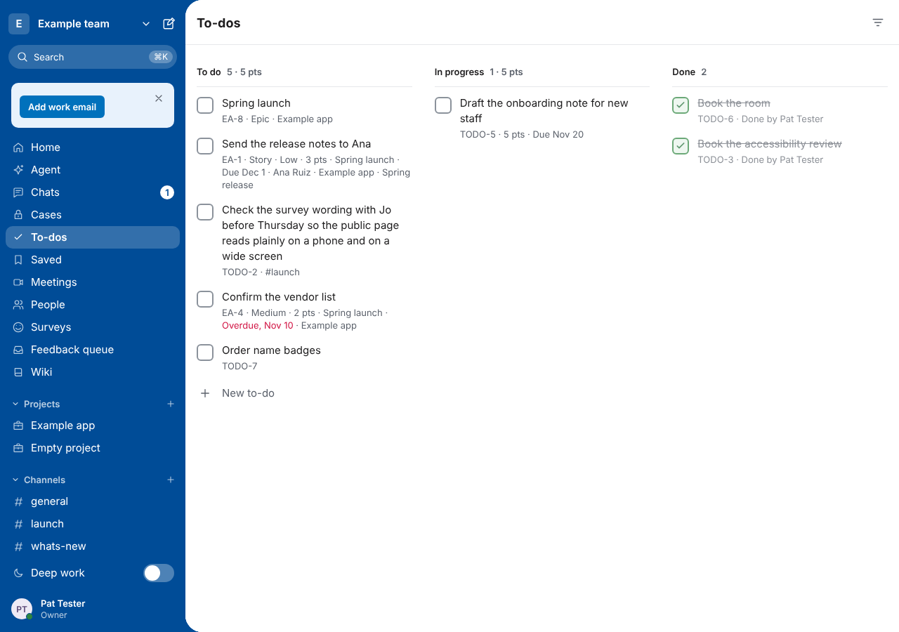
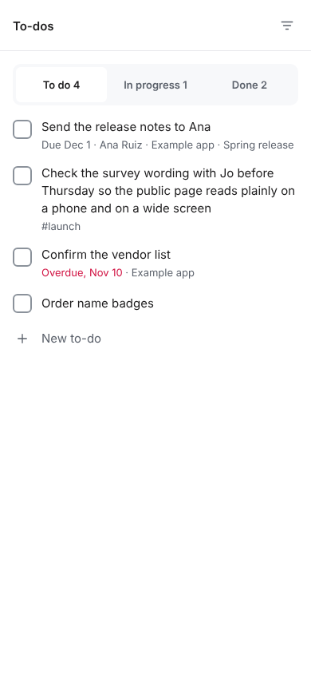
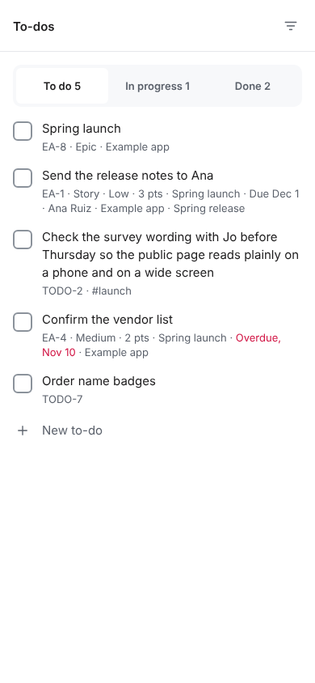
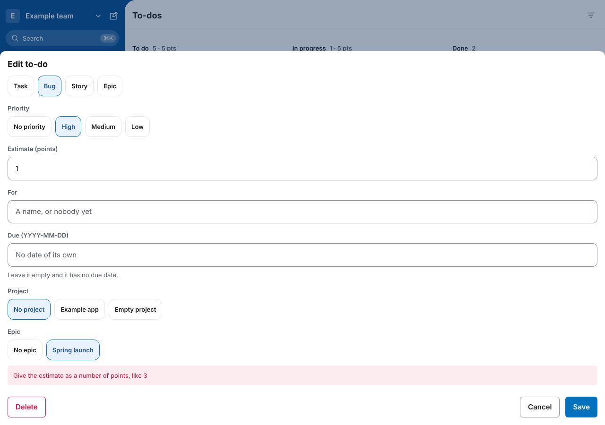
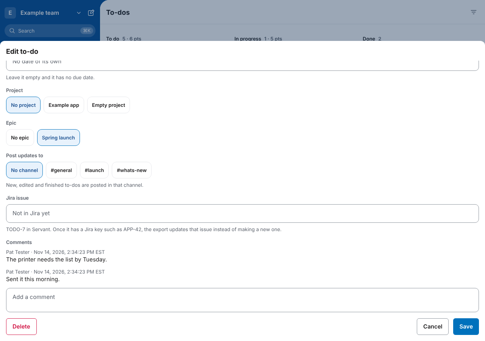
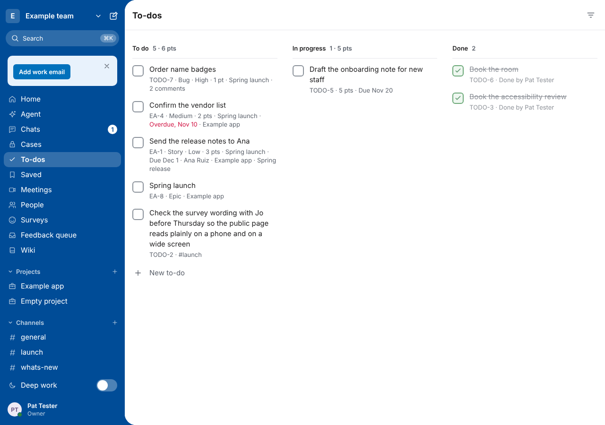
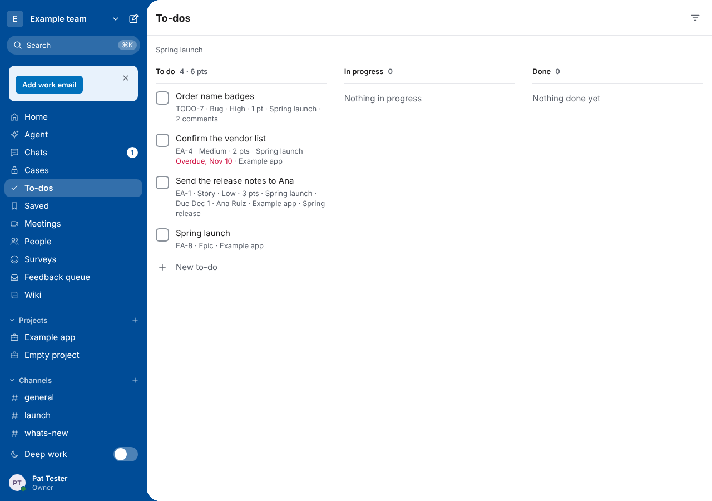

# To-dos as a tracker: before and after

Actual browser screenshots from running builds, not mockups.

- **Before:** the board without the tracker's fields, at `0efcd57` (the captures in [../todos-spacing](../todos-spacing/README.md)).
- **After:** this change.
- **Phone:** 390 × 844 with touch. **Desktop:** 1280 × 900. Device scale 1, light appearance, English. A made-up
  workspace; on the after side some to-dos were given a type, a priority, an estimate and an epic.

| Viewport | Before | After |
| --- | --- | --- |
| Desktop |  |  |
| Phone |  |  |

## New in Details

These fields did not exist before.

| | |
| --- | --- |
| Description, type, priority and estimate |  |
| Epic, Jira issue and comments |  |
| Sorted by priority, with points in the column headings |  |
| One epic and the to-dos under it |  |

The script that took the after captures also drove the board and failed on any difference: the key line of each card;
an estimate of "lots" is refused with a message; a to-do made a high-priority bug of 1 point under an epic shows
"Bug · High · 1 pt · Spring launch"; two comments are added without closing the sheet and the card then says
"2 comments"; sorting by priority puts the high one first; choosing an epic shows only its to-dos; no sideways scroll.
