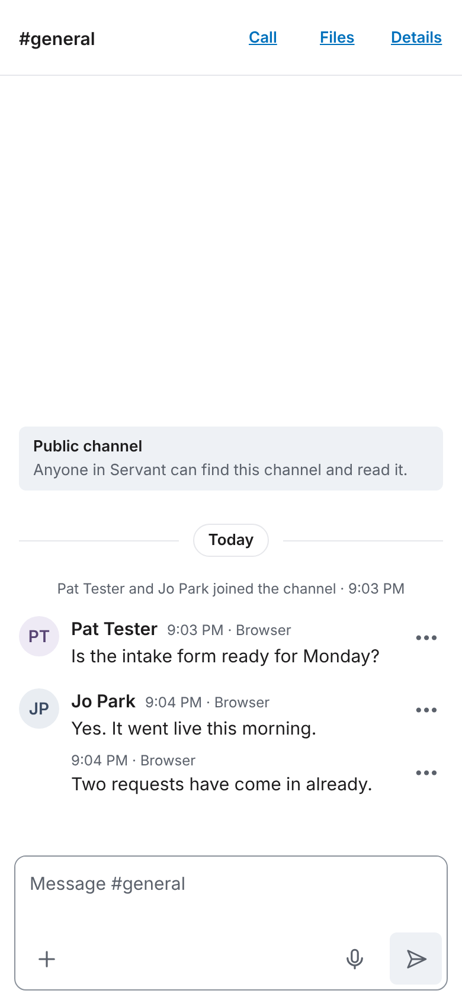
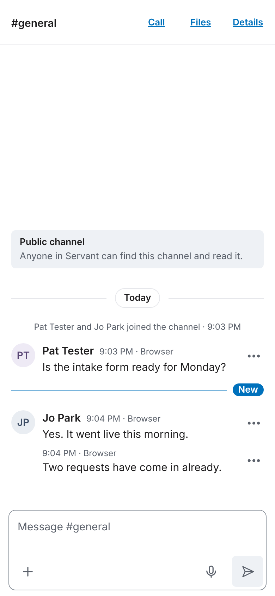
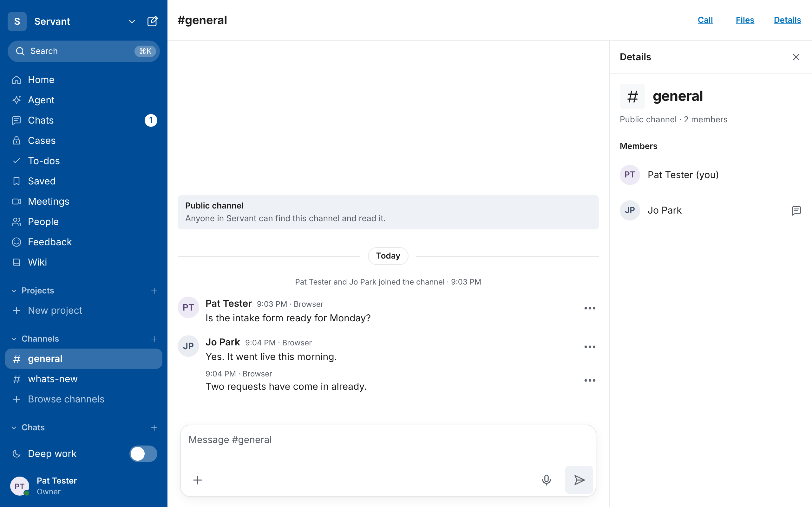
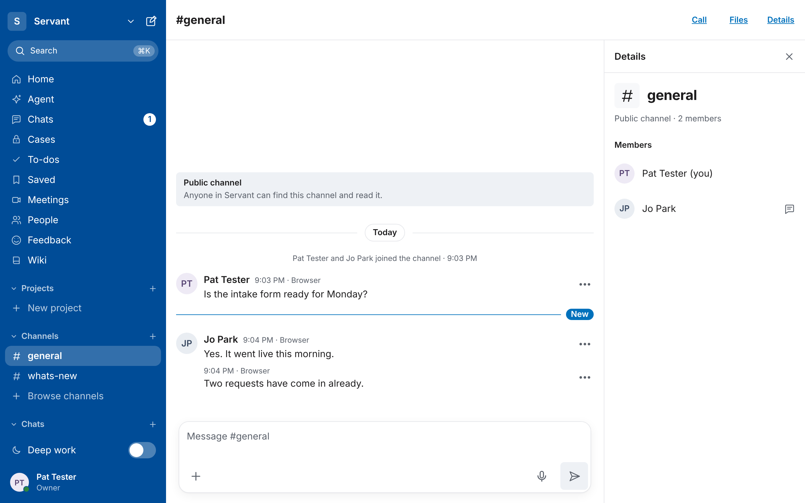
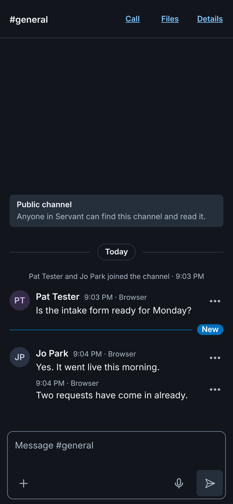

# The New line: before and after

Opening a conversation with unread messages gave no sign of where they began. A line marked **New** now sits above the first one.

Real browser screenshots from the running app against a throwaway local server, phone 390 × 844 and desktop 1280 × 800, device scale 2.

- **Before:** `main` at `1989903`.
- **After:** the branch at `5eeb71c`.
- Made-up workspace with two placeholder people. Pat Tester asks a question in #general and reads everything; Jo Park answers twice while Pat is elsewhere; Pat opens #general.
- Both sides show the same unread state: for these captures the page was stopped from telling the server the messages were seen, so opening the channel on one side did not mark them read for the other. Both sides ran against the branch's server, whose new field `main`'s app ignores.

| | Before (`1989903`) | After (`5eeb71c`) |
| --- | --- | --- |
| Phone |  |  |
| Desktop |  |  |
| Phone, dark | not captured; no line either |  |

## What did not exist before

- **Coming back.** Pat read the answers, a third arrived while Pat was looking (no line for it), then Pat opened Files and a fourth arrived. Back in #general, the line has moved above the fourth: [after/returned-phone-light.png](after/returned-phone-light.png).
- **Nothing new.** Opened again after reading everything, there is no line: [after/read-phone-light.png](after/read-phone-light.png).

## What the run checked

The same two-person run, on the branch, without holding anything back:

```
1 open with two unread: line above the first new message: true
2 after the messages are marked read: line still there: true
3 a message arrives while looking: still one line, in the same place: true
4 back from Files: one line, now above what arrived while away: true
5 opened again with nothing new: no line: true
6 tab hidden and shown: line above what arrived while hidden: true
```

Not seen on a phone: there is no iPhone, simulator or Android device where these were taken. Nothing in the change is specific to a platform, but the app going to the background and returning was only exercised as a browser tab being hidden and shown.
