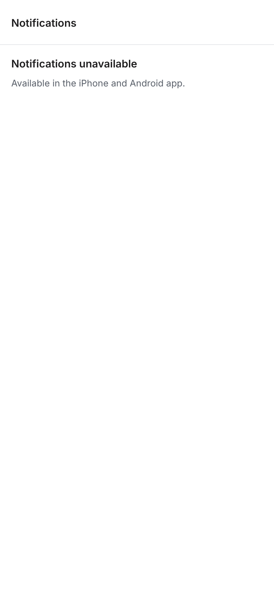
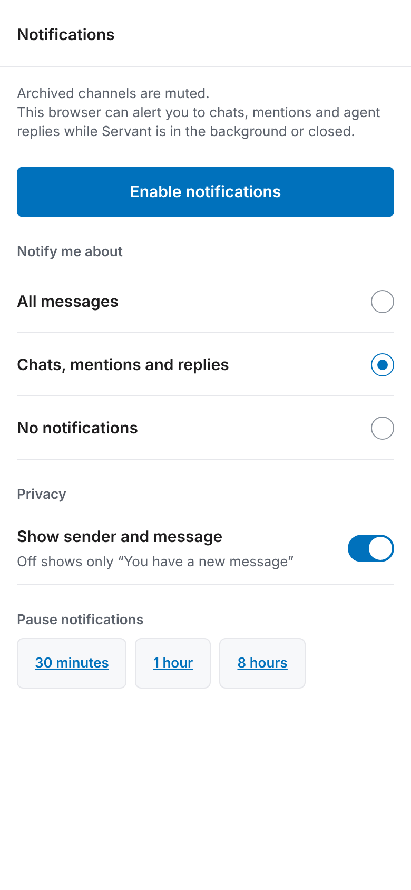
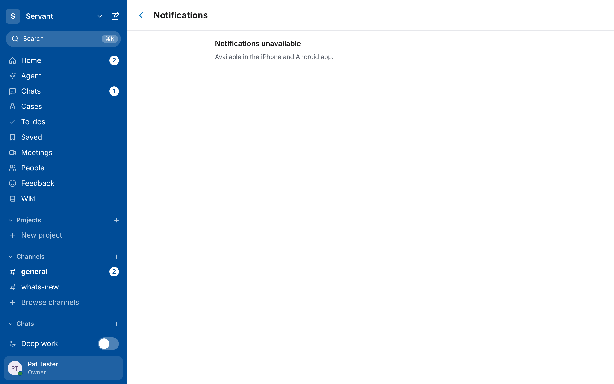
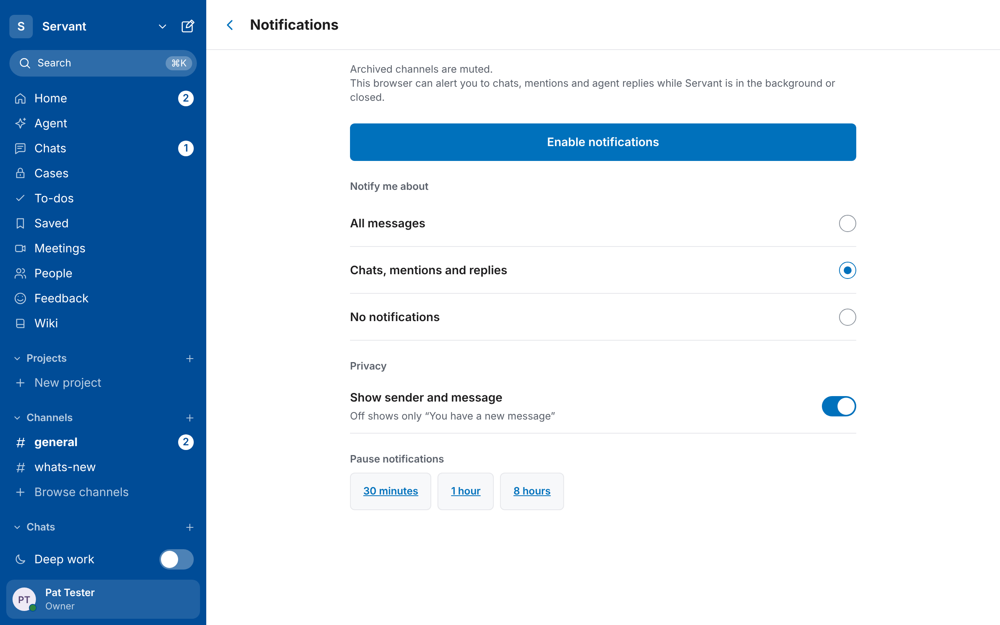
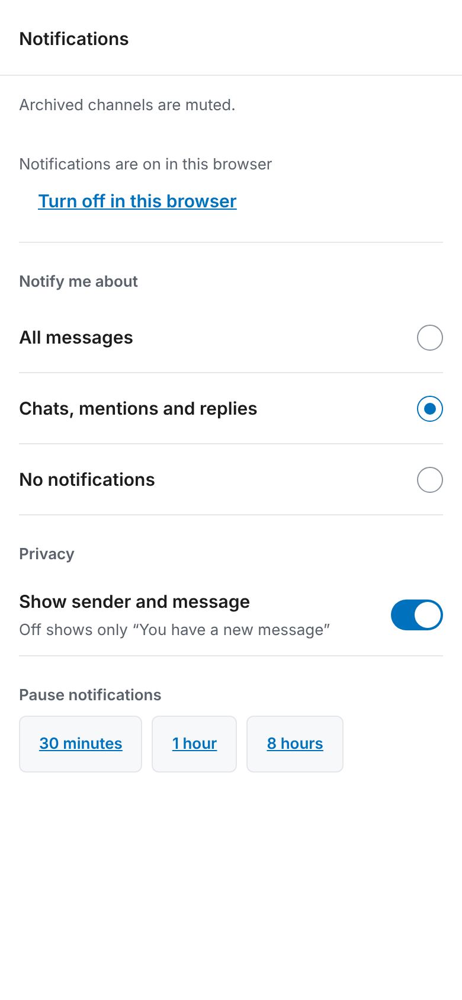
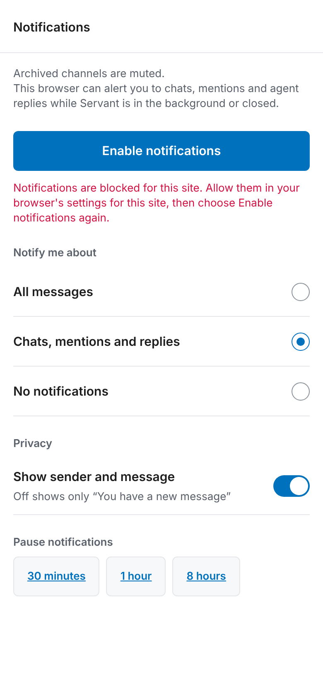
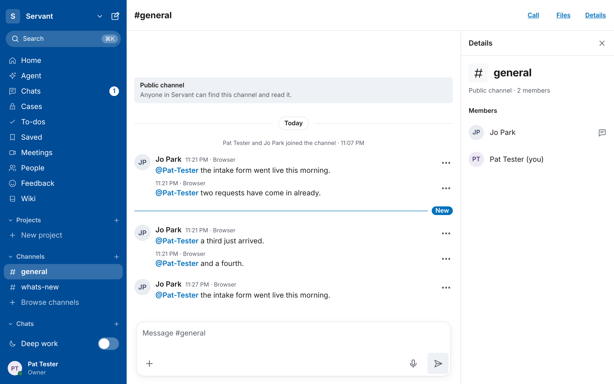

# Notifications in a browser: before and after

The web app could not alert anyone: its Notifications screen said they were only in the phone apps. A browser can now be alerted through web push.

Real browser screenshots from the running app against a throwaway local server, phone 390 × 844 and desktop 1280 × 800, device scale 2, in Chromium 153.

- **Before:** `main` at `f375f79`.
- **After:** the branch at `fa179ec`.
- Made-up workspace with two placeholder people, Pat Tester and Jo Park.

| | Before (`f375f79`) | After (`fa179ec`) |
| --- | --- | --- |
| Phone |  |  |
| Desktop |  |  |

## What did not exist before

| Turned on | The browser blocks notifications | After clicking an alert |
| --- | --- | --- |
|  |  |  |

Turned on, desktop: [after/settings-on-desktop.png](after/settings-on-desktop.png).

**Not pictured: the alert itself.** It is drawn by the operating system, which a headless browser does not have. What the service worker asked the browser to show is in the run below (step 4).

## What the run checked

Pat turns notifications on, Jo writes, and the alert is followed from the server to the screen. One thing is stood in for: this Chromium has no push service to subscribe to ("Registration failed - permission denied"), so subscribing returns the test's own address and keys, and the server's request to that address is caught instead of going to Google. The test opens the sealed message with the browser's keys and hands it to the service worker, as a push service would. The app, the service worker and the server are the real ones.

```
before (main): the Notifications screen says "Notifications unavailable. Available in the iPhone and Android app."
a real subscription in this Chromium (permission granted): cannot subscribe: Registration failed - permission denied
1 off: the screen offers Enable notifications and has asked the browser for nothing: true
2 on: one registration under /push/<server>/: true · subscribed with a 65-byte server key: true
3 a mention while Pat is elsewhere: requests to the push service: 1
  to the subscription address: true · signed with the server key the browser subscribed with: true · nothing readable in it: true · 338 bytes
  opened with the browser's keys: {"title":"Jo Park in #general","body":"@Pat-Tester the intake form went live this morning.","tag":"ch_…","data":{"userId":"usr_…","deviceId":"dev_…","conversationId":"ch_…","messageId":"11"}}
4 the service worker shows: [{"title":"Jo Park in #general","body":"@Pat-Tester the intake form went live this morning.","tag":"ch_…","data":{"userId":"usr_…","deviceId":"dev_…","conversationId":"ch_…","messageId":"11"}}]
5 clicked: Servant opens the conversation: true · the alert is taken down: true
6 a mention in the conversation Pat is reading: requests to the push service: 0
7 with Show sender and message off, the alert opened with the browser's keys: {"title":"Servant","body":"You have a new message","tag":"ch_…","data":{"userId":"usr_…","deviceId":"dev_…","conversationId":"ch_…","messageId":"13"}}
8 started from a click with Servant closed: opens the conversation: true · nothing left after the #: true
9 turned off in this browser: registrations left: 0 · unsubscribed: true · requests to the push service for the next mention: 0
10 the browser blocks notifications: the screen says: "Notifications are blocked for this site. Allow them in your browser's settings for this site, then choose Enable notifications again."
```

Not verified: delivery through a real push service (Google, Mozilla, Apple or Microsoft) and the alert as the operating system draws it. Nothing was tried in Firefox or Safari.
