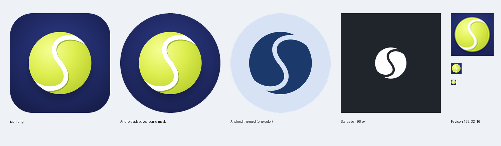
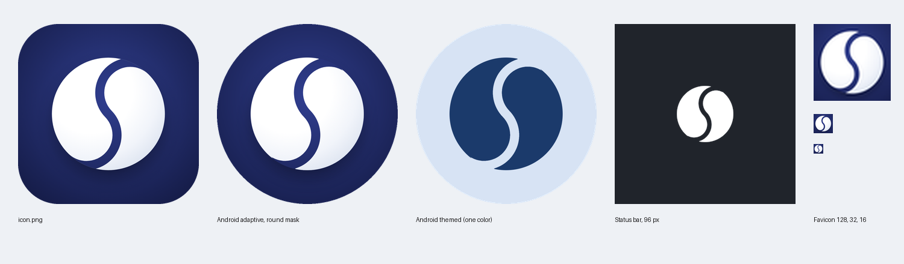
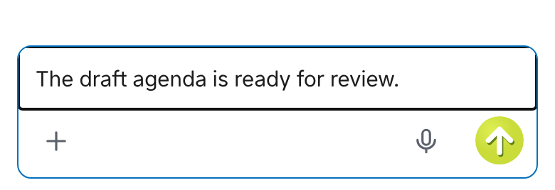
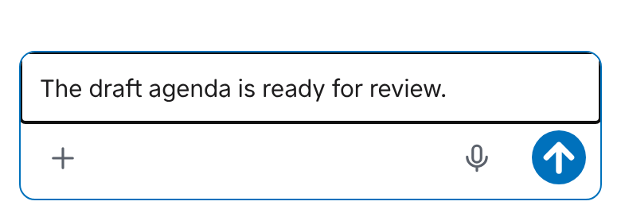
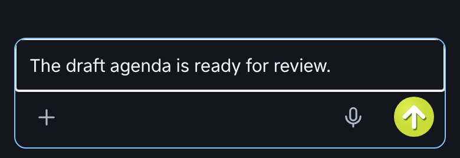
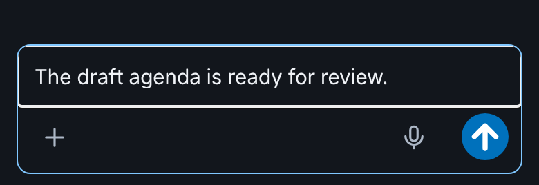
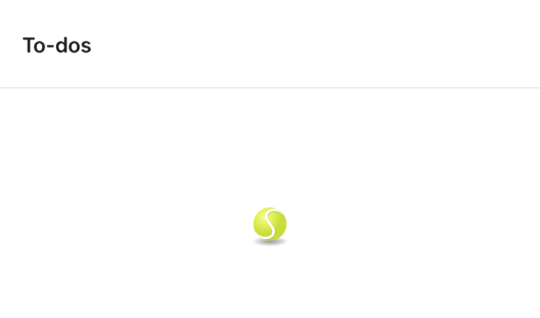
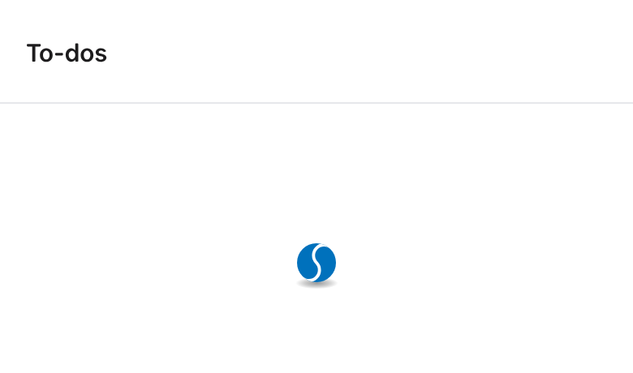
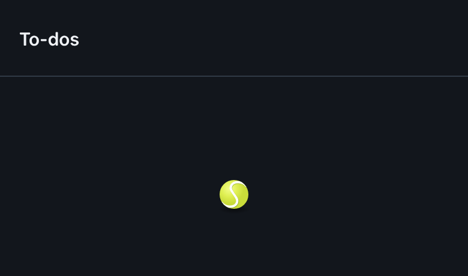
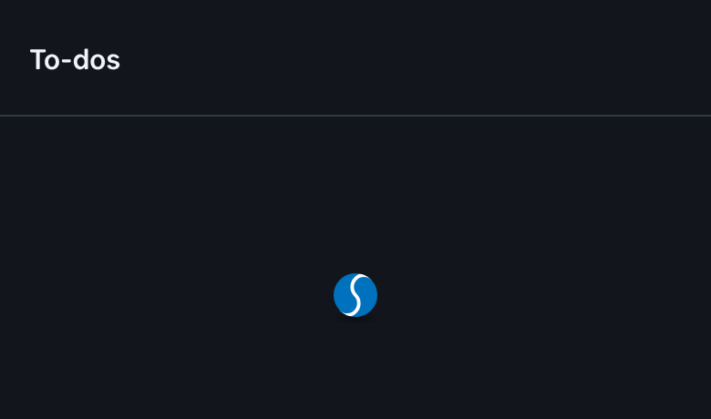

# A white ball on navy, and no yellow-green in the app: before and after

The app icon's ball is now white, and its S is the field's own navy (the same gradient as the field, so it reads as cut through the ball). The S is two equal arcs that meet at the ball's middle, as in a yin-yang, turned 45 degrees, with each end running off the edge as a tennis ball's seam does; the loading ball draws the same path. In the app, the yellow-green is gone: the send button and the loading ball are the primary color with white on them, like a filled button, and the agent's live line breathes between the two blues instead of green and blue. The greens that mean something (available, done) are unchanged.

- **Before:** `main` at `70b45b6`.
- **After:** this branch.

## The icon files

The icon, the Android adaptive icon in a round launcher mask, the one-color shape for Android themed icons, the status-bar icon, and the favicon at 128, 32 and 16 pixels. These are the files themselves, composed the way a launcher, a themed icon and a status bar use them; they were not photographed on a phone.

| Before | After |
| --- | --- |
|  |  |

## The send button

Real browser screenshots from the running app at phone size (390 wide), device scale 2, cropped to the message box of the Agent chat on a new test server (Pat Tester is a made-up person).

| | Before | After |
| --- | --- | --- |
| Light |  |  |
| Dark |  |  |

## The loading ball

To-dos with every answer from the server held back, so the page stays loading. Reduced motion is on, so the ball rests on its shadow and the two captures show the same moment. Same size and scale, cropped to the top of the page.

| | Before | After |
| --- | --- | --- |
| Light |  |  |
| Dark |  |  |

The agent's live line ("Thinking…") is not captured: it needs an agent mid-reply, and the test server has none. Its change is the color under the words, `green` to `blueDark`, covered by `agent-reply-controls.test.ts`.
