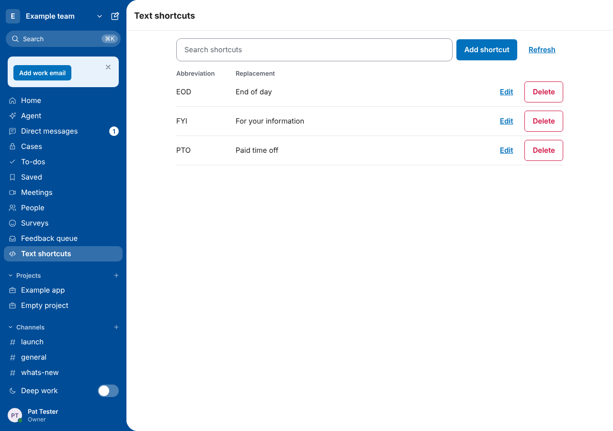
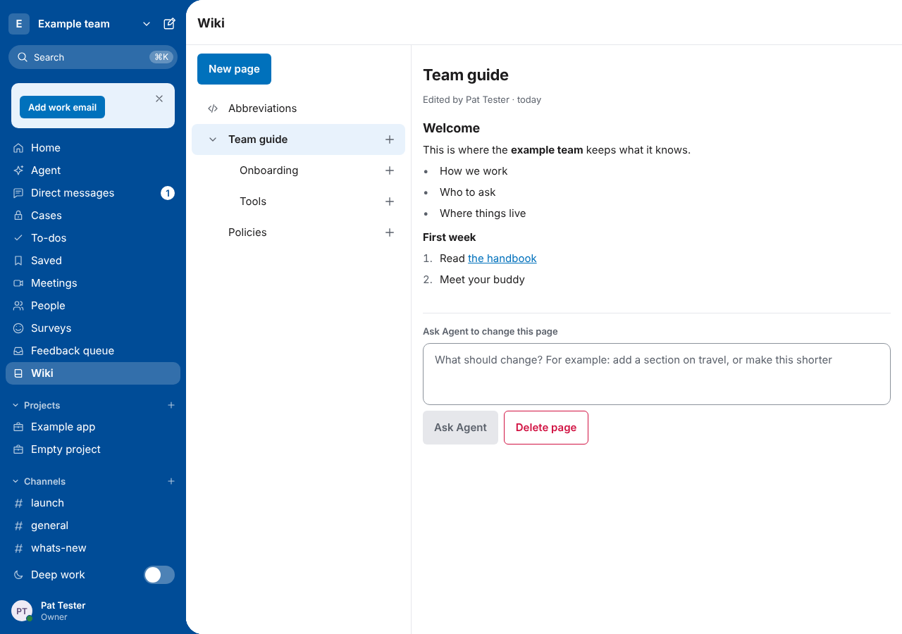
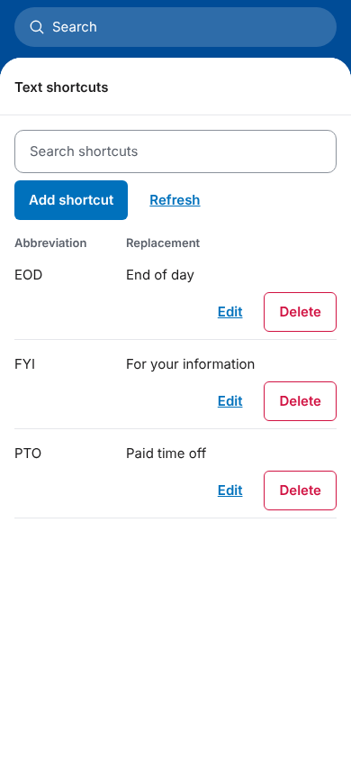
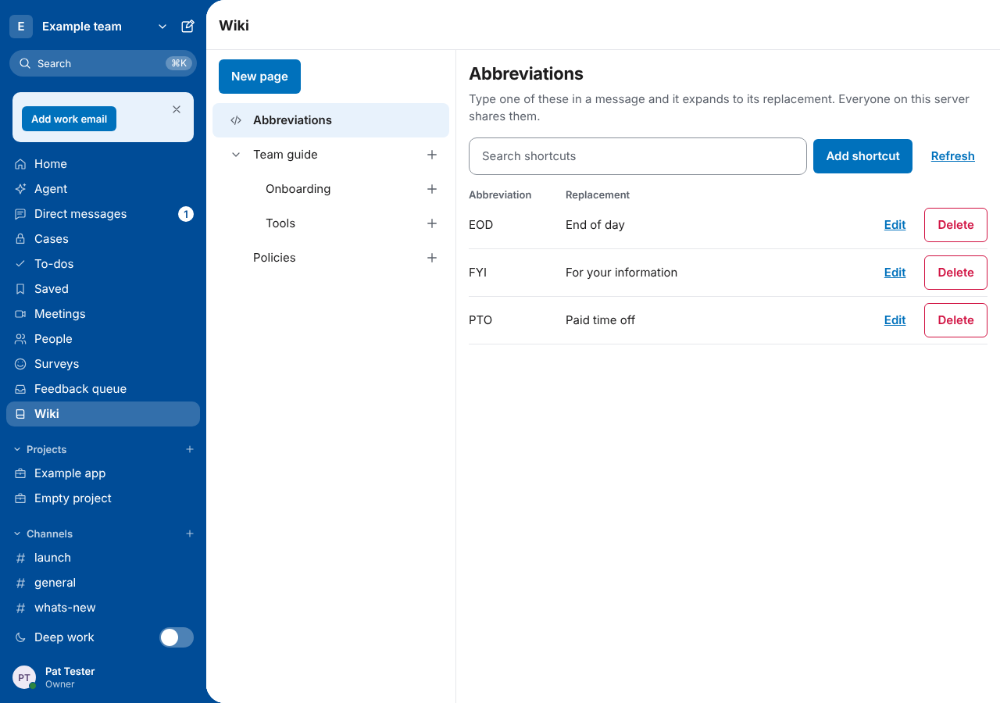
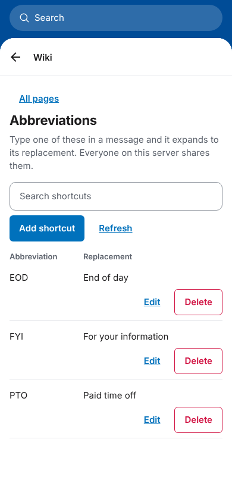
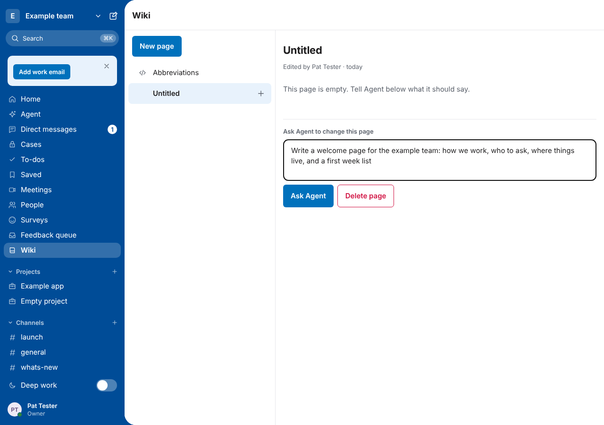
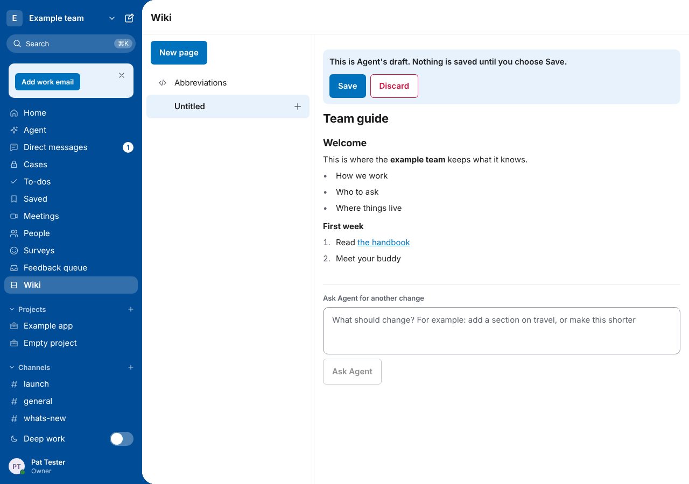
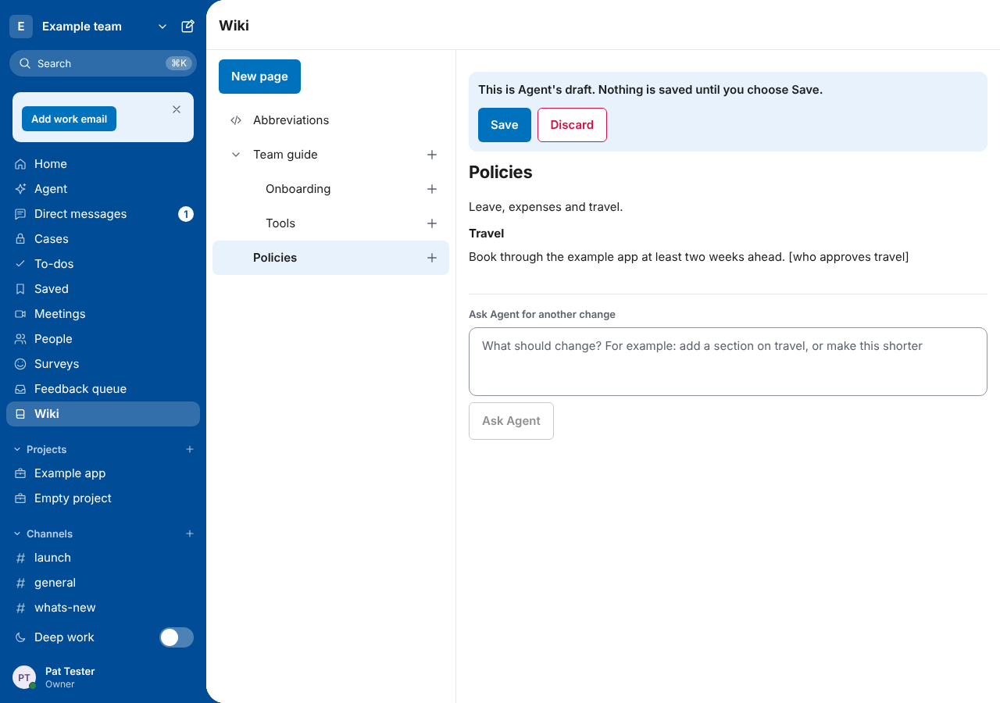
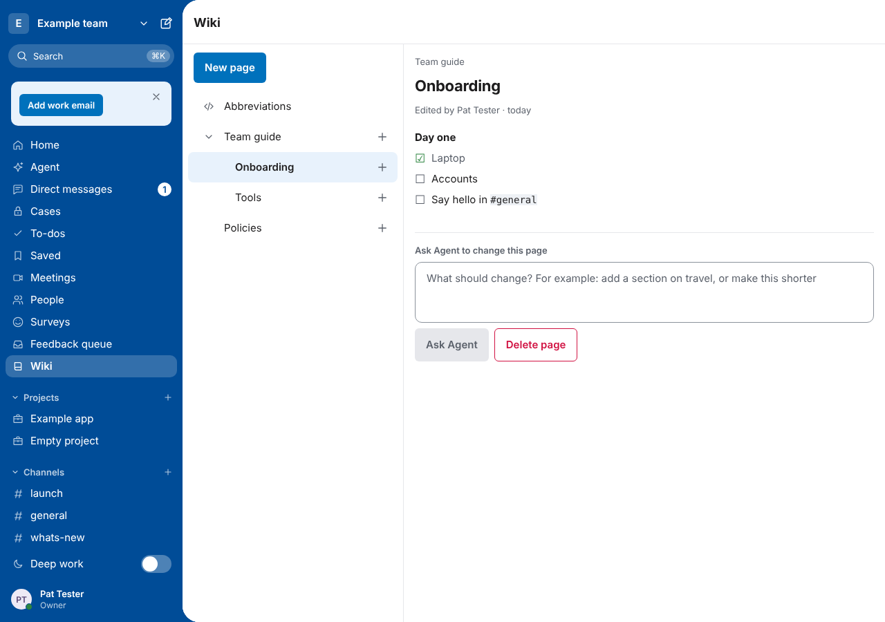
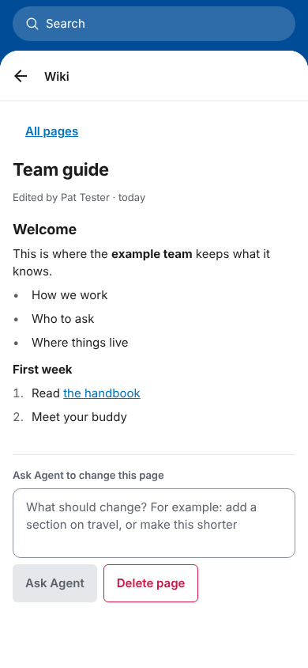

# Wiki in place of Text shortcuts: before and after

These are actual browser screenshots from running builds. They are not mockups or edited images.

- **Before:** `main` at `ced7f324557540436060e1b7f5dbbbcdcf15c508`, the PR's base.
- **After:** the branch at `6dc455b`; the full hash is in the manifest.
- **Desktop:** 1280 × 900. **Phone:** 390 × 844. Device scale 1, light appearance, English.
- Both sides ran their own server on a copy of the same made-up workspace (Pat Tester is signed in). The wiki's pages were made through the screen itself during the capture run: New page or the tree's +, a request to Agent, Save.
- **The agent in these captures is a stand-in.** The capture machine has no model, so a small local program answered each request with fixed text chosen by a word in the request. The screens, the request box, the draft and the save are the real app and server; the wording of the drafts is not a model's.

Commits, routes, times and checksums are in [manifest.json](manifest.json).

## The sidebar's place

Before, the sidebar opened Text shortcuts, a single list. After, it opens Wiki: a tree of pages on the left and the open page beside it. The wiki did not exist before.

| Viewport | Before | After |
| --- | --- | --- |
| Desktop |  |  |
| Phone |  |  |

## Abbreviations, the built-in page

The shortcuts are now the first page of the tree. The list, its search and its buttons are the same.

| Viewport | Before | After |
| --- | --- | --- |
| Desktop |  |  |
| Phone |  |  |

## New: a page is written and changed by asking Agent

None of these screens existed before.

| Step | Screenshot |
| --- | --- |
| A new page: the only field is the request to Agent |  |
| Agent's draft, shown where the page will be, with Save and Discard |  |
| Asking for a change to a written page. What Agent was not told is left in square brackets |  |
| A subpage, added from the tree, with the page it sits under named above its title |  |
| A page on a phone |  |
