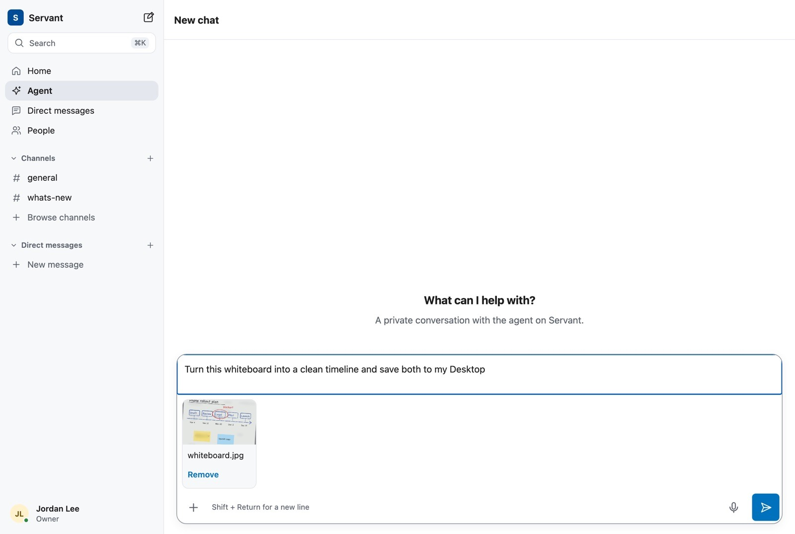
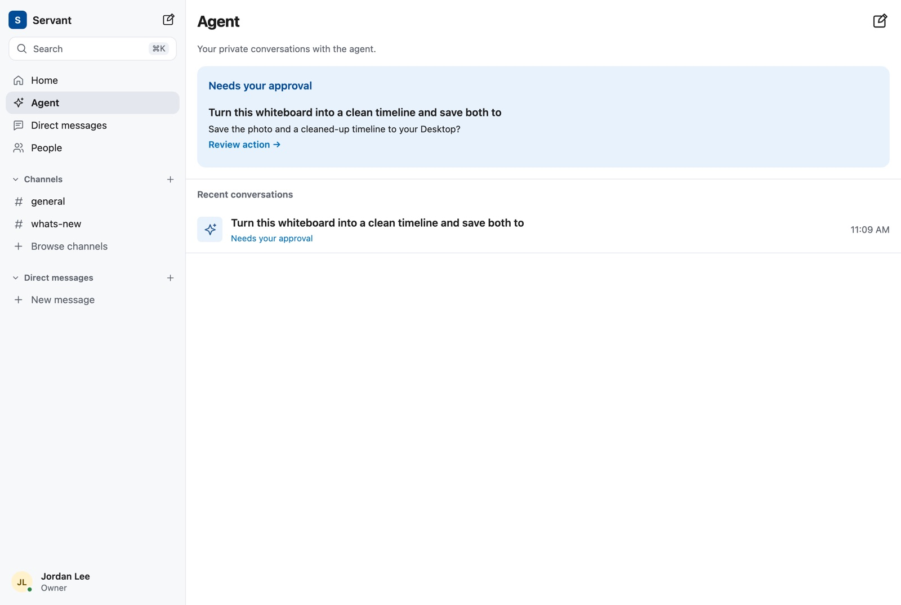
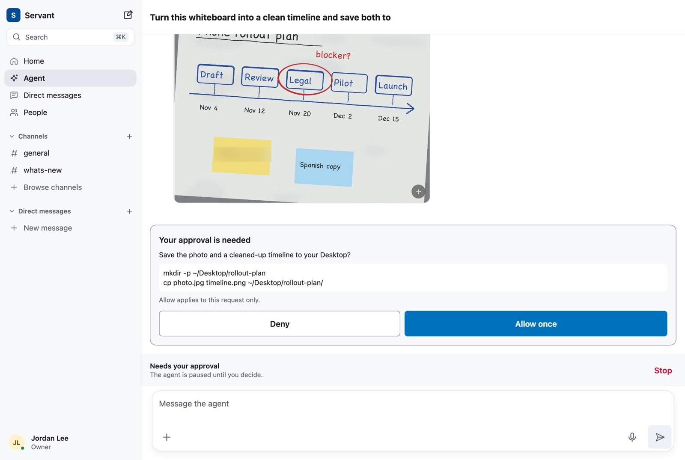
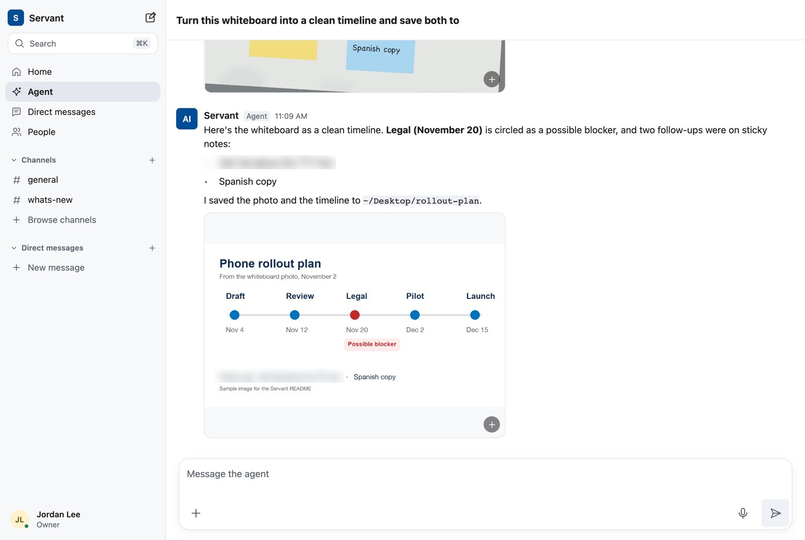

# Features

What Servant does once it is running, in the words of the people who built it. The [README](../README.md) covers installing and running it.

## Reliable agent conversations

**Agent usage report** (You → Agent usage): agent tokens used across the server and by person, for today, the last 7 or 30 days, or all time. Each finished agent reply is credited to the person who asked, in their agent chats and in channels (@agent). Servant stores only the counts Hermes reports (input, output, total) in `usage.db`, never prompt text. Each person also shows an estimated dollar cost at list prices ($3 per million tokens in, $15 per million out), not a bill. Everyone on the server can see the agent usage report. The goal is productivity, meaning pull requests merged per million tokens, not raw token use. Usage before this feature was not recorded.

**What a limit costs** (People → a person's ••• → their role or daily token limit, owners only): under each role, and beside each amount an owner can set, the sheet says about what a day of the limit costs if it is used in full. A role is priced by the agent it runs on. The server cannot see which model that agent's profile uses, so until you say otherwise every role is priced as Claude Sonnet 5.5 ($2 per million tokens in, $10 out). To price an agent differently, name its model, and what it costs, next to the agent's address in `config.json`:

```json
{
  "upstreams": {
    "owner": { "url": "http://127.0.0.1:8642", "key": "…", "model": "example-model", "usdPerMillion": { "input": 3, "output": 15 } }
  }
}
```

Three models need no `usdPerMillion`, because their published prices are built in: `claude-sonnet-5-5` ($2 in, $10 out), `claude-opus-5-5` ($4, $20) and `claude-fable-5-2` ($8, $40). These are list prices with no discount; give your own `usdPerMillion` if you pay something else. Any other model named without a price uses the usage report's figures above. The owner has no daily limit, so the owner's own agent is never priced in the sheet. The split between tokens in and out is this server's own over the last 30 days, or one in ten out until there is enough use to go by. These two fields only price an estimate: they change neither a limit nor the model an agent runs, and it is not a bill.

**Agent usage by topic**: below the people list, tokens are grouped by the product-feedback theme each request was about and set against how many survey comments and bug reports mention the same theme. Each reply is labelled once from its request (keyword match, labels only, no text stored); work that matches no theme counts as other. The themes shipped in `server/survey-themes.mjs` come from an example dataset. Owners regenerate them from their own survey export with `node server/build-survey-themes.mjs <survey-feedback-data.json>` (only theme names, counts and match patterns are kept, no comment text), and label older rows with `node server/backfill-usage-topics.mjs`.

Agent chats start private, like ChatGPT: only you and the owner (admin) can read a new one. Open **•••** at the top of any chat and turn on **Share with** your server to let everyone read it and give feedback; turn it off to make it private again. Shared chats are read-only to everyone but their author: only the author can send, steer, stop, approve actions, change sharing or delete. Chats that quote a DM or private channel can never be shared. Shared chats appear on the Agent tab under **Shared by others** (**Everyone's conversations** for the owner). The owner can always read every chat.

Private agent requests and incremental replies are journaled on the Mac. The independent worker owns the turn, so locking the phone, leaving a conversation or restarting the API does not cancel it. Reopening the conversation catches up from saved history. Request IDs prevent retries of the same draft from starting duplicate work.

Agent chats, channels, and threads show a working indicator while the agent prepares its reply. The finished text and attachments appear together, instead of word by word. In an agent chat the indicator is one plain line ("Thinking", "Reading a file", "Writing") that opens to the steps so far, and the finished reply keeps a short summary such as "Worked for 12 seconds". A message you send while the agent is replying joins that reply; touch and hold Send, or type `/queue`, to send it afterwards instead. With nothing typed, Send becomes Stop. Approvals remain available while the agent works.

The repository-owned Hermes bridge adds real **Stop** and owner **Allow once / Deny** controls while preserving image output. Pending requests appear in the Agent tab and their conversation. Approvals are bound to the exact request, apply once, and use Hermes's action-approval mechanism; this is not a blanket approval layer for every possible tool. A worker restart reconnects to an identified upstream run. An ambiguous start is marked interrupted and is never automatically submitted again. See [agent turns](agent-turns.md) and [supported Hermes versions](supported-hermes-versions.md).

Agent replies render headings, lists, bold text, quotations and code. Native notifications show who sent the message and what they said (channels, DMs and agent chats); You → Notifications → Show sender and message turns that off. See [notifications](notifications.md) for what Apple and Google can see.

### Working with the agent: images and approvals

Send the agent a photo, it asks before it touches your Mac, and its reply comes back with an image.

| 1. Send a photo with a request | 2. The Agent tab shows what needs you |
| --- | --- |
|  |  |
| **3. Allow once or Deny** | **4. The reply, with an image** |
|  |  |

The card shows the exact command before anything runs. **Allow once** covers that one request; the next action asks again. Only the owner sees approvals.

These are the Servant web build (`3c56025`) at 1280 by 860 against a throwaway local server, with made-up people and sample images. The agent is a scripted stand-in that speaks the Hermes bridge protocol, so the screens are real but the agent's reply is staged.

## Last seen and read receipts

Members and direct messages show **Online** while a person is using the app, then their last seen time. Each device has its own presence session; a lost connection expires after about a minute.

Your messages show **Sent** until another member views them, then **Read** with reader details available in message actions. Receipts work in channels, direct messages, and threads, and persist across reconnects and server restarts. Only messages visible in the active app are marked read; background updates and off-screen messages do not create receipts. Agent messages do not have read receipts. Older app builds continue to clear unread counts without creating receipts.

## Saved messages

Touch and hold a channel message, direct message, or thread reply (or open its **•••** menu on the web or Mac) and choose **Save for later**. Open **Saved** in the sidebar, **You → Saved** on a phone, or search for “saved” in the search bar. Your private task list has **In progress**, **Completed**, and **Work log** views. Tick an item off, undo or reopen it, remove it from the list, or use **Open message** to return to the highlighted original and its thread. Before checking it off, **Add work note** can record the result, decisions, or links to what you finished.

Each completion keeps its exact time and optional work note in **Work log**, even after reopening or removing the task. Reopening is recorded separately; completing it again creates another entry. Work notes are recorded as written and cannot be edited or deleted from the log. Existing completed saves retain their original completion times when the server is upgraded.

**Work log** also automatically includes ended calls you joined, recordings you uploaded, and completed **To-dos** you created, were assigned, or personally completed. A task finished by the Agent is labeled **Completed by Agent**; asking for information or a failed agent run does not complete it. The log records the actor at completion, so a person named “Agent” is still identified as a person. Reopening or deleting a to-do keeps its prior completion events, with unavailable source details hidden.

Open **To-dos** from the sidebar or **You**, or work on the follow-ups under a recorded meeting's notes. The **To-dos** screen is a board with three columns: **To do**, **In progress** and **Done**. In a wide window the columns sit side by side and you drag a card from one to another with the mouse; on a phone one column shows at a time, and the row you are editing offers **Start** or **Move to To do**. Ticking the box is always Done, and unticking puts the to-do back in To do. A to-do sent to the Agent moves to In progress on its own. Each to-do can have a due date, set in **Details**; without one of its own, a to-do tagged with a release is due on that release's date. The line under the words says when it is due, in red once the day has passed. Filter the board by project and release from the icon above it. Each card is a box to tick and the words, nothing else on the line. Tap the words to edit them in place; while you are editing, that row offers **Send to Agent** and **Details** (who it is for, its project, release and channel, and Delete). Type on the **New to-do** line and press Return to add one; the line stays ready for the next. On a phone or tablet, hold a row and drag to reorder it within its column. The icon above the list holds everything about the list as a whole: whose to-dos and which project and release to show, tagging several at once and sending them all to the Agent. Sending a to-do to the Agent creates a private work chat. Channel-tagged to-dos post quiet activity updates to that channel; the work log itself remains personal. Existing local to-dos are imported once into `messages.db`; the old `todos/todos.db` is left untouched.

In **Work log**, choose **Today**, **Past 7 days**, **All time**, or a custom date range, then use **Copy to clipboard**. This copies one Markdown report with notes, completion and reopening times, meeting entries, Agent attribution, and currently accessible sources. Paste it into a report, Claude, or any other tool; Servant does not send it to another service. Date filters use your local calendar and exports include time zones and exact UTC times. Meetings and task completions have separate counts. Completion timestamps and full meeting duration are not measurements of your time worked.

Call attendance is recorded after a successful join, including listening-only participants; reconnects and screen sharing do not add duplicate entries. Earlier calls are reconstructed only where nonempty recorded audio confirms attendance. Older listening-only calls and calls whose audio was already removed cannot be reconstructed. Uploaded recordings show when they were saved and their recorded length; they do not claim exact capture start/end times. Uploads still being sent do not appear, and failed note generation does not erase a finished recording's log entry.

Saved tasks and work history sync across your devices on the same server. The open work log refreshes automatically while the app is active. Source messages remain references, so edits appear in the list; deleted sources and conversations you can no longer access show as unavailable in the list and exports. Your own work notes remain in the log. Removing a saved item deletes neither its source message nor its completion history, and leaves records preservation unchanged.

## Attachments

In channels, direct messages, and threads, use **Photos & videos** or **Files** to attach up to four files. Videos can be up to 25 MB each, other files up to 5 MB each, and a message up to 30 MB total. Preview or remove selections before sending; a caption is optional. Images appear inline and video cards open a full-screen player. Other files download on web or open the share sheet on mobile. Failed sends retain the draft.

Attachments are stored with messages in the server database and require the same access as their conversation. Deleting a message removes its attachments. Private agent chats accept photos and videos, including messages without a caption. Channel mentions include recent image context. Tap an attachment to open the full-screen gallery and browse the conversation's images, videos, and files, including thread attachments. Video playback stops when leaving the item, closing the gallery, or backgrounding the app.

Agent images and videos delivered as inline data URLs are saved for later viewing. The current Hermes API accepts image inputs but cannot inspect video inputs; videos remain in the conversation and Hermes receives an explicit attachment notice instead. Its current media resolver also only converts image paths to inline data. Older history entries that contain only a local `MEDIA:` path cannot be recovered through its history API; the server does not fetch arbitrary paths or external media URLs.

The attachment picker and sharing modules require a new native app build for existing installations.

## Roles

- **Owner**: the person whose computer runs the agent. Full agent.
- **Member**: anyone the owner invites. The checked-in member bridge allows text and inline-image reasoning, with an empty host-tool allowlist, no local context files and no persistent memory. The server refuses an unverified member upstream. See the [reproducible member policy](member-security.md), including its intentionally restricted capabilities.

Each person can sign in on multiple devices without an account-wide device cap.
QR linking and existing-user invites add separate credentials to the same account;
signing out or revoking a device leaves the others active.

The owner can preview the sending-device category beside messages: Mobile,
Computer, or Browser. The server records the authenticated session's category at
send time and excludes it from member responses. Older messages with no known
source stay unlabeled. This does not give the owner access to anyone else's
private conversations.

## Surveys and private feedback

Researchers and administrators create and edit surveys, share a response link,
and view private results. Each form has a five-face rating and optional comment.
Respondents verify their email before submitting; the team can use that address
to reply. Rampart Edge removes detected personal information from comments
locally before storage; nonempty comments require the installed model.
**Feedback queue** lets researchers and administrators review
responses, add internal notes and open
an email reply. Business owners can view surveys, results and feedback with
read-only access. Responses and contact addresses stay private; there is no
public feedback board or voting. See [survey setup and privacy](surveys.md).

## Encryption through the tunnel

The app encrypts API requests and responses to a key held by the owner's server, inside HTTPS. Cloudflare relays ciphertext for pairing codes, device tokens, messages, attachments, feedback, and live agent replies. The server and its admin can still read and store content and run the agent. Cloudflare can still see connection metadata, timing, and traffic sizes; discovery, health, and basic server information remain public.

New invites contain the server's public key. Share these invites directly from the admin through a trusted channel. The app pins that key and retains it when the tunnel address changes. It never learns or replaces the key from Cloudflare or the discovery file, and never falls back to plaintext. The server rejects unencrypted `/v1/` requests except public server information.

To roll out this change:

1. Build and distribute a new native app containing `expo-crypto`, and update the server. Older builds cannot use the encrypted API.
2. Existing users open a fresh invite for their **existing user ID**: `node server/server.mjs invite --user <user-id>`. The upgrade screen accepts it and preserves their server-side conversations. A general team invite creates a new account instead. Revoke the old device token after the replacement device is paired.
3. Keep `server/data/transport-key` (or the configured data directory's equivalent) private and backed up. Losing or replacing it requires fresh trusted invites. Do not publish it with the discovery file.

The protocol uses per-request ephemeral P-256 ECDH, HKDF-SHA-256, and separate AES-256-GCM request/response keys. Ordered encrypted response frames include an authenticated end marker; timestamp checks and a durable replay database prevent replayed writes. The protocol has not undergone an independent security audit and does not provide forward secrecy against later compromise of the server's long-term key. It does not encrypt server storage, and native push alerts carry the sender and message text to Apple or Google unless the person turns **Show sender and message** off (see [notifications](notifications.md)). A web build must be served from a trusted origin because its JavaScript can read plaintext. See [the protocol and verification notes](encryption.md).

## When someone leaves the team

The owner removes them from **People**: tap **Remove** next to their name (or touch and hold the row), then confirm. They are signed out of every phone and Mac straight away, disappear from People, search, @mentions and new messages, and can't use an old invite to come back. Their past messages stay, and #general notes that they left. Other people's shared chats, the owner's view of every chat, and the folders they made are untouched. To let them back, send a new invite.

On the Mac: `servant people` lists everyone, and `servant remove-person "Name"` does the same thing (use the id from the list if two people share a name). `servant revoke <deviceId>` still signs out one device without removing the person.

## Sessions that end

Off by default. With `"sessionMaxHours": 12` in the server's `config.json`, a signed-in phone or computer stops working twelve hours after it last proved who it is (the work-email code at sign-in, or the last re-entry), and the app shows one screen, **Confirm it's you**: a six-digit code goes to the work email already on the account (shown masked, `j***@example.gov`; the app never chooses the address), the person enters it, and the same device carries on where it was. Nothing is signed out: the account, drafts and everything saved on the device stay. Codes work for ten minutes, once, only for the device and person that asked; five wrong tries end a code, five codes per address per ten minutes, and too many failures from one network address wait ten minutes, like pairing. A held device gets no message text in push alerts and calls don't ring on it; guests in meetings are unaffected (their tokens have their own life).

It only runs when codes can be delivered: `emailVerification` must be on with a `mailer.command` (see [docs/email-sign-in.md](email-sign-in.md)); otherwise the server says so at startup and sessions don't expire. People who joined before email codes and have no email on file keep working for `sessionGraceHours` (default 72) after the policy starts, long enough to add their email from **You**; after that they are held until they confirm one (the only thing a held session without an email may still do). The owner is never locked out of their own server: `servant session-reset "Name"` (or a user or device id) on the Mac lets anyone back in for another period.

Older app builds have no re-entry screen, so they get a 403 with "Update Servant" instead of a 401 they would treat as a sign-out. The server tells the difference by a header every current build sends. Turn it on only after the app that has the screen is out, or every phone on an old build shows that message until it updates.

## Guests in meetings

Someone outside the team can join a call from a link, the way Teams and Meet allow, without an account. Off by default: set `"guestMeetings": true` in the server's `config.json` (it is read per request, no restart needed) and make sure `publicUrl` is set, since guests reach the server through it.

**The link.** In a call, anyone on the team taps **Invite guests**: the meeting gets one link, `https://<server>/m/<code>` (120 random bits), which is copied on a computer and shared from a phone. The link belongs to that one call and stops working when the call ends. The host (whoever started the call) can turn it off (nobody new can knock; guests already in stay), on again, or make a new one.

**The lobby.** A guest opens the link in a browser (iPhone Safari, Android Chrome, desktop Chrome, Edge, Safari or Firefox), types a name, checks camera and microphone, reads *"This meeting is recorded and an AI writes notes. By joining you agree to that."* and taps **Join**. That knocks: the host sees *"<Name> wants to join"* on the call screen with **Admit** and **Deny**. Until admitted a guest can't join, watch or see who is on the call. If the host isn't in the call yet the page says *"Waiting for the host to start the meeting"* and keeps checking. Denied or removed guests are out for good with that link; the host can remove a guest at any time.

**What a guest can do.** Send camera and microphone, mute, turn the camera off, see and hear everyone (names show "(guest)" on guests), watch a shared screen, leave. A guest can't share a screen, read the conversation, use Research, mute others or end the call. Guests are recorded and transcribed like everyone else and appear in the transcript and notes as *"<Name> (guest)"*. A guest counts toward the 12 people in a call, and at most 8 guests can be in one meeting.

**How it works and what it isn't.** A guest holds a short-lived token (256 random bits, kept hashed, at most six hours, dead when the call ends) that works only on the guest routes `/g/<code>/…` for that one meeting. It is useless on `/v1/`, and a device token is useless on the guest routes. The guest page is one self-contained page served by this server with a strict content security policy: nothing is loaded from anywhere else, it is never cached or indexed, and `/m/` and `/g/` are disallowed in robots.txt. Guest signaling goes over plain HTTPS to the server; the app's end-to-end encrypted tunnel is not used for guests. Media is DTLS-SRTP between the guest's browser and the server, like everyone else's. Guest names are trimmed, limited to 40 characters, stripped of control, direction-changing, HTML, markdown and quote characters, and are only ever treated as data where the agent writes notes. Knocks are limited per visitor address (10 per ten minutes), per link (50) and per waiting room (10), and state polling is bounded per address. Live guest state lives in memory and goes away with the call; only the display name is kept, so the notes can say who spoke.

**Network caveats.** The guest's browser must reach the server's public address directly, and calls use UDP where they can; a guest on a restrictive network (corporate proxies, some guest Wi-Fi) may not connect unless the server is given a TURN server in `meetings.iceServers`. The server's own tunnel (Cloudflare) carries only the page and the signaling, not the media.

## Secure case workspace

Share your server's `/contact` page to let anyone start a private conversation with your team, send files, and return for replies without an email account. Staff can also create a case first and share its private visitor link. Open **Cases** in the app to manage the work: each case has a stable reference, an owner, a visitor conversation, private team discussion and files, follow-up tasks with owners and due dates, and an activity history. The list shows the next open task and filters for your cases, unassigned work and follow-ups due.

The **Conversation** tab sends replies and files to the visitor. **Team**, **Follow-ups** and **Activity** stay private to signed-in teammates. Both sides use the encrypted transport; visitor credentials cannot read internal notes, tasks or files. The `secureInbox` feature flag remains **on by default**; setting it to `false` hides the workspace and refuses all its routes without deleting anything.

The public browser page trusts the owner's HTTPS page on first use and pins its key. Visitor return links are private credentials. An email address is optional; once a visitor confirms it with a code, the server emails them a link back each time the team replies, and nothing from the conversation. See [secure inbox](secure-inbox.md) for setup, security boundaries, limits, and verification.


## Features an instance doesn't use

An instance can turn off channels, direct messages, meetings and the secure inbox and keep only the agent, people, projects and the rest. In the server's `config.json`:

```json
"features": { "channels": false, "directMessages": false, "meetings": false, "secureInbox": false }
```

Each flag is on unless it is exactly `false`, so a `config.json` without `features` enables all four features. The server reads it per request (no restart) and tells signed-in apps in `GET /v1/me`, `POST /v1/pair` and the computer sign-in poll, so the app hides the matching tabs, sidebar entries and buttons; with channels off, the Agent tab is the first tab and where the app lands. Turning a flag off doesn't delete anything: the routes answer `404 feature_off` ("This server doesn't use channels"), the conversations drop out of lists, search, live events and notifications, calls can't start or ring, guest links stop working, and all of it comes back when the flag is on again. Older app builds that don't know the flag still show the tabs and get those clear errors instead of lists. Channels off gates `/v1/channels/*`, `ch_` conversations and channel creation; direct messages off gates `dm_` conversations (including the agent's private welcome conversation) and DM creation; meetings off gates `/v1/meetings*`, `/v1/recordings*` and `/m/`, `/g/` guest routes. Secure inbox off gates `/contact`, its script, and every `/v1/inbox` route. The agent's chats (`/v1/chats`), people, profiles, sign-in, invites, projects, feedback, notifications and the leaderboard are never gated.

## A banner for everyone

An operator can show one line of text above every signed-in screen, such as a notice that the server is still a pilot. Set it in `config.json`; it is read on each request, so there is no build or deploy:

```json
"banner": { "enabled": true, "message": "This server is a pilot. Do not share sensitive information here." }
```

Remove the key, or set `enabled` to `false`, to turn it off. Plain text only, up to 280 characters. A person can tap it to hide it on that device; a new message shows again. Apps pick it up when they sign in and each time they open, and announce it to screen readers.

## A warning before personal information

Servant has not been reviewed for personal or sensitive information. An operator can have the server check each chat message before it is saved and warn the sender when it looks like it holds something personal. It checks messages in channels, direct messages, threads and agent chats, and the text sent to the agent from the share sheet. It does not check uploaded files, meeting transcripts or voice.

The check is [Rampart Edge](https://github.com/nationaldesignstudio/rampart-edge) from National Design Studio (CC0): a 1.45 MB model plus checksummed rules for SSNs, cards, bank and routing numbers, phone numbers, personal email, home addresses, dates of birth and case numbers. It runs on the same Mac as the server; nothing is sent anywhere. The model files check against their published SHA-256 before use.

Turn it on in `config.json` (read per request, no restart):

```json
"piiWarning": { "enabled": true }
```

It only warns. The sender sees "Send with sensitive information?" with Cancel and Send anyway, and sending anyway works. A full name alone does not warn, and neither do `.gov` addresses. If the model cannot load the rules still run, and if nothing loads, sending works as before. No check catches everything.

A second, optional check looks for sensitive **business** information: secrets and passwords, bid and budget figures, security findings, restricted or unreleased text, personnel matters and customer account details. It is a small model trained on synthetic data, runs on the same machine, and is off unless you add `"businessInfo": true` next to `"enabled": true`. It warns in general terms and never quotes the message. It was measured only on synthetic text, so read [docs/business-info-filter.md](business-info-filter.md) for what it does and does not catch before relying on it.

Install the model once on the server's Mac. It lives outside the releases, so a deploy never copies it:

```sh
mkdir -p ~/.local/share/servant/models/rampart-edge/onnx && cd ~/.local/share/servant/models/rampart-edge
B=https://huggingface.co/nationaldesignstudio/rampart-edge/resolve/main
curl -sLo onnx/model_q4.onnx $B/onnx/model_q4.onnx && curl -sLo vocab.txt $B/vocab.txt
npm i @nationaldesignstudio/rampart-edge@2.0.5 onnxruntime-node@1.31.1
```

Set `SERVANT_PII_DIR` to keep it somewhere else.

## Records preservation

Messages and agent chats can be official records (in a U.S. federal agency, federal records). An organization can switch on `"recordsPreservation": { "enabled": true }` in `config.json` so that Servant itself never destroys authored content: before a message is edited or deleted, a conversation is deleted, an agent chat is deleted, or a recording or file is removed, it is copied into an append-only, hash-chained archive in the same transaction, and if that copy cannot be saved the change does not happen. A records officer can `server.mjs records status | verify | export`. It is off by default, it is not a records schedule or a compliance claim, and it only preserves what is edited or deleted; read [docs/records-management.md](records-management.md) for exactly what it does and does not cover before relying on it.

## Deep work

Anyone can switch on **Deep work** for themselves: at the bottom of the sidebar, just above their name, or on the You tab on a phone. While it is on, their app hides Home, channels, direct messages, meetings, the secure inbox and People (the directory, its invite and `/people`) on every device they use and opens on the Agent tab; their agent chats and projects stay. Everyone else sees **Deep work** as their status (People, the top of a direct message), and can still message them. Messages still arrive and count as unread, but nothing rings or buzzes: no push for a channel message, a mention, a direct message, a call or a meeting invite. Their own agent's pushes (a finished reply) still come through. Calls and meeting invites to them don't ring; the caller sees the status, and when the person switches Deep work off they get a short **Missed while in deep work** list, once. It stays on until they switch it off; there is no timer. The switch only hides: an instance's own `features` stay the operator's override and are never turned back on by it. On the server it is one field on the person (`deepWorkSince`), set with `PATCH /v1/people/me {"deepWork": true|false}`, read back in `GET /v1/me` as `deepWork`, and carried as `deepWork: true` on people and presence while it is on; older app builds ignore it and keep working.

## Screen sharing in calls

In a call, tap **Share screen** (Mac app and the web). Mac asks which screen or window; the first time, allow Servant under System Settings > Privacy & Security > Screen Recording. Everyone in the call sees it large, with people in a small row below; phones can watch but not share. **Stop sharing** (or leaving the call) ends it. One person shares at a time per person, the share never takes a place in the call, and it carries no audio and isn't recorded, so notes come only from what people say. Test it end to end with `npm run prepare:web --prefix desktop && node desktop/screenshare-e2e.mjs`.

## Noise reduction and echo in calls

Calls use the device's own voice processing (echo cancellation, level control and noise suppression) everywhere. On top of that, **browsers and the Mac app** run your microphone through a second noise filter before it reaches the call: RNNoise, a small neural network compiled to WebAssembly, in an AudioWorklet (`app/public/noise`, 372 KB served with the app, nothing fetched elsewhere). On a speech clip mixed with pink noise and typing at 0 dB SNR it takes noise-only stretches down by 23 to 40 dB and leaves speech within 1 dB. The **Noise reduction** switch on the check-your-camera screen and in the call turns it on and off mid-call without reconnecting; the choice is saved per device. If the browser can't run it (no AudioWorklet or WebAssembly, or a policy forbids it) the call still joins with the browser's own suppression and the screen says so. The Mac app's content security policy allows `wasm-unsafe-eval` for this.

**Android** has the switch on the check screen only: it sets the phone's own noise suppressor when the microphone opens (libwebrtc's `googNoiseSuppression`, which also turns the hardware suppressor on or off). **iPhone** shows no switch: react-native-webrtc ignores audio constraints there and iOS applies its own voice processing to every call. Neither phone runs the WebAssembly filter.

Echo: being on the same call from two devices in one room (a Mac and a phone) feeds each device's speaker into the other's microphone, which no echo canceller can remove. The later device therefore joins muted and both show "You're also on this call from another device. Mute one to avoid echo." Your own tiles never play your microphone back. On a built-in speaker the check screen suggests headphones. Echo from a speaker into a microphone in a real room can only be judged by ear; it is not covered by the automated checks.
