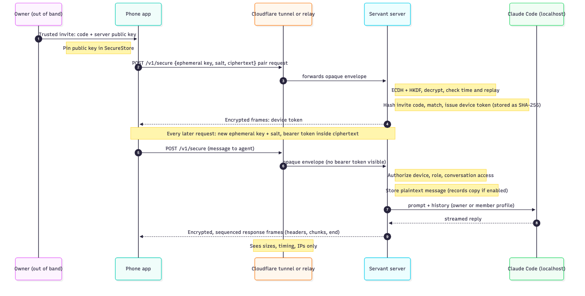
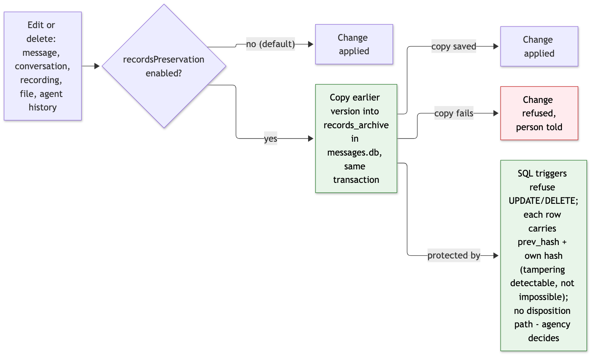
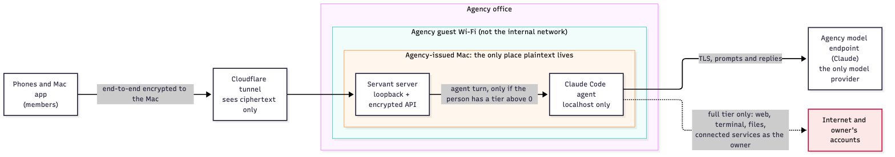
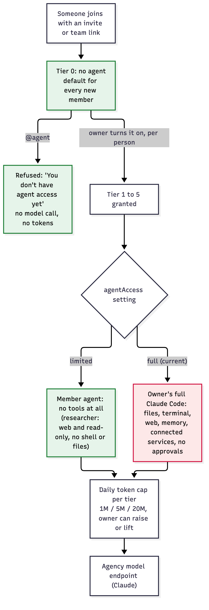

# Servant security architecture (for cyber review)

Seven diagrams of how Servant works, written for an ATO or cyber reviewer. Each one has a Mermaid source (`.mmd`) you can edit, plus rendered `.png` and `.svg` files. The diagrams summarize the detailed docs linked at the end. Where they disagree, the linked docs and the code win.

**A security review of these diagrams is answered point by point in [review-response.md](review-response.md):** each concern, the control that answers it, how to turn it on, the evidence, and what is still open.

Known gaps, stated up front:

- Agent access is currently set to **full**, by owner decision on October 31, 2026. Anyone who can message the agent gets the owner's Hermes tools on the owner's Mac. See diagram 4 and [member-security.md](../member-security.md).
- Servant does not encrypt data at rest. Plaintext sits in the data directory on the owner's Mac, so protection relies on the Mac itself (FileVault, account security).
- The Cloudflare Worker relay is built and tested but **not deployed**. Today's path is a cloudflared quick tunnel, which uses a GitHub Gist for discovery.
- Plaintext leaves the trusted boundary in four cases:
  - Prompts go to the model provider(s) configured in Hermes.
  - Push previews go to Apple and Google: sender, title, and up to 240 characters of body.
  - Crash diagnostics go to Firebase Crashlytics.
  - Email sign-in codes go to the mail command.

## 1. System context and trust boundaries

Phones, the Mac app and MCP clients all use the same encrypted API. Cloudflare relays it but only sees ciphertext, sizes, timing and IP addresses. Plaintext exists only on the owner's Mac.

## 2. Server components and data at rest

- **Supervisor:** binds to loopback only.
- **API releases:** immutable, switched by `server/deploy.mjs`. The durable worker is swapped by `worker-swap.sh`.
- **Secrets** (`transport-key`, `config.json`): live in the gitignored data directory and never leave the Mac.
- **Device tokens:** stored as SHA-256 hashes.

## 3. Pairing and an encrypted request

The invite carries the server's public key, and the app pins it. Every request then uses:

- a new P-256 ephemeral key and salt
- HKDF and AES-GCM
- a 2-minute timestamp window and replay checks
- the bearer token *inside* the ciphertext

Details: [encryption.md](../encryption.md).

## 4. Agent access tiers

## 5. Records preservation

When `recordsPreservation` is on, edits and deletes first copy the earlier version into the archive. If that copy fails, the change is refused. The archive is append-only: SQL triggers block changes, and a hash chain makes tampering detectable but not impossible. Servant has no disposition path; the agency decides retention. Details: [records-management.md](../records-management.md).

## 6. Deployment environment

The reference deployment runs the server and Hermes on one agency-issued Mac. The Mac sits on the office's guest Wi-Fi, not the agency's internal network, so it cannot reach internal systems. Hermes uses the agency's own Claude endpoint as its only model provider. Plaintext exists only on that Mac.

## 7. Agent and model gating

Two concerns reviewers raise, and how they're handled:

- **Hermes might cause an issue.** Every new member starts at tier 0: no agent. An `@agent` from them is refused before any model call (`no_agent`), and only an owner can grant a tier, one person at a time. When a tier is granted, the `agentAccess` setting decides what the agent can do. `limited` gives members an agent with no tools; the researcher tier gets web and read-only skills but no shell or files. Both are checked before every turn. `full`, the current setting, gives granted members the owner's Hermes on the owner's Mac, so set `"agentAccess": "limited"` for a review deployment.
- **Unfettered model access.** Hermes has one configured model provider, and only the server can reach Hermes, since its API listens on localhost. Each tier has a daily token cap (1M, 5M or 20M), and `usage.db` records token counts per person but never prompt text. The owner can raise or lift a person's cap, and that exemption is the thing to audit.

## 8. Entitlements, approvals and the network gate

Built after the first seven diagrams, and off until an owner turns them on. Source: `08-entitlements-and-approvals.mmd` (drawn in [review-response.md](review-response.md#1-the-agent-acting-for-someone-who-shouldnt-be-able-to-make-it)).

- **Approval before acting** (`agentCapabilities`): before the full agent reads or changes files or GitHub for someone, their manager sees the action and allows it once, always, or declines. Fails closed.
- **Network gate** (`agentEgress` with the sandbox wrapper): the agent reaches only the `always` list and the hosts a person was granted. The same sandbox can close the server's keys and databases to the agent.
- **Records**: every request, decision and checked action is kept in tables that refuse updates and deletes.

Details: [entitlements.md](../entitlements.md), [agent-egress.md](../agent-egress.md).

A broader system and change view is in [Architecture diagrams](../architecture/README.md).

## Source documents

- [ato-data-flows.md](../ato-data-flows.md): every external data flow
- [encryption.md](../encryption.md)
- [relay-transport.md](../relay-transport.md)
- [member-security.md](../member-security.md)
- [entitlements.md](../entitlements.md)
- [agent-egress.md](../agent-egress.md)
- [piv-sign-in.md](../piv-sign-in.md)
- [email-sign-in.md](../email-sign-in.md)
- [notifications.md](../notifications.md)
- [records-management.md](../records-management.md)
- [deployment.md](../deployment.md)
- [SECURITY.md](../../SECURITY.md)

To re-render: `npx -y @mermaid-js/mermaid-cli -i NN-name.mmd -o NN-name.png --size 1500 -b white`
