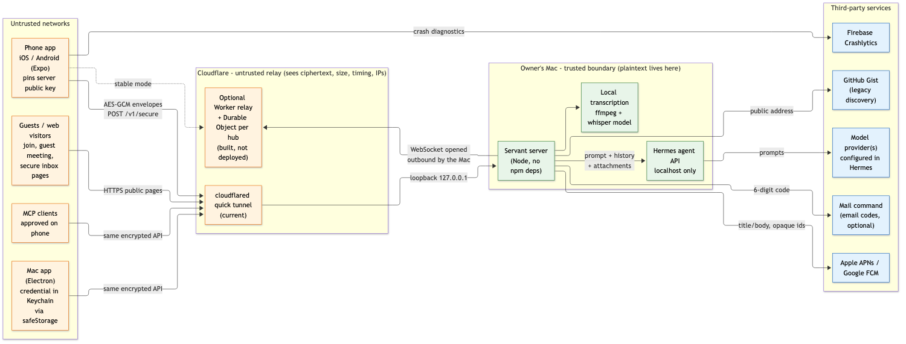
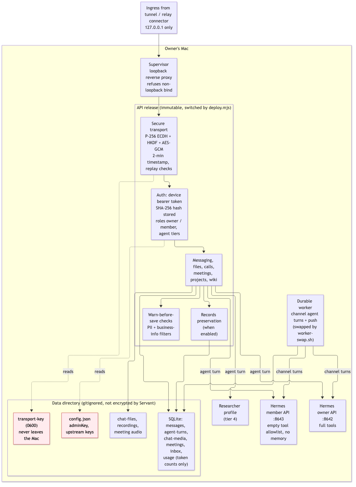
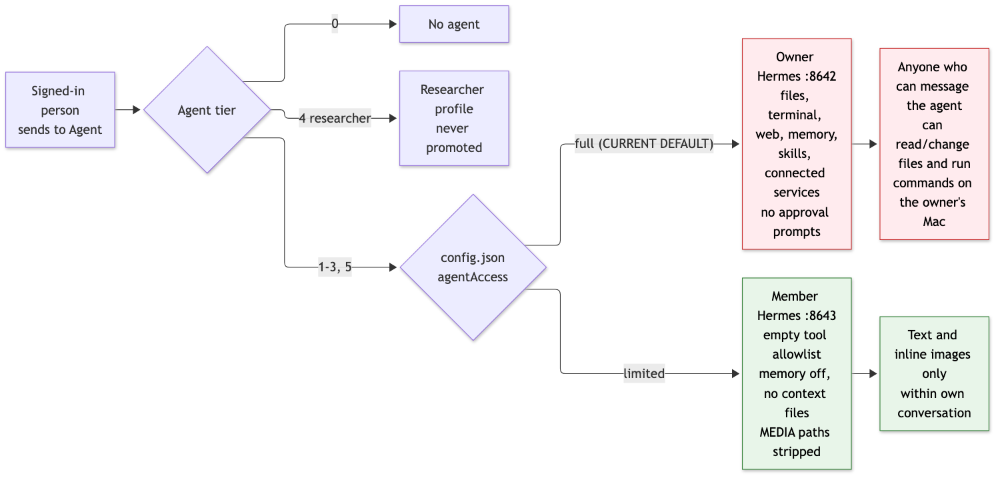

# Servant security architecture (for cyber review)

Five diagrams of how Servant works, written for an ATO or cyber reviewer. Each one has a Mermaid source (`.mmd`) you can edit, plus rendered `.png` and `.svg` files. The diagrams summarize the detailed docs linked at the end. Where they disagree, the linked docs and the code win.

Known gaps, stated up front:

- Agent access is currently set to **full**, by owner decision on October 31, 2026. Anyone who can message the agent gets the owner's Hermes tools on the owner's Mac. See diagram 4 and [member-security.md](../member-security.md).
- Servant does not encrypt data at rest. Plaintext sits in the data directory on the owner's Mac, so protection relies on the Mac itself (FileVault, account security).
- The Cloudflare Worker relay is built and tested but **not deployed**. Today's path is a cloudflared quick tunnel, which uses a GitHub Gist for discovery.
- Plaintext leaves the trusted boundary in four cases:
  - Prompts go to the model provider(s) configured in Hermes.
  - Push previews go to Apple and Google: sender, title, and up to 240 characters of body.
  - Crash diagnostics go to Firebase Crashlytics.
  - Email sign-in codes go to the mail command.

## 1. System context and trust boundaries

Phones, the Mac app and MCP clients all use the same encrypted API. Cloudflare relays it but only sees ciphertext, sizes, timing and IP addresses. Plaintext exists only on the owner's Mac.

## 2. Server components and data at rest

- **Supervisor:** binds to loopback only.
- **API releases:** immutable, switched by `server/deploy.mjs`. The durable worker is swapped by `worker-swap.sh`.
- **Secrets** (`transport-key`, `config.json`): live in the gitignored data directory and never leave the Mac.
- **Device tokens:** stored as SHA-256 hashes.

## 3. Pairing and an encrypted request

The invite carries the server's public key, and the app pins it. Every request then uses:

- a new P-256 ephemeral key and salt
- HKDF and AES-GCM
- a 2-minute timestamp window and replay checks
- the bearer token *inside* the ciphertext

Details: [encryption.md](../encryption.md).

## 4. Agent access tiers

## 5. Records preservation

When `recordsPreservation` is on, edits and deletes first copy the earlier version into the archive. If that copy fails, the change is refused. The archive is append-only: SQL triggers block changes, and a hash chain makes tampering detectable but not impossible. Servant has no disposition path; the agency decides retention. Details: [records-management.md](../records-management.md).

## Source documents

- [ato-data-flows.md](../ato-data-flows.md): every external data flow
- [encryption.md](../encryption.md)
- [relay-transport.md](../relay-transport.md)
- [member-security.md](../member-security.md)
- [piv-sign-in.md](../piv-sign-in.md)
- [email-sign-in.md](../email-sign-in.md)
- [notifications.md](../notifications.md)
- [records-management.md](../records-management.md)
- [deployment.md](../deployment.md)
- [SECURITY.md](../../SECURITY.md)

To re-render: `npx -y @mermaid-js/mermaid-cli -i NN-name.mmd -o NN-name.png --size 1500 -b white`
