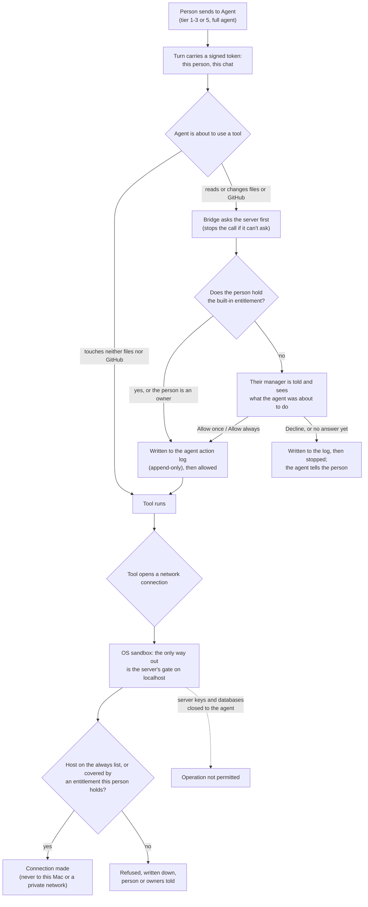

# Answers to the security review

A security review of the architecture diagrams in this folder raised the concerns below. This page takes them one at a time: what the concern is, what control answers it, how to turn the control on, where the evidence is, and what is still open. It is evidence for a review, not an authorization to operate.

Read this first: **most of these controls ship turned off.** A server keeps working exactly as it did until its owner turns each one on, because each changes what teammates can do. The table says what each setting is; what a deployment has to turn on is in [the last section](#what-a-deployment-has-to-turn-on).

## Summary

| Concern | Control | Setting | Built | Default |
| --- | --- | --- | --- | --- |
| The agent runs commands, reads files or uses connected services for someone who shouldn't be able to | Nobody has an agent until an owner gives them one | (always) | Yes | On |
| | Members get an agent with no tools at all | `"agentAccess": "limited"` | Yes | Off (`full`) |
| | Before the full agent reads or changes files or GitHub for someone, their manager approves it, once or always | `"agentCapabilities": { "mode": "ask" }` | Yes | Off |
| | The agent reaches only the hosts a person was granted | `"agentEgress": { "mode": "ask" }` and the sandbox wrapper | Yes | Off |
| A prompt injection steers the agent | The same three controls bound what a steered agent can do; nothing detects the injection itself | as above | Partly | Off |
| Local files, credentials, configuration and databases | The sandbox closes the server's keys and databases to the agent | `SERVANT_SANDBOX_DENY_PATHS` | Yes (Mac) | Off |
| | Not encrypted at rest | | No | |
| Prompts and content go to an outside model provider | One configured provider; the network gate can hold the agent to it | Hermes configuration; `agentEgress.always` | Yes | Deployment's choice |
| Device enrollment, tokens, revocation, replay | Pinned key, tokens inside the ciphertext, replay window, revocation, optional 12-hour re-entry | `sessionMaxHours` for re-entry | Yes | Re-entry off |
| Records can be deleted without a trace | Edits and deletes are copied to an append-only archive first | `"recordsPreservation": { "enabled": true }` | Yes | Off |
| Audit logging | Entitlement history, agent action log, refused hosts, token use per person | with the settings above | Yes | With those settings |
| Exposure to the internet through Cloudflare | Only ciphertext crosses it | (always) | Yes | On |

## 1. The agent acting for someone who shouldn't be able to make it

This was the review's first concern, and it is accurate for any server left at its defaults: with `agentAccess` at its default of `full`, anyone who can message the agent gets the owner's tools on the server's computer, with no approval.

Four controls answer it. They stack; each is worth having without the others.

(The same diagram is `08-entitlements-and-approvals.mmd`.)

### 1a. Nobody has an agent until an owner gives them one

Every new person starts at tier 0. A message to the agent from them is refused before any model is called, and only an owner can raise a tier, one person at a time. This is always on.

Evidence: `server/usage.mjs` (`agentTierOf`), `server/server.mjs` (`noAgent`); diagram 7.

### 1b. Members get an agent with no tools

`"agentAccess": "limited"` in `config.json` puts everyone but owners on a separate agent with an empty tool allowlist: no terminal, files, browser, connected services or memory. The server checks that agent's own statement of what it can do before every turn and refuses the turn if it has gained a tool. Researchers are never promoted to the full agent whatever the setting.

This is the strongest answer to the concern and the simplest: it removes the capability instead of governing it. Its cost is that members can no longer have the agent do work on the server's computer.

Evidence: [member-security.md](../member-security.md); `server/member-policy.mjs`, `server/member-policy.json`; `server/member-policy.test.mjs` ("member turns require explicit bridge attestation, not ordinary Hermes tool listing"); `scripts/test-hermes-compat.py` builds two real member agents and asserts neither has tools or memory.

### 1c. The full agent asks before it reads or changes files or GitHub

For people who do need the agent to work on the server's computer, `"agentCapabilities": { "mode": "ask" }` puts an approval in front of every such action:

- Four entitlements are built in: Filesystem read, Filesystem write, GitHub read, GitHub write.
- Before a tool call that needs one, the agent's bridge asks the server. If the person holds it, the call goes ahead. If not, the person's manager is told, sees the action the agent was about to take, and answers **Allow once**, **Allow always** or **Decline**.
- A manager can only allow what they hold themselves, so every allowance traces back, person by person, to an owner.
- It fails closed. If the bridge can't reach the server, the call is stopped. A bridge that can't ask at all is not handed a turn.
- A shell command is read one-sidedly: it counts as "read" only when every part of it is on a short list of commands known to only read. Anything else needs Filesystem write. A wrong guess asks for more approval than was needed, never less.

Evidence: [entitlements.md](../entitlements.md) ("Built-in entitlements"); `server/entitlements.mjs`, `server/hermes_guard.py`, `server/hermes_capabilities.py`; `server/entitlements-http.test.mjs` ("built-in entitlements: the first use asks the manager, who allows once or always, and it is recorded"); `scripts/test-agent-capabilities.py` (what each command needs; unreachable and malformed answers are refusals); `scripts/test-hermes-compat.py` (`EntitlementCheckTest`: a real Hermes stops the tool call until the server allows it).

What it does not do:

- It is a check made inside the agent, not a wall around the computer. A program the agent was allowed to run can do more than its command line shows. **Filesystem write should be granted as "this person's agent may run arbitrary commands on the server's computer".**
- Owners' own agents are logged but not held for approval; owners are the ones who approve.
- Read and write cover everything the server's user and credentials can reach, not one folder or repository.
- It has been tested piece by piece and through Hermes's own hook, but not yet watched stopping and resuming a live model's turn.

### 1d. The agent reaches only the hosts a person was granted

`"agentEgress": { "mode": "ask" }`, with the agent started through `scripts/run-agent-sandboxed.sh`, leaves the agent one way out to the network: a gate inside the server that refuses every host not on the server's `always` list or covered by an entitlement the person holds. Each chat's commands present a signed token, so they are judged for that person alone. The gate never connects to the server's own computer or a private network.

Evidence: [agent-egress.md](../agent-egress.md); `server/egress.mjs`, `server/hermes_egress.py`, `scripts/run-agent-sandboxed.sh`; `server/egress.test.mjs`; `server/entitlements-http.test.mjs` ("ask, confirm, be granted: the agent reaches a host only for the person who holds the entitlement"); the wrapper was run on a Mac: a command that ignores the proxy has no network, and a raw socket is refused by the system.

What it does not do: it sees host names, not content, so an allowed host can receive anything; web and browser tools that go through a gateway appear as the gateway's host; the token keeps a command honest about whose it is but commands still run as one user on one computer. The Linux path of the wrapper has not been run.

## 2. Prompt injection

Nothing in Servant detects a malicious instruction in a page, file or message the agent reads. The controls above limit what an agent steered that way can do:

- with 1b, a member's agent has no tools to misuse;
- with 1c, a steered agent still has to get its action approved by the person's manager, who sees the action;
- with 1d, it can only send data to hosts that person was granted;
- with the sandbox's closed paths (section 3), it cannot read the server's keys or databases.

Still open: an owner's own agent is not held for approval, so an injection in something an owner asks the agent to read acts with the owner's access, limited only by the network gate and the closed paths.

## 3. Local files, credentials, configuration and databases

What exists:

- The server writes its configuration and state files private to its own user (0600, in a 0700 folder). Device tokens are stored only as hashes. The server's private key never leaves the computer.
- The sandbox wrapper can close files and folders to the agent and everything it starts: `SERVANT_SANDBOX_DENY_PATHS` (the data folder, the push credentials folder) with `SERVANT_SANDBOX_ALLOW_PATHS` for the folders the agent is handed files in. A closed path can't be read, written, listed, moved, copied or linked to. This matters most for the secret that signs per-person tokens: without it, an agent allowed to read files could read that secret and pass as anyone. Mac only.

Evidence: [agent-egress.md](../agent-egress.md), step 4; `scripts/run-agent-sandboxed.sh`; run on a Mac against a stand-in data folder (reads, writes, links, moves and copies of closed files refused; attached files still readable).

Still open, and the review is right to press on it:

- **Nothing is encrypted at rest.** Messages, attachments and credentials are plaintext in the data directory; protection is the computer's own (disk encryption, account security).
- The agent's model and GitHub credentials are shared by everyone the agent works for. Per-person credentials are planned, not built.
- The closed-paths control has no automated test; it was verified by hand.

## 4. Prompts and content sent to an outside model provider

Whatever is typed to the agent, and whatever the agent reads while working, goes to the model provider configured in Hermes. Servant does not filter it.

What limits it:

- One provider is configured, and the reference deployment uses the agency's own model endpoint ([diagram 6](README.md#6-deployment-environment)).
- With the network gate on and only that endpoint on the `always` list, the agent cannot send content to any other provider.
- An optional check warns a person before they send a message that looks like it holds personal or sensitive business information ([business-info-filter.md](../business-info-filter.md)). It warns and never blocks: the sender can send anyway.
- Daily token limits per person, and a count of tokens per person with no prompt text kept.

Still open: there is no control on what a repository or file contains before the agent reads it. Whether source code or other sensitive material may be sent to the endpoint is the deploying agency's decision about that endpoint.

## 5. Device enrollment, tokens, revocation and replay

- **Enrollment.** A device joins with a one-use or expiring invite. Where email sign-in is on, a code sent to a work address on an allowed domain is required first ([email-sign-in.md](../email-sign-in.md)). Sign-in with a federal identity provider or a certificate card is a proposal, not built ([piv-sign-in.md](../piv-sign-in.md)).
- **Server identity.** The invite carries the server's public key and the app pins it; it is never learned from the relay, and there is no fallback to plaintext.
- **Tokens.** The device token travels inside the encrypted request, never in the outer transport, and is stored on the server as a hash.
- **Replay.** Each request has a fresh key, a two-minute time window and a replay check that survives a restart.
- **Revocation.** Removing a device or a person makes their tokens fail at once and ends their live connections; a removed person's entitlements are revoked in the same step.
- **Re-entry.** `sessionMaxHours` makes a device confirm a code from the work address on file every so many hours. Off by default.

Evidence: [encryption.md](../encryption.md); `server/secure-transport.test.mjs` ("modified, expired, wrong-server and replayed requests never execute, including after restart"; "bad pins and plaintext responses fail closed without fallback"; "response tampering, reordering and truncation are detected"); `server/session-expiry.test.mjs` ("twelve hours after the email step every door closes with session_expired…"); `server/entitlements-http.test.mjs` ("removing a person revokes what they held and stops their agent's traffic…").

Still open: the transport has no forward secrecy if the server's long-term key is taken, and it has not had an independent protocol audit.

## 6. Records integrity and retention

With `"recordsPreservation": { "enabled": true }`, every edit or delete first copies the earlier content into an append-only, hash-chained archive in the same transaction; if the copy can't be saved the change does not happen. It is off by default because it changes what "delete" means for the people using the server; an agency deployment should turn it on.

Two records are kept whatever that setting is, because they are about access, not content: the history of every entitlement request and decision, and the agent action log. Both refuse updates and deletes.

Evidence: [records-management.md](../records-management.md); `server/records-preserve.mjs`, `server/records-preserve.test.mjs`; `server/entitlements.test.mjs` ("editing, retiring and a person leaving close access without deleting anything"; "the agent action log keeps every line, newest first, and can't be changed").

Still open: the archive makes tampering detectable, not impossible, for someone with the server's user account. Servant has no retention schedule; the agency sets one.

## 7. Audit logging

| What is recorded | Where | Can it be changed? |
| --- | --- | --- |
| Every entitlement request, decision, single use and revocation, with who and when | `entitlements.db`, `history` | No (refuses updates and deletes) |
| Every checked agent action: whose agent, which chat, the action, what it needed, how it ended | `entitlements.db`, `actions` | No (refuses updates and deletes) |
| Hosts an agent was refused, per person | `egress.db`, `attempts` | Counts are updated in place |
| Tokens used per person per turn (no prompt text) | `usage.db` | Appended |
| Edits and deletes of content, when records preservation is on | `messages.db`, `records_archive` | No (hash-chained) |
| Terms accepted, with version, time and device | server state | Appended |

Owners read the first three in the app's Entitlements screen and over the API.

Still open: connections the gate **allowed** are not logged, only refused ones. Tool calls that touch neither files nor GitHub are not logged. Nothing is shipped to an outside log collector; the logs live on the server's computer, where the server's user can reach the files.

## 8. Exposure to the internet through Cloudflare

Phones reach the server through a Cloudflare tunnel or the optional relay. Either one carries only ciphertext, sizes, timing and network addresses: the app encrypts to the server's pinned key, and the device token is inside the ciphertext. An encrypted request cannot reach the server's local administration routes. The agent's own API listens on localhost only.

Evidence: [encryption.md](../encryption.md), [relay-transport.md](../relay-transport.md); `server/secure-transport.test.mjs` ("real app crypto interoperates with Node; proxy sees neither token, content, files nor response"; "encrypted requests cannot reach local admin or recursively tunnel").

Still open: the reference deployment uses a quick tunnel with a discovery file rather than the stable relay.

## What a deployment has to turn on

A server keeps the defaults in the summary table until its owner changes them, so a deployment being reviewed should be asked for its own values of: `agentAccess`, `agentCapabilities`, `agentEgress` (and whether the agent is started through the sandbox wrapper, with which paths closed), `sessionMaxHours`, `recordsPreservation`, and whether email sign-in is on. With all of them at their defaults the review's first concern is true of that system: every control in sections 1 and 3 is built and tested, and none is switched on. Turning them on is a decision about when teammates' agents change, not a matter of more code.

## What is not built

- Per-person model and GitHub credentials (today the agent uses the owner's for everyone).
- Encryption at rest.
- A log of allowed network connections, and shipping logs off the computer.
- Path- or repository-level entitlements (today: all files, all of GitHub).
- Detection of prompt injection.
- Sign-in with a federal identity provider or certificate card.
- A sandbox for closed paths on Linux through the wrapper.
